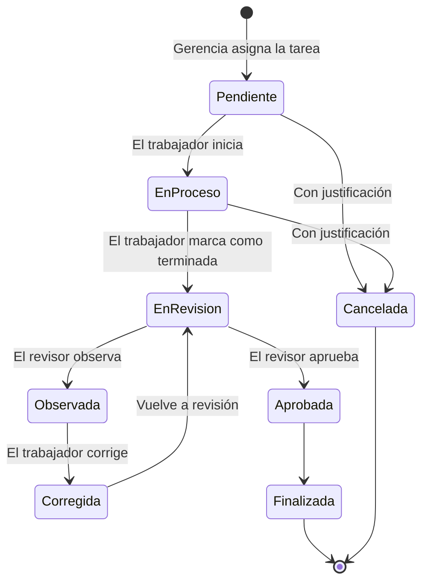

# TORRES ASOCIADOS – Sistema Integral de Gestión Empresarial

> *"Cada actividad tiene un responsable, cada avance queda registrado y cada resultado puede medirse."*

Plataforma web para administrar, controlar y supervisar las operaciones de **TORRES ASOCIADOS S.A.C.** desde un solo lugar: clientes, personal, tareas, obligaciones contables y tributarias, documentos, finanzas, proyectos y resultados.

| | |
|---|---|
| **Solicitante** | Gerencia General – TORRES ASOCIADOS S.A.C. |
| **Tipo de sistema** | Aplicación web adaptable a computadora, tablet y celular |
| **Versión del documento de requerimientos** | 1.0 (noviembre de 2026) |
| **Estado del proyecto** | 📝 Análisis y documentación de requerimientos |

---

## Tabla de contenidos

1. [Objetivo](#1-objetivo)
2. [Identidad y diseño](#2-identidad-y-diseño)
3. [Roles y permisos](#3-roles-y-permisos)
4. [Módulos del sistema](#4-módulos-del-sistema)
5. [Flujo principal: ciclo de una tarea](#5-flujo-principal-ciclo-de-una-tarea)
6. [Seguridad, respaldos y auditoría](#6-seguridad-respaldos-y-auditoría)
7. [Automatización e inteligencia del sistema](#7-automatización-e-inteligencia-del-sistema)
8. [Requerimientos técnicos](#8-requerimientos-técnicos)
9. [Hoja de ruta por fases](#9-hoja-de-ruta-por-fases)
10. [Criterios de aceptación y entrega](#10-criterios-de-aceptación-y-entrega)
11. [Entregables previos a la programación](#11-entregables-previos-a-la-programación)
12. [Puntos por definir](#12-puntos-por-definir)
13. [Estructura sugerida del repositorio](#13-estructura-sugerida-del-repositorio)

---

## 1. Objetivo

Centralizar la información de la empresa para que **toda actividad quede registrada con un responsable, una fecha, un estado y un resultado verificable**.

Gerencia debe poder conocer en tiempo real:

- Qué hace cada trabajador y qué tareas tiene asignadas.
- Qué avances registró y qué actividades están atrasadas.
- Qué obligaciones tributarias tiene cada cliente.
- Qué servicios se ejecutaron y cuánto se facturó.
- Qué proyectos presentan dificultades.

### Visión

TORRES ASOCIADOS busca dejar de ser un estudio contable tradicional y convertirse en una empresa de servicios profesionales con procesos organizados, información centralizada, control de resultados y atención eficiente:

- Cada cliente tiene un **expediente**.
- Cada servicio tiene un **proceso**.
- Cada actividad tiene un **responsable**.
- Cada avance queda **registrado**.
- Cada trabajo tiene una **revisión**.
- Cada resultado puede **medirse**.
- Cada decisión importante tiene **trazabilidad**.

---

## 2. Identidad y diseño

- Nombre: **TORRES ASOCIADOS – Sistema de Gestión Empresarial**.
- Estilo moderno, elegante, minimalista y profesional (no genérico ni anticuado).
- Colores institucionales: **azul marino, dorado y detalles verdes**.
- Incorporar el logotipo oficial.
- Interfaz sencilla e intuitiva, adaptable a computadora, tablet y celular.
- Panel principal personalizado según el perfil del usuario.
- Menú lateral por módulos y centro de notificaciones.

---

## 3. Roles y permisos

Los permisos deben ser **configurables, por rol y por cliente**. Ningún usuario debe ver información confidencial que no necesite para sus funciones.

| Perfil | Permisos principales |
|---|---|
| **Gerencia General** | Acceso integral, administración de usuarios, asignación y aprobación de actividades, reportes financieros y gerenciales, configuración general. |
| **Contabilidad** | Acceso a clientes asignados, registro de operaciones, control de obligaciones, carga documental y registro de avances. |
| **Asistente contable** | Acceso limitado a clientes y tareas asignadas, carga de evidencias e instrucciones; **sin** autorización para aprobar operaciones sensibles. |
| **Administración** | Control de pagos, ingresos, egresos, gestión documental y seguimiento administrativo. |
| **Comercial** | Registro de prospectos, seguimiento comercial, cotizaciones, reuniones y resultados. |

---

## 4. Módulos del sistema

### 4.1 Gerencia General
Tablero de control consolidado.

- **Indicadores:** clientes activos y nuevos del mes; total de trabajadores; actividades asignadas / completadas / pendientes / atrasadas; % de cumplimiento del equipo; servicios contables ejecutados; obligaciones y documentos próximos a vencer; ingresos del mes y cuentas por cobrar; proyectos activos y finalizados.
- **Funciones:** crear, asignar, modificar y supervisar tareas; definir responsables, prioridades y fechas límite; consultar historial por trabajador; revisar, aprobar u observar trabajos; ver reportes individuales y grupales; autorizar operaciones sensibles y administrar permisos; recibir alertas de incumplimiento y revisar el historial de modificaciones.

### 4.2 Personal y control de actividades ⭐ *(módulo prioritario)*
Cada trabajador tiene usuario individual y accede solo a lo autorizado.

- **Ficha del trabajador:** nombres y apellidos, DNI, cargo, área, fecha de incorporación, tipo de vínculo, horario/jornada, correo, teléfono, estado activo/inactivo, funciones y supervisor inmediato.
- **Panel individual:** mis tareas, actividades de hoy, estados (pendiente, en proceso, terminada, observada), fechas límite, proyectos, historial y notificaciones.
- **Registro de avances** (fecha y hora automáticas): cliente/proyecto/área, actividad, descripción del trabajo, % de avance, tiempo dedicado, dificultades, observaciones, próximo paso y **evidencias** (fotos, Excel, Word, PDF, comprobantes, capturas autorizadas).
- **Asignación de tareas:** nombre, descripción e instrucciones, cliente y proyecto, responsable principal y colaboradores, prioridad (baja / media / alta / urgente), fechas de inicio y límite, evidencia requerida y requisitos de aprobación. Se notifica al trabajador al asignar o modificar.
- **Seguimiento:** actividades recibidas, ejecutadas, aprobadas, observadas y atrasadas; tiempo registrado; % de cumplimiento; historial de avances y evidencias; reportes diarios, semanales y mensuales.

> **Principio de diseño:** se mide **resultado y cumplimiento**, no solo tiempo conectado. No se requiere vigilancia invasiva ni registro de pulsaciones de teclado.

### 4.3 Clientes
Base de datos centralizada con ficha y expediente digital por cliente.

- **General:** razón social o nombres, RUC/DNI, domicilio fiscal, representante legal, contactos, actividad económica, régimen tributario, fecha de incorporación, estado y responsable asignado.
- **Comercial:** servicios contratados, honorario mensual, servicios adicionales, contrato, condiciones de pago, vencimiento, historial de pagos y observaciones.
- **Operativa:** obligaciones mensuales, declaraciones, libros, planillas, conciliaciones, documentación recibida/pendiente, actividades ejecutadas e incidencias.
- La documentación de cada cliente permanece **separada y accesible solo a usuarios autorizados**.

### 4.4 Contable y tributario
Seguimiento por periodo y responsable.

- **Obligaciones mensuales:** periodo tributario, declaración mensual, PDT 621, PLAME, libros electrónicos, registro de compras y ventas, conciliación bancaria, planilla y otras según el cliente. Cada una registra vencimiento, responsable, estado, fechas de ejecución y presentación, constancia/evidencia, observaciones y aprobación.
- **Calendario tributario:** según RUC, régimen y cronograma aplicable, con alertas anticipadas. Las fechas se configuran según el **calendario oficial vigente** y sus actualizaciones; **no se asume una fecha fija para todos los clientes**.
- **Historial tributario:** periodos declarados, rectificaciones, constancias, incidencias y observaciones.

### 4.5 Proyectos y servicios especiales
Servicios fuera de la contabilidad mensual: diagnósticos tributarios, asesorías, constitución de empresas, planes de negocio, consultoría administrativa, gestión comercial, exportaciones, proyectos forestales, asistencia técnica y proyectos de inversión.

Cada proyecto registra: nombre, cliente, descripción, objetivo, responsable, equipo, presupuesto, honorarios, fechas de inicio y entrega, etapas, actividades, evidencias, entregables, estado y resultado final. Incluye **vista de cronograma** y **tablero de tareas**.

### 4.6 Documentos y expedientes digitales
Repositorio centralizado clasificable por empresa, cliente, proyecto, periodo, tipo de documento y área.

- **Tipos:** RUC, contratos, poderes, licencias, declaraciones, constancias, estados financieros, comprobantes, informes, actas, documentos laborales, administrativos y comerciales.
- **Funciones:** subir, descargar y visualizar; buscar por nombre, cliente o fecha; categorías y carpetas; **control de versiones** con registro de quién cargó o modificó; permisos y alertas de vencimiento.

### 4.7 Financiero y administrativo
- **Ingresos:** cliente, servicio, honorario, comprobante, emisión, vencimiento, monto, importe pagado, saldo pendiente y estado de cobranza.
- **Egresos:** concepto, proveedor, fecha, importe, categoría, comprobante, responsable y medio de pago.
- **Reportes:** ingresos y egresos mensuales, cuentas por cobrar y morosos, rentabilidad por servicio y por cliente, flujo de caja administrativo.

### 4.8 Accesos y seguridad de clientes
Registro de plataformas usadas por cada cliente (SUNAT, SUNARP, bancos, AFP, EsSalud, sistemas contables, correos, etc.): plataforma, URL, identificador no secreto, cliente, responsable autorizado, fecha de revisión, estado, MFA y **referencia a una bóveda segura**.

> ⚠️ **Regla crítica:** el sistema **NO** almacena contraseñas, Clave SOL, claves bancarias, PIN, CVV, tokens ni códigos de autenticación en texto plano. Se usa un gestor de contraseñas seguro con permisos individuales y trazabilidad.

### 4.9 Comunicaciones y notificaciones
Centro de notificaciones por usuario. Se notifica cuando: se asigna o modifica una tarea, se acerca una fecha límite, hay atraso, se registra un avance, se observa o aprueba un trabajo, se aproxima un vencimiento tributario, falta documentación o hay un pago vencido.

Integración futura con correo electrónico y WhatsApp Business, sujeta a viabilidad técnica, permisos y políticas de cada plataforma.

### 4.10 Reportes e indicadores
Todos los reportes deben poder **exportarse a Excel y PDF**.

- **Personal:** actividades asignadas, terminadas, aprobadas, observadas y atrasadas; cumplimiento semanal y mensual.
- **Clientes:** activos e inactivos, servicios contratados, obligaciones cumplidas y pendientes, documentación faltante, honorarios y pagos.
- **Gerencia:** estado general, productividad por área, carga de trabajo, clientes atendidos, proyectos activos, ingresos, gastos, incidencias y alertas.

### 4.11 Aliados y oportunidades comerciales
Registro de aliados estratégicos, proveedores, profesionales externos, potenciales clientes y contactos. Cada oportunidad incluye: nombre, contacto, empresa, descripción, responsable, fecha de contacto, estado de negociación, próxima actividad, resultado y valor estimado.

---

## 5. Flujo principal: ciclo de una tarea

Este es el **requerimiento prioritario**: la primera versión debe demostrar el circuito completo de asignación, avance, evidencia, revisión, observación, aprobación y consulta de historial desde el panel de Gerencia.



**Estados:** Pendiente · En proceso · En revisión · Observada · Corregida · Aprobada · Finalizada · Cancelada (con justificación).

> **Regla de negocio:** marcar una tarea como terminada **no equivale** a aprobarla. Cuando corresponda, debe pasar por revisión de un responsable autorizado.

---

## 6. Seguridad, respaldos y auditoría

- Inicio de sesión individual; contraseñas protegidas con mecanismos criptográficos seguros.
- Autenticación multifactor (MFA) para perfiles privilegiados.
- Permisos por rol y por cliente.
- Cifrado de comunicaciones y protección de archivos.
- Registro de accesos, modificaciones e historial de operaciones.
- Copias de seguridad automáticas y procedimiento de recuperación probado.
- Cierre de sesiones y revocación de usuarios que dejen de trabajar.
- Política de conservación y eliminación de información.
- Protección de datos personales conforme a la **normativa peruana aplicable**.
- **Auditoría:** se registra quién creó, modificó, aprobó o eliminó un registro y cuándo. Los registros críticos no pueden alterarse sin dejar trazabilidad.

---

## 7. Automatización e inteligencia del sistema

- Generación automática de tareas recurrentes mensuales.
- Calendario de obligaciones por cliente y alertas de vencimiento.
- Asignación de actividades según responsable y plantillas para tareas frecuentes.
- Reportes semanales automáticos e indicadores de cumplimiento.
- Recordatorios de pagos y de actividades atrasadas.
- Buscador general de clientes, documentos y actividades.
- **A futuro:** evaluar IA para clasificar documentos, extraer datos de comprobantes, preparar borradores de informes y detectar inconsistencias. **Toda decisión contable o tributaria debe ser revisada y autorizada por un profesional responsable.**

---

## 8. Requerimientos técnicos

El desarrollador debe presentar una **propuesta técnica** que cubra:

- Arquitectura, tecnología y lenguaje de programación.
- Base de datos y diseño de interfaz.
- Infraestructura de alojamiento, dominio y certificado de seguridad.
- Autenticación, gestión de permisos y almacenamiento documental.
- Sistema de respaldos y registro de auditoría.
- Documentación técnica, manual de usuario, capacitación y soporte.

El sistema debe ser **modular y escalable**. TORRES ASOCIADOS conserva el control de su información, código fuente, base de datos y documentación contractual, según lo acordado con el desarrollador.

> El stack tecnológico aún **no está definido**; ver [Puntos por definir](#12-puntos-por-definir).

---

## 9. Hoja de ruta por fases

Cada fase se prueba y aprueba antes de iniciar la siguiente.

| Fase | Nombre | Alcance |
|---|---|---|
| **1** | Sistema base y control gerencial | Usuarios, roles, clientes, personal, tareas, avances, evidencias, aprobaciones y dashboard gerencial. |
| **2** | Gestión contable y tributaria | Obligaciones, calendario tributario, control mensual por cliente, declaraciones, documentos y alertas. |
| **3** | Gestión administrativa y financiera | Honorarios, ingresos, egresos, cuentas por cobrar y reportes financieros. |
| **4** | Proyectos y gestión comercial | Proyectos, cronogramas, aliados, prospectos, cotizaciones y seguimiento comercial. |
| **5** | Automatización e integraciones | Correo, WhatsApp Business (si es viable), IA y otras integraciones autorizadas. |

---

## 10. Criterios de aceptación y entrega

### Checklist de pruebas

- [ ] Gerencia puede visualizar todas las actividades.
- [ ] Cada trabajador ingresa con su propio usuario.
- [ ] Gerencia puede asignar tareas.
- [ ] Los trabajadores pueden registrar avances y adjuntar evidencias.
- [ ] Se puede observar, devolver y aprobar un trabajo.
- [ ] Se puede consultar el historial de cada trabajador.
- [ ] Se puede consultar el expediente de cada cliente.
- [ ] Se generan alertas de fechas límite.
- [ ] Se pueden generar y exportar reportes.
- [ ] Los permisos impiden accesos no autorizados.
- [ ] Se realizan respaldos y se puede recuperar información.
- [ ] El sistema funciona desde computadoras y celulares.
- [ ] Los registros críticos quedan auditados.

### Contenido de la entrega

Código fuente · base de datos documentada · manual técnico · manual de usuario · credenciales administrativas iniciales · capacitación · procedimiento de respaldo.

---

## 11. Entregables previos a la programación

Antes de programar, se presentan a Gerencia:

1. Diseño de pantallas principales y prototipo navegable.
2. Mapa de navegación y flujo de procesos.
3. Estructura de la base de datos.
4. Cronograma por fases y entregables.
5. Presupuesto detallado y costos recurrentes.
6. Alcance, exclusiones y supuestos de cada fase.
7. Plan de pruebas, capacitación, soporte y mantenimiento.
8. Propuesta de titularidad y entrega del código fuente.

**Gerencia debe aprobar el diseño funcional y el alcance de la Fase 1 antes de iniciar la programación.**

---

## 12. Puntos por definir

Aspectos que el documento de requerimientos deja abiertos y conviene decidir antes de diseñar:

| # | Tema | Pregunta pendiente |
|---|---|---|
| 1 | **Stack tecnológico** | Lenguaje, framework, base de datos y hosting. |
| 2 | **Bóveda de contraseñas** | ¿Qué gestor se usará y cómo se referencia desde el sistema? |
| 3 | **Revisión de tareas** | ¿Quién aprueba según el tipo de tarea? ¿Hay doble aprobación en operaciones sensibles? |
| 4 | **Calendario tributario** | ¿Se carga manualmente cada año o se integra una fuente oficial? ¿Quién lo mantiene? |
| 5 | **Almacenamiento de archivos** | Servicio, tamaño máximo por archivo, cuotas y política de retención. |
| 6 | **Registro de tiempo** | ¿Obligatorio o solo "cuando corresponda"? ¿Por tarea o por jornada? |
| 7 | **Facturación** | ¿Se integra con facturación electrónica o solo se registra el comprobante? |
| 8 | **Respaldos** | Frecuencia, ubicación, retención y objetivos de recuperación (RPO/RTO). |
| 9 | **Datos personales** | Base legal, consentimiento y plazos de conservación (Ley N.° 29733 y su reglamento). |
| 10 | **Titularidad** | Cesión de código fuente, licencias de terceros y condiciones de mantenimiento. |
| 11 | **Migración** | ¿Existen datos actuales (Excel, carpetas) que haya que importar? |
| 12 | **Logotipo y guía visual** | Archivos oficiales y códigos exactos de color. |

---

## 13. Estructura sugerida del repositorio

```text
torres-asociados-sistema/
├── README.md
├── docs/
│   ├── requerimientos/      # Documento original (.docx) y versiones
│   ├── diseno/              # Prototipos, mapa de navegación, flujos
│   ├── base-de-datos/       # Modelo entidad-relación y diccionario de datos
│   ├── manual-tecnico/
│   └── manual-usuario/
├── src/                     # Código fuente (según stack definido)
├── tests/
└── .github/                 # Plantillas de issues y pull requests
```

---

## Licencia y titularidad

*Por definir con el desarrollador, conforme a lo acordado contractualmente (ver punto 10 de [Puntos por definir](#12-puntos-por-definir)).*

---

<sub>Documento de trabajo derivado de *Requerimientos Funcionales y Técnicos – Sistema Integral de Gestión Empresarial, v1.0 (noviembre de 2026)*.</sub>
