# TORRES ASOCIADOS – Sistema Integral de Gestión Empresarial

> *"Cada actividad tiene un responsable, cada avance queda registrado y cada resultado puede medirse."*

Plataforma web para administrar, controlar y supervisar las operaciones de **TORRES ASOCIADOS S.A.C.** desde un solo lugar: clientes, personal, tareas, obligaciones contables y tributarias, documentos, finanzas, proyectos y resultados.

| | |
|---|---|
| **Solicitante** | Gerencia General – TORRES ASOCIADOS S.A.C. |
| **Tipo de sistema** | Aplicación web adaptable a computadora, tablet y celular |
| **Versión del documento de requerimientos** | 1.0 (noviembre de 2026) |
| **Stack** | Next.js 16 + NestJS 12 + Prisma 7 + PostgreSQL 16, monorepo pnpm + Turborepo, Docker Compose |
| **Estado del proyecto** | 🛠️ Fase 1: Sprint 1 (acceso, roles y auditoría, [12.8](#128-sprint-1-autenticación-roles-y-auditoría)) y Sprint 2 (personal, clientes y asignaciones, [12.9](#129-sprint-2-personal-clientes-y-asignaciones)) terminados. Fase 0 con entregables de Gerencia pendientes ([avance](#103-fase-0-análisis-diseño-y-base-técnica)) |

### Convenciones de este documento

- Todos los diagramas están en Mermaid y se visualizan directamente en GitHub.
- Los requerimientos usan el código `RF-<MÓDULO>-<NN>` (funcionales) y `RNF-<CATEGORÍA>-<NN>` (no funcionales). Los códigos son estables: si un requerimiento se descarta se marca como **Retirado**, no se renumera.
- Prioridad MoSCoW: **M** (obligatorio), **S** (debería), **C** (podría), **W** (no en esta versión).
- Toda cifra de cronograma o métrica marcada como *estimación* o *propuesta* debe validarse con Gerencia antes de comprometerse.

---

## Tabla de contenidos

1. [Objetivo](#1-objetivo)
2. [Identidad y diseño](#2-identidad-y-diseño)
3. [Roles y permisos](#3-roles-y-permisos)
4. [Módulos del sistema](#4-módulos-del-sistema)
5. [Requerimientos funcionales](#5-requerimientos-funcionales)
6. [Requerimientos no funcionales](#6-requerimientos-no-funcionales)
7. [Arquitectura](#7-arquitectura)
8. [Modelo de datos](#8-modelo-de-datos)
9. [Procesos y flujos](#9-procesos-y-flujos)
10. [Plan de trabajo](#10-plan-de-trabajo)
11. [Criterios de aceptación y entrega](#11-criterios-de-aceptación-y-entrega)
12. [Configuración del repositorio](#12-configuración-del-repositorio)

---

## 1. Objetivo

Centralizar la información de la empresa para que **toda actividad quede registrada con un responsable, una fecha, un estado y un resultado verificable**.

Gerencia debe poder conocer en tiempo real:

- Qué hace cada trabajador y qué tareas tiene asignadas.
- Qué avances registró y qué actividades están atrasadas.
- Qué obligaciones tributarias tiene cada cliente.
- Qué servicios se ejecutaron y cuánto se facturó.
- Qué proyectos presentan dificultades.

### Visión

TORRES ASOCIADOS busca dejar de ser un estudio contable tradicional y convertirse en una empresa de servicios profesionales con procesos organizados, información centralizada, control de resultados y atención eficiente:

- Cada cliente tiene un **expediente**.
- Cada servicio tiene un **proceso**.
- Cada actividad tiene un **responsable**.
- Cada avance queda **registrado**.
- Cada trabajo tiene una **revisión**.
- Cada resultado puede **medirse**.
- Cada decisión importante tiene **trazabilidad**.

---

## 2. Identidad y diseño

- Nombre: **TORRES ASOCIADOS – Sistema de Gestión Empresarial**.
- Estilo moderno, elegante, minimalista y profesional (no genérico ni anticuado).
- Colores institucionales: **azul marino, dorado y detalles verdes**.
- Incorporar el logotipo oficial.
- Interfaz sencilla e intuitiva, adaptable a computadora, tablet y celular.
- Panel principal personalizado según el perfil del usuario.
- Menú lateral por módulos y centro de notificaciones.

---

## 3. Roles y permisos

Los permisos deben ser **configurables, por rol y por cliente**. Ningún usuario debe ver información confidencial que no necesite para sus funciones.

| Perfil | Permisos principales |
|---|---|
| **Gerencia General** | Acceso integral, administración de usuarios, asignación y aprobación de actividades, reportes financieros y gerenciales, configuración general. |
| **Contabilidad** | Acceso a clientes asignados, registro de operaciones, control de obligaciones, carga documental y registro de avances. |
| **Asistente contable** | Acceso limitado a clientes y tareas asignadas, carga de evidencias e instrucciones; **sin** autorización para aprobar operaciones sensibles. |
| **Administración** | Control de pagos, ingresos, egresos, gestión documental y seguimiento administrativo. |
| **Comercial** | Registro de prospectos, seguimiento comercial, cotizaciones, reuniones y resultados. |

### Matriz de permisos inicial

Leyenda: **T** total · **A** solo clientes o registros asignados · **P** propios · **L** lectura · **—** sin acceso.

| Recurso / acción | Gerencia | Contabilidad | Asistente | Administración | Comercial |
|---|:-:|:-:|:-:|:-:|:-:|
| Usuarios y roles | T | — | — | — | — |
| Fichas de personal | T | L | — | L | — |
| Crear y asignar tareas | T | A | — | A | P |
| Ver tareas | T | A | P | A | P |
| Registrar avances | T | A | P | A | P |
| Aprobar u observar tareas | T | A | — | A | — |
| Clientes: ficha general | T | A | A (L) | T (L) | L |
| Clientes: ficha comercial | T | — | — | T | L |
| Clientes: ficha operativa | T | A | A | L | — |
| Obligaciones tributarias | T | A | A | L | — |
| Aprobar obligaciones | T | A | — | — | — |
| Cronograma tributario | T | L | L | — | — |
| Documentos del cliente | T | A | A | A | — |
| Accesos de plataformas | T | A | — | — | — |
| Ingresos y cobranza | T | — | — | T | L |
| Egresos | T | — | — | T | — |
| Anular ingresos o egresos | T | — | — | — | — |
| Proyectos | T | A | A | A | A |
| Oportunidades y aliados | T | — | — | L | T |
| Reportes gerenciales | T | — | — | Financieros | Comerciales |
| Auditoría | T | — | — | — | — |
| Configuración | T | — | — | — | — |

La matriz es la configuración inicial; Gerencia puede ajustarla (RF-ROL-02).

**Visibilidad de clientes implementada (Sprint 2):** los roles con alcance global (Gerencia) ven todos los clientes; los demás solo ven los clientes a los que están asignados en el equipo del cliente. Por eso, en la configuración inicial, Administración y Comercial ven únicamente sus clientes asignados (no la lectura total que indica la tabla); para darles vista total basta con asignarlos al equipo o cambiar el alcance de su rol.

---

## 4. Módulos del sistema

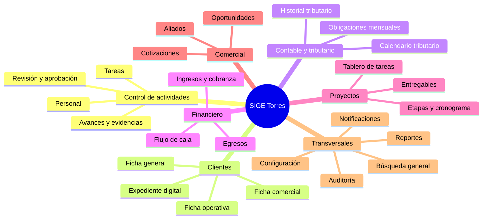

### 4.1 Gerencia General
Tablero de control consolidado.

- **Indicadores:** clientes activos y nuevos del mes; total de trabajadores; actividades asignadas / completadas / pendientes / atrasadas; % de cumplimiento del equipo; servicios contables ejecutados; obligaciones y documentos próximos a vencer; ingresos del mes y cuentas por cobrar; proyectos activos y finalizados.
- **Funciones:** crear, asignar, modificar y supervisar tareas; definir responsables, prioridades y fechas límite; consultar historial por trabajador; revisar, aprobar u observar trabajos; ver reportes individuales y grupales; autorizar operaciones sensibles y administrar permisos; recibir alertas de incumplimiento y revisar el historial de modificaciones.

### 4.2 Personal y control de actividades ⭐ *(módulo prioritario)*
Cada trabajador tiene usuario individual y accede solo a lo autorizado.

- **Ficha del trabajador:** nombres y apellidos, DNI, cargo, área, fecha de incorporación, tipo de vínculo, horario/jornada, correo, teléfono, estado activo/inactivo, funciones y supervisor inmediato.
- **Panel individual:** mis tareas, actividades de hoy, estados (pendiente, en proceso, terminada, observada), fechas límite, proyectos, historial y notificaciones.
- **Registro de avances** (fecha y hora automáticas): cliente/proyecto/área, actividad, descripción del trabajo, % de avance, tiempo dedicado, dificultades, observaciones, próximo paso y **evidencias** (fotos, Excel, Word, PDF, comprobantes, capturas autorizadas).
- **Asignación de tareas:** nombre, descripción e instrucciones, cliente y proyecto, responsable principal y colaboradores, prioridad (baja / media / alta / urgente), fechas de inicio y límite, evidencia requerida y requisitos de aprobación. Se notifica al trabajador al asignar o modificar.
- **Seguimiento:** actividades recibidas, ejecutadas, aprobadas, observadas y atrasadas; tiempo registrado; % de cumplimiento; historial de avances y evidencias; reportes diarios, semanales y mensuales.

> **Principio de diseño:** se mide **resultado y cumplimiento**, no solo tiempo conectado. No se requiere vigilancia invasiva ni registro de pulsaciones de teclado.

### 4.3 Clientes
Base de datos centralizada con ficha y expediente digital por cliente.

- **General:** razón social o nombres, RUC/DNI, domicilio fiscal, representante legal, contactos, actividad económica, régimen tributario, fecha de incorporación, estado y responsable asignado.
- **Comercial:** servicios contratados, honorario mensual, servicios adicionales, contrato, condiciones de pago, vencimiento, historial de pagos y observaciones.
- **Operativa:** obligaciones mensuales, declaraciones, libros, planillas, conciliaciones, documentación recibida/pendiente, actividades ejecutadas e incidencias.
- La documentación de cada cliente permanece **separada y accesible solo a usuarios autorizados**.

### 4.4 Contable y tributario
Seguimiento por periodo y responsable.

- **Obligaciones mensuales:** periodo tributario, declaración mensual, PDT 621, PLAME, libros electrónicos, registro de compras y ventas, conciliación bancaria, planilla y otras según el cliente. Cada una registra vencimiento, responsable, estado, fechas de ejecución y presentación, constancia/evidencia, observaciones y aprobación.
- **Calendario tributario:** según RUC, régimen y cronograma aplicable, con alertas anticipadas. Las fechas se configuran según el **calendario oficial vigente** y sus actualizaciones; **no se asume una fecha fija para todos los clientes**.
- **Historial tributario:** periodos declarados, rectificaciones, constancias, incidencias y observaciones.

### 4.5 Proyectos y servicios especiales
Servicios fuera de la contabilidad mensual: diagnósticos tributarios, asesorías, constitución de empresas, planes de negocio, consultoría administrativa, gestión comercial, exportaciones, proyectos forestales, asistencia técnica y proyectos de inversión.

Cada proyecto registra: nombre, cliente, descripción, objetivo, responsable, equipo, presupuesto, honorarios, fechas de inicio y entrega, etapas, actividades, evidencias, entregables, estado y resultado final. Incluye **vista de cronograma** y **tablero de tareas**.

### 4.6 Documentos y expedientes digitales
Repositorio centralizado clasificable por empresa, cliente, proyecto, periodo, tipo de documento y área.

- **Tipos:** RUC, contratos, poderes, licencias, declaraciones, constancias, estados financieros, comprobantes, informes, actas, documentos laborales, administrativos y comerciales.
- **Funciones:** subir, descargar y visualizar; buscar por nombre, cliente o fecha; categorías y carpetas; **control de versiones** con registro de quién cargó o modificó; permisos y alertas de vencimiento.

### 4.7 Financiero y administrativo
- **Ingresos:** cliente, servicio, honorario, comprobante, emisión, vencimiento, monto, importe pagado, saldo pendiente y estado de cobranza.
- **Egresos:** concepto, proveedor, fecha, importe, categoría, comprobante, responsable y medio de pago.
- **Reportes:** ingresos y egresos mensuales, cuentas por cobrar y morosos, rentabilidad por servicio y por cliente, flujo de caja administrativo.

### 4.8 Accesos y seguridad de clientes
Registro de plataformas usadas por cada cliente (SUNAT, SUNARP, bancos, AFP, EsSalud, sistemas contables, correos, etc.): plataforma, URL, identificador no secreto, cliente, responsable autorizado, fecha de revisión, estado, MFA y **referencia a una bóveda segura**.

> ⚠️ **Regla crítica:** el sistema **NO** almacena contraseñas, Clave SOL, claves bancarias, PIN, CVV, tokens ni códigos de autenticación en texto plano. Se usa un gestor de contraseñas seguro con permisos individuales y trazabilidad.

### 4.9 Comunicaciones y notificaciones
Centro de notificaciones por usuario. Se notifica cuando: se asigna o modifica una tarea, se acerca una fecha límite, hay atraso, se registra un avance, se observa o aprueba un trabajo, se aproxima un vencimiento tributario, falta documentación o hay un pago vencido.

Integración futura con correo electrónico y WhatsApp Business, sujeta a viabilidad técnica, permisos y políticas de cada plataforma.

### 4.10 Reportes e indicadores
Todos los reportes deben poder **exportarse a Excel y PDF**.

- **Personal:** actividades asignadas, terminadas, aprobadas, observadas y atrasadas; cumplimiento semanal y mensual.
- **Clientes:** activos e inactivos, servicios contratados, obligaciones cumplidas y pendientes, documentación faltante, honorarios y pagos.
- **Gerencia:** estado general, productividad por área, carga de trabajo, clientes atendidos, proyectos activos, ingresos, gastos, incidencias y alertas.

### 4.11 Aliados y oportunidades comerciales
Registro de aliados estratégicos, proveedores, profesionales externos, potenciales clientes y contactos. Cada oportunidad incluye: nombre, contacto, empresa, descripción, responsable, fecha de contacto, estado de negociación, próxima actividad, resultado y valor estimado.

### 4.12 Seguridad, respaldos y auditoría
- Inicio de sesión individual; contraseñas protegidas con mecanismos criptográficos seguros.
- Autenticación multifactor (MFA) para perfiles privilegiados.
- Permisos por rol y por cliente.
- Cifrado de comunicaciones y protección de archivos.
- Registro de accesos, modificaciones e historial de operaciones.
- Copias de seguridad automáticas y procedimiento de recuperación probado.
- Cierre de sesiones y revocación de usuarios que dejen de trabajar.
- Política de conservación y eliminación de información.
- Protección de datos personales conforme a la **normativa peruana aplicable**.
- **Auditoría:** se registra quién creó, modificó, aprobó o eliminó un registro y cuándo. Los registros críticos no pueden alterarse sin dejar trazabilidad.

### 4.13 Automatización e inteligencia del sistema
- Generación automática de tareas recurrentes mensuales.
- Calendario de obligaciones por cliente y alertas de vencimiento.
- Asignación de actividades según responsable y plantillas para tareas frecuentes.
- Reportes semanales automáticos e indicadores de cumplimiento.
- Recordatorios de pagos y de actividades atrasadas.
- Buscador general de clientes, documentos y actividades.
- **A futuro:** evaluar IA para clasificar documentos, extraer datos de comprobantes, preparar borradores de informes y detectar inconsistencias. **Toda decisión contable o tributaria debe ser revisada y autorizada por un profesional responsable.**

---

## 5. Requerimientos funcionales

Catálogo derivado del documento *Requerimientos Funcionales y Técnicos v1.0 (noviembre de 2026)*. Cada requerimiento tiene un código estable, prioridad MoSCoW y la fase del [plan de trabajo](#10-plan-de-trabajo) en que se entrega.

### 5.1 Actores

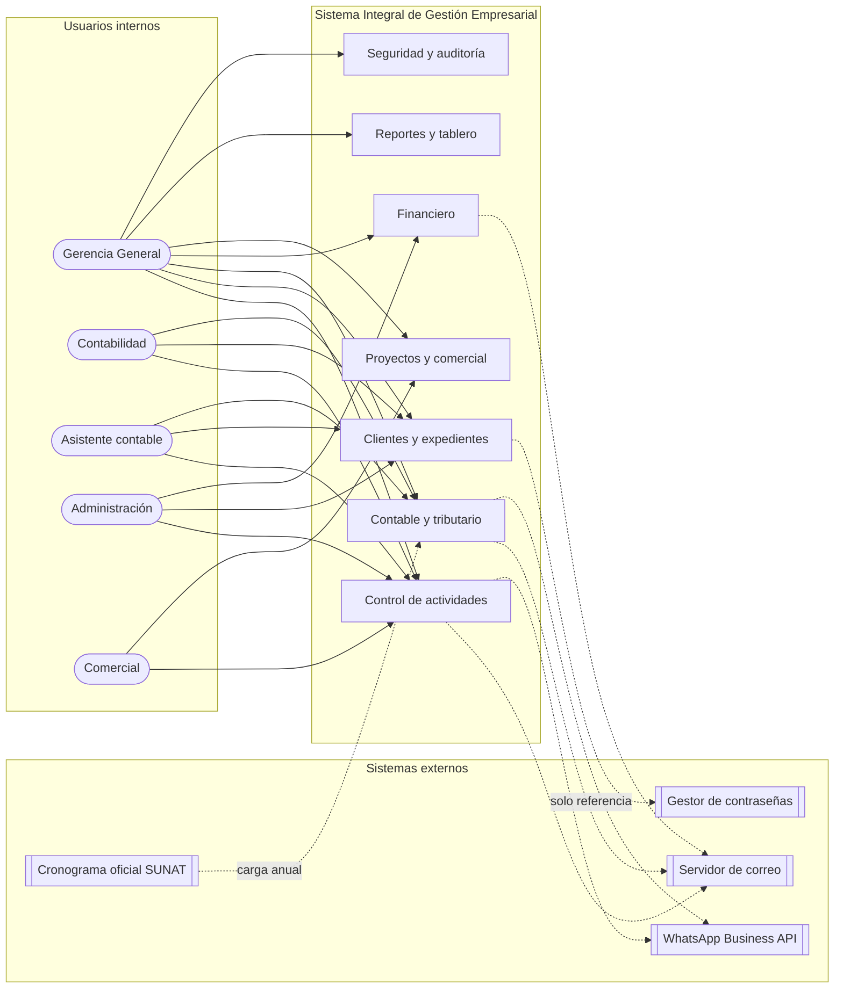

| Actor | Descripción |
|---|---|
| Gerencia General | Supervisa toda la operación, asigna y aprueba trabajo, administra usuarios y configuración. |
| Contabilidad | Ejecuta y revisa el trabajo contable de los clientes que tiene asignados. |
| Asistente contable | Ejecuta tareas asignadas sobre clientes asignados; no aprueba operaciones sensibles. |
| Administración | Gestiona ingresos, egresos, cobranzas y documentación administrativa. |
| Comercial | Gestiona prospectos, aliados, cotizaciones y oportunidades. |
| Sistema (procesos programados) | Genera tareas recurrentes, calcula vencimientos y emite alertas. |

### 5.2 Autenticación y sesiones (AUT)

| Código | Requerimiento | Prioridad | Fase |
|---|---|---|---|
| RF-AUT-01 | El usuario inicia sesión con correo y contraseña propios. No existen cuentas compartidas. | M | 1 |
| RF-AUT-02 | MFA por TOTP (aplicación autenticadora) opcional para cada usuario desde Mi cuenta; cada rol puede configurarse para exigirlo. Por decisión de Gerencia (23/11/2026) ningún rol lo exige por defecto. | M | 1 |
| RF-AUT-03 | El sistema bloquea temporalmente la cuenta tras 5 intentos fallidos consecutivos durante 15 minutos y registra cada intento en auditoría. | M | 1 |
| RF-AUT-04 | El usuario puede cerrar su sesión y ver sus sesiones activas (dispositivo, IP, último uso) y cerrarlas de forma remota. | M | 1 |
| RF-AUT-05 | Gerencia puede revocar todas las sesiones de un usuario y desactivarlo; el acceso se corta en la siguiente petición. | M | 1 |
| RF-AUT-06 | La sesión expira tras un periodo de inactividad configurable (por defecto 30 minutos) y por duración máxima (por defecto 8 horas). | M | 1 |
| RF-AUT-07 | Recuperación de contraseña mediante enlace de un solo uso enviado al correo registrado, con vigencia de 30 minutos. | S | 1 |
| RF-AUT-08 | **Retirado** (23/11/2026, decisión de Gerencia): Gerencia define la contraseña de cada usuario y no se obliga a cambiarla en el primer ingreso. | — | — |
| RF-AUT-09 | Códigos de recuperación de MFA de un solo uso, generados al activarlo. | S | 1 |

### 5.3 Roles y permisos (ROL)

| Código | Requerimiento | Prioridad | Fase |
|---|---|---|---|
| RF-ROL-01 | El sistema incluye los roles base Gerencia General, Contabilidad, Asistente contable, Administración y Comercial, con la [matriz de permisos inicial](#matriz-de-permisos-inicial). | M | 1 |
| RF-ROL-02 | Los permisos son granulares por acción y recurso (por ejemplo `tarea:aprobar`, `cliente:ver_comercial`) y Gerencia puede crear roles adicionales combinándolos. | M | 1 |
| RF-ROL-03 | Además del rol, el acceso a datos de un cliente requiere que el usuario esté **asignado** a ese cliente. Gerencia General accede a todos. | M | 1 |
| RF-ROL-04 | Las secciones de un cliente (general, comercial, operativa, documentos, accesos) tienen permisos independientes. | M | 1 |
| RF-ROL-05 | Toda acción denegada se registra en auditoría con usuario, recurso y motivo. | M | 1 |
| RF-ROL-06 | Las operaciones marcadas como sensibles (aprobar trabajos, anular ingresos, cambiar permisos, desactivar usuarios) solo las ejecutan roles con el permiso explícito. | M | 1 |
| RF-ROL-07 | Gerencia puede configurar doble aprobación para tipos de operación sensibles. | C | 3 |

### 5.4 Personal (PER)

| Código | Requerimiento | Prioridad | Fase |
|---|---|---|---|
| RF-PER-01 | Registrar la ficha del trabajador: nombres, apellidos, DNI, cargo, área, fecha de incorporación, tipo de vínculo, horario o jornada, correo, teléfono, estado, funciones y supervisor inmediato. | M | 1 |
| RF-PER-02 | Cada ficha se vincula a un único usuario del sistema y todo usuario con acceso tiene ficha de trabajador; no existen cuentas técnicas ni genéricas. | M | 1 |
| RF-PER-03 | Desactivar un trabajador revoca su usuario y sus sesiones, conserva todo su historial y obliga a reasignar sus tareas abiertas. | M | 1 |
| RF-PER-04 | Gestionar el catálogo de áreas y cargos. | M | 1 |
| RF-PER-05 | Panel individual "Mi trabajo": tareas de hoy, tareas por estado, fechas límite próximas, proyectos en los que participa y notificaciones. | M | 1 |
| RF-PER-06 | Historial del trabajador: tareas recibidas, ejecutadas, aprobadas, observadas y atrasadas; tiempo registrado; porcentaje de cumplimiento; avances y evidencias. Visible para el propio trabajador, su supervisor y Gerencia. | M | 1 |
| RF-PER-07 | El sistema no registra pulsaciones de teclado, capturas automáticas de pantalla ni tiempo de conexión como medida de desempeño. | M | 1 |

### 5.5 Tareas (TAR)

| Código | Requerimiento | Prioridad | Fase |
|---|---|---|---|
| RF-TAR-01 | Crear una tarea con: nombre, descripción e instrucciones, cliente (opcional), proyecto (opcional), responsable principal, colaboradores, prioridad (baja, media, alta, urgente), fecha de inicio, fecha límite, evidencia requerida, si requiere aprobación y revisor. | M | 1 |
| RF-TAR-02 | Solo puede asignarse como responsable a un usuario asignado al cliente de la tarea. | M | 1 |
| RF-TAR-03 | La tarea sigue la [máquina de estados de la tarea](#91-ciclo-de-vida-de-una-tarea): Pendiente, En proceso, En revisión, Observada, Corregida, Aprobada, Finalizada, Cancelada. Cualquier otra transición es rechazada por el servidor. | M | 1 |
| RF-TAR-04 | Marcar una tarea como terminada la pasa a **En revisión** si requiere aprobación, o directamente a **Finalizada** si no la requiere. Terminar no equivale a aprobar. | M | 1 |
| RF-TAR-05 | No se puede enviar a revisión una tarea cuya evidencia requerida no ha sido adjuntada. | M | 1 |
| RF-TAR-06 | Cancelar exige una justificación escrita y solo puede hacerlo quien asignó la tarea o Gerencia. | M | 1 |
| RF-TAR-07 | Cada cambio de estado guarda quién, cuándo, estado anterior, estado nuevo y comentario. | M | 1 |
| RF-TAR-08 | Modificar responsable, fechas, prioridad o instrucciones notifica al responsable y a los colaboradores, y queda en el historial de la tarea. | M | 1 |
| RF-TAR-09 | Una tarea se considera **atrasada** cuando la fecha límite pasó y no está Aprobada, Finalizada ni Cancelada. El atraso es un indicador calculado, no un estado. | M | 1 |
| RF-TAR-10 | Vistas de tareas: lista con filtros (estado, responsable, cliente, proyecto, prioridad, rango de fechas, atrasadas), tablero kanban por estado y calendario por fecha límite. | M | 1 |
| RF-TAR-11 | Comentarios en la tarea con mención a usuarios, que generan notificación al mencionado. | S | 1 |
| RF-TAR-12 | Plantillas de tareas frecuentes con instrucciones, evidencia requerida y lista de verificación predefinidas. | S | 2 |
| RF-TAR-13 | Subtareas o lista de verificación dentro de una tarea. | C | 2 |

### 5.6 Avances y evidencias (AVA)

| Código | Requerimiento | Prioridad | Fase |
|---|---|---|---|
| RF-AVA-01 | Registrar un avance con fecha y hora automáticas del servidor, actividad, descripción del trabajo, porcentaje de avance, tiempo dedicado, dificultades, observaciones y próximo paso. | M | 1 |
| RF-AVA-02 | El cliente, proyecto y área del avance se heredan de la tarea y no se escriben a mano. | M | 1 |
| RF-AVA-03 | Adjuntar evidencias a un avance: imágenes, PDF, Word, Excel y capturas autorizadas, con límite de tamaño configurable. | M | 1 |
| RF-AVA-04 | Registrar un avance sobre una tarea Pendiente la pasa automáticamente a En proceso. | M | 1 |
| RF-AVA-05 | Un avance registrado no se edita ni se elimina; las correcciones se hacen con un nuevo avance que referencia al anterior. | M | 1 |
| RF-AVA-06 | El porcentaje de avance de la tarea es el del último avance registrado. | M | 1 |
| RF-AVA-07 | El registro de tiempo dedicado es obligatorio u opcional según configuración (ver la decisión D-06 en [Decisiones pendientes](#109-decisiones-pendientes)). | M | 1 |
| RF-AVA-08 | Las evidencias se previsualizan en el navegador (imágenes y PDF) y se descargan con control de permisos. | M | 1 |

### 5.7 Revisión y aprobación (REV)

| Código | Requerimiento | Prioridad | Fase |
|---|---|---|---|
| RF-REV-01 | El revisor ve una bandeja "Por revisar" con las tareas En revisión que le corresponden. | M | 1 |
| RF-REV-02 | El revisor puede **aprobar** (con comentario opcional) u **observar** (con comentario obligatorio que indica qué corregir). | M | 1 |
| RF-REV-03 | Observar devuelve la tarea al responsable en estado Observada; al registrar la corrección pasa a Corregida y luego vuelve a revisión. | M | 1 |
| RF-REV-04 | El responsable de una tarea no puede aprobar su propia tarea. | M | 1 |
| RF-REV-05 | Cada ronda de revisión queda registrada con número de ronda, revisor, decisión, comentario y fecha. | M | 1 |
| RF-REV-06 | Aprobada pasa a Finalizada automáticamente al cerrar el periodo o manualmente por Gerencia, según configuración. | S | 1 |

### 5.8 Tablero gerencial (GER)

| Código | Requerimiento | Prioridad | Fase |
|---|---|---|---|
| RF-GER-01 | Indicadores de actividades: asignadas, completadas, pendientes, atrasadas y porcentaje de cumplimiento del equipo, filtrables por periodo, área y trabajador. | M | 1 |
| RF-GER-02 | Indicadores de clientes: activos y nuevos del mes. | M | 1 |
| RF-GER-03 | Indicador de total de trabajadores activos y carga de trabajo por trabajador. | M | 1 |
| RF-GER-04 | Lista de alertas: tareas atrasadas, tareas urgentes sin iniciar, trabajos por revisar. | M | 1 |
| RF-GER-05 | Indicadores tributarios: obligaciones y documentos próximos a vencer, servicios contables ejecutados. | M | 2 |
| RF-GER-06 | Indicadores financieros: ingresos del mes y cuentas por cobrar. | M | 3 |
| RF-GER-07 | Indicadores de proyectos: activos y finalizados. | M | 4 |
| RF-GER-08 | Cada indicador permite navegar al detalle que lo compone. | S | 1 |
| RF-GER-09 | El panel principal se adapta al perfil: cada rol ve sus propios indicadores al ingresar. | M | 1 |

### 5.9 Clientes (CLI)

| Código | Requerimiento | Prioridad | Fase |
|---|---|---|---|
| RF-CLI-01 | Registrar la ficha general: tipo de persona, razón social o nombres, RUC o DNI, domicilio fiscal, representante legal, actividad económica, régimen tributario, fecha de incorporación, estado y responsable asignado. | M | 1 |
| RF-CLI-02 | Validar el formato del RUC (11 dígitos con dígito verificador) y del DNI (8 dígitos), y que el RUC no se repita. | M | 1 |
| RF-CLI-03 | Registrar múltiples contactos por cliente con nombre, cargo, correo, teléfono y si es contacto principal. | M | 1 |
| RF-CLI-04 | Asignar usuarios al cliente (equipo del cliente), que determina quién puede verlo. | M | 1 |
| RF-CLI-05 | Ficha comercial: servicios contratados, honorario mensual, servicios adicionales, contrato, condiciones de pago, vencimiento del contrato, historial de pagos y observaciones. | M | 3 |
| RF-CLI-06 | Ficha operativa: obligaciones mensuales configuradas, documentación recibida y pendiente, actividades ejecutadas e incidencias. | M | 2 |
| RF-CLI-07 | Expediente digital: vista única del cliente con pestañas General, Comercial, Operativa, Tareas, Documentos, Accesos e Historial, cada una sujeta a su permiso. | M | 1 |
| RF-CLI-08 | Un cliente no se elimina: pasa a estado Inactivo y conserva su historial. | M | 1 |
| RF-CLI-09 | Registrar incidencias del cliente con fecha, descripción, responsable y estado. | S | 2 |
| RF-CLI-10 | Importar clientes desde una plantilla Excel validada, con reporte de filas rechazadas. | S | 1 |

### 5.10 Contable y tributario (TRI)

| Código | Requerimiento | Prioridad | Fase |
|---|---|---|---|
| RF-TRI-01 | Catálogo de tipos de obligación: declaración mensual (PDT 621), PLAME, libros electrónicos, registro de compras, registro de ventas, conciliación bancaria, planilla y otros configurables. | M | 2 |
| RF-TRI-02 | Configurar por cliente qué obligaciones le aplican, con su responsable y revisor. | M | 2 |
| RF-TRI-03 | Cargar el cronograma oficial de vencimientos por periodo y por último dígito del RUC, diferenciando grupos de contribuyentes cuando el cronograma oficial lo haga. Las fechas no se calculan con una regla fija. | M | 2 |
| RF-TRI-04 | Generar cada periodo las obligaciones de cada cliente con su fecha de vencimiento según su RUC y el cronograma cargado, y una tarea asociada para el responsable. | M | 2 |
| RF-TRI-05 | Cada obligación registra: periodo, vencimiento, responsable, estado, fecha de ejecución, fecha de presentación, constancia o evidencia, observaciones y aprobación. | M | 2 |
| RF-TRI-06 | No se puede marcar una obligación como presentada sin adjuntar la constancia. | M | 2 |
| RF-TRI-07 | Calendario tributario visual (mes y lista) filtrable por cliente, responsable y tipo de obligación. | M | 2 |
| RF-TRI-08 | Alertas anticipadas de vencimiento configurables (por defecto 5, 3 y 1 día antes) al responsable y al revisor. | M | 2 |
| RF-TRI-09 | Registrar rectificaciones vinculadas a la obligación original, con motivo y constancia. | M | 2 |
| RF-TRI-10 | Historial tributario por cliente: periodos declarados, rectificaciones, constancias, incidencias y observaciones. | M | 2 |
| RF-TRI-11 | Control mensual: matriz cliente × obligación del periodo con el estado de cada celda. | M | 2 |
| RF-TRI-12 | Si el cronograma de un periodo no está cargado, el sistema alerta a Gerencia y no genera obligaciones con fechas supuestas. | M | 2 |

### 5.11 Documentos y expedientes (DOC)

| Código | Requerimiento | Prioridad | Fase |
|---|---|---|---|
| RF-DOC-01 | Subir, visualizar y descargar documentos clasificados por cliente, proyecto, periodo, tipo de documento y área. | M | 2 |
| RF-DOC-02 | Catálogo de tipos: RUC, contrato, poder, licencia, declaración, constancia, estado financiero, comprobante, informe, acta, documento laboral, administrativo y comercial. | M | 2 |
| RF-DOC-03 | Carpetas y categorías por cliente. | S | 2 |
| RF-DOC-04 | Control de versiones: subir una nueva versión conserva las anteriores con quién y cuándo la cargó. | M | 2 |
| RF-DOC-05 | Fecha de vencimiento opcional por documento (licencias, poderes, contratos) con alerta anticipada. | M | 2 |
| RF-DOC-06 | Búsqueda por nombre, cliente, tipo y rango de fechas. | M | 2 |
| RF-DOC-07 | Cada descarga y visualización de un documento queda registrada en auditoría. | M | 2 |
| RF-DOC-08 | Documentación pendiente: lista por cliente de documentos esperados en el periodo y no recibidos, con alerta. | S | 2 |
| RF-DOC-09 | Un documento no se elimina: se archiva y deja de mostrarse en las vistas normales. | M | 2 |
| RF-DOC-10 | Las evidencias de avances y las constancias de obligaciones se integran al expediente del cliente. | M | 2 |

### 5.12 Financiero y administrativo (FIN)

| Código | Requerimiento | Prioridad | Fase |
|---|---|---|---|
| RF-FIN-01 | Registrar ingresos: cliente, servicio, honorario, tipo y número de comprobante, fecha de emisión, vencimiento, monto, importe pagado, saldo pendiente y estado de cobranza. | M | 3 |
| RF-FIN-02 | Registrar cobros parciales o totales contra un ingreso, con fecha, medio de pago y voucher; el saldo y el estado se recalculan. | M | 3 |
| RF-FIN-03 | Generar cada mes los ingresos esperados por honorario mensual de cada cliente activo. | S | 3 |
| RF-FIN-04 | Registrar egresos: concepto, proveedor, fecha, importe, categoría, comprobante, responsable y medio de pago. | M | 3 |
| RF-FIN-05 | Un ingreso o egreso no se elimina: se anula con motivo, por usuario con permiso, y queda en auditoría. | M | 3 |
| RF-FIN-06 | Cuentas por cobrar y morosidad por antigüedad del saldo (0-30, 31-60, 61-90, más de 90 días). | M | 3 |
| RF-FIN-07 | Rentabilidad por servicio y por cliente: ingresos frente a horas dedicadas y egresos asignados. | S | 3 |
| RF-FIN-08 | Flujo de caja administrativo mensual. | M | 3 |
| RF-FIN-09 | Recordatorio de pago vencido al responsable de cobranza. | M | 3 |
| RF-FIN-10 | Integración con facturación electrónica (emisión desde el sistema): sujeta a la decisión D-07. | W | — |

### 5.13 Proyectos y servicios especiales (PRY)

| Código | Requerimiento | Prioridad | Fase |
|---|---|---|---|
| RF-PRY-01 | Registrar proyectos: nombre, cliente, tipo de servicio, descripción, objetivo, responsable, equipo, presupuesto, honorarios, fechas de inicio y entrega, estado y resultado final. | M | 4 |
| RF-PRY-02 | Definir etapas del proyecto con fechas y orden; las tareas del proyecto pertenecen a una etapa. | M | 4 |
| RF-PRY-03 | Registrar entregables por etapa con archivo, fecha y aprobación. | M | 4 |
| RF-PRY-04 | Vista de cronograma (Gantt) de etapas y tareas. | M | 4 |
| RF-PRY-05 | Tablero de tareas (kanban) del proyecto. | M | 4 |
| RF-PRY-06 | Porcentaje de avance del proyecto calculado a partir de sus tareas. | S | 4 |
| RF-PRY-07 | Marcar proyectos con dificultades y mostrarlos en el tablero gerencial. | M | 4 |

### 5.14 Comercial: aliados y oportunidades (COM)

| Código | Requerimiento | Prioridad | Fase |
|---|---|---|---|
| RF-COM-01 | Registrar aliados estratégicos, proveedores, profesionales externos y contactos con su tipo. | M | 4 |
| RF-COM-02 | Registrar oportunidades: nombre, contacto, empresa, descripción, responsable, fecha de contacto, estado de negociación, próxima actividad, resultado y valor estimado. | M | 4 |
| RF-COM-03 | Embudo comercial por estado de negociación. | M | 4 |
| RF-COM-04 | Registrar reuniones y actividades de seguimiento de la oportunidad. | M | 4 |
| RF-COM-05 | Cotizaciones vinculadas a la oportunidad con servicios, montos, vigencia y estado. | S | 4 |
| RF-COM-06 | Convertir una oportunidad ganada en cliente, trasladando sus datos. | S | 4 |
| RF-COM-07 | Recibir como oportunidades los leads del sitio web torresasociados.pe (sujeto a la decisión D-13). | C | 5 |

### 5.15 Accesos de plataformas de clientes (ACC)

| Código | Requerimiento | Prioridad | Fase |
|---|---|---|---|
| RF-ACC-01 | Registrar las plataformas de cada cliente: plataforma (SUNAT, SUNARP, banco, AFP, EsSalud, sistema contable, correo, otra), URL, identificador no secreto, responsable autorizado, fecha de revisión, estado, si tiene MFA y referencia a la entrada de la bóveda. | M | 2 |
| RF-ACC-02 | El sistema **no** acepta ni almacena contraseñas, Clave SOL, claves bancarias, PIN, CVV, tokens ni códigos de autenticación. Los formularios no tienen campos para ello. | M | 2 |
| RF-ACC-03 | Validar que los campos de texto libre de este módulo no contengan patrones de secretos conocidos y rechazarlos. | S | 2 |
| RF-ACC-04 | Alertar cuando la fecha de revisión de un acceso venció. | S | 2 |
| RF-ACC-05 | Solo usuarios con permiso `acceso:ver` y asignados al cliente ven este módulo; cada consulta queda en auditoría. | M | 2 |

### 5.16 Notificaciones (NOT)

| Código | Requerimiento | Prioridad | Fase |
|---|---|---|---|
| RF-NOT-01 | Centro de notificaciones por usuario con contador de no leídas, marcado como leída y enlace al registro que la originó. | M | 1 |
| RF-NOT-02 | Notificaciones en tiempo real en el navegador sin recargar la página. | S | 1 |
| RF-NOT-03 | Eventos que notifican: tarea asignada o modificada, fecha límite próxima, tarea atrasada, avance registrado, trabajo observado o aprobado, mención en comentario. | M | 1 |
| RF-NOT-04 | Eventos que notifican: vencimiento tributario próximo, documentación faltante, documento por vencer. | M | 2 |
| RF-NOT-05 | Eventos que notifican: pago vencido. | M | 3 |
| RF-NOT-06 | Envío por correo electrónico según preferencias del usuario por tipo de evento. | S | 5 |
| RF-NOT-07 | Envío por WhatsApp Business sujeto a viabilidad (decisión D-14). | C | 5 |
| RF-NOT-08 | Resumen diario por correo con las tareas del día y las atrasadas. | S | 5 |

### 5.17 Reportes e indicadores (REP)

| Código | Requerimiento | Prioridad | Fase |
|---|---|---|---|
| RF-REP-01 | Todo reporte se exporta a Excel (.xlsx) y PDF con el logotipo, filtros aplicados, usuario y fecha de generación. | M | 1 |
| RF-REP-02 | Reporte de personal: asignadas, terminadas, aprobadas, observadas y atrasadas; cumplimiento semanal y mensual por trabajador y por área. | M | 1 |
| RF-REP-03 | Reporte diario, semanal y mensual de actividades por trabajador. | M | 1 |
| RF-REP-04 | Reporte de clientes: activos e inactivos, servicios contratados, obligaciones cumplidas y pendientes, documentación faltante. | M | 2 |
| RF-REP-05 | Reporte de honorarios y pagos por cliente. | M | 3 |
| RF-REP-06 | Reporte gerencial: estado general, productividad por área, carga de trabajo, clientes atendidos, proyectos activos, ingresos, gastos, incidencias y alertas. | M | 4 |
| RF-REP-07 | La exportación respeta los permisos del usuario: nadie exporta datos que no puede ver en pantalla. | M | 1 |

**Definición de indicadores**

| Indicador | Fórmula |
|---|---|
| Cumplimiento | Tareas aprobadas o finalizadas dentro de la fecha límite ÷ tareas con fecha límite en el periodo, excluyendo canceladas. |
| Atraso | Tareas cuya fecha límite pasó sin estar aprobadas, finalizadas o canceladas. |
| Tasa de observación | Tareas con al menos una observación ÷ tareas que pasaron por revisión. |
| Tiempo medio de revisión | Promedio del tiempo entre En revisión y la decisión del revisor. |

### 5.18 Auditoría (AUD)

| Código | Requerimiento | Prioridad | Fase |
|---|---|---|---|
| RF-AUD-01 | Registrar creación, modificación, aprobación, anulación y desactivación de todo registro de negocio con usuario, fecha y hora, IP, entidad, identificador, valores anteriores y nuevos. | M | 1 |
| RF-AUD-02 | Registrar inicios de sesión exitosos y fallidos, cierres de sesión, revocaciones y cambios de permisos. | M | 1 |
| RF-AUD-03 | El registro de auditoría es de solo inserción: ningún usuario, incluida Gerencia, puede modificarlo ni borrarlo desde el sistema. | M | 1 |
| RF-AUD-04 | Consulta de auditoría para Gerencia con filtros por usuario, entidad, acción y rango de fechas, exportable. | M | 1 |
| RF-AUD-05 | Historial de cambios visible en el detalle de cada registro crítico (tarea, cliente, obligación, ingreso). | M | 1 |

### 5.19 Automatización (AUTO)

| Código | Requerimiento | Prioridad | Fase |
|---|---|---|---|
| RF-AUTO-01 | Tareas recurrentes: definir una regla (mensual, semanal, día del mes) a partir de una plantilla, que genera las tareas automáticamente. | M | 2 |
| RF-AUTO-02 | Generación mensual de obligaciones tributarias por cliente (ver RF-TRI-04). | M | 2 |
| RF-AUTO-03 | Alertas de fecha límite próxima y de atraso, calculadas cada hora. | M | 1 |
| RF-AUTO-04 | Reporte semanal automático a Gerencia con el cumplimiento del equipo. | S | 5 |
| RF-AUTO-05 | Recordatorios de pagos vencidos. | M | 3 |
| RF-AUTO-06 | Cada proceso automático es idempotente: ejecutarlo dos veces en el mismo periodo no duplica registros. | M | 1 |
| RF-AUTO-07 | Gerencia ve el historial de ejecuciones de procesos automáticos con resultado y errores. | S | 2 |

### 5.20 Búsqueda general (BUS)

| Código | Requerimiento | Prioridad | Fase |
|---|---|---|---|
| RF-BUS-01 | Buscador general en la barra superior que encuentra clientes (por nombre, RUC o DNI), tareas, documentos y proyectos. | M | 2 |
| RF-BUS-02 | Los resultados respetan permisos y asignaciones del usuario. | M | 2 |
| RF-BUS-03 | La búsqueda ignora tildes y mayúsculas. | M | 2 |

### 5.21 Configuración (CFG)

| Código | Requerimiento | Prioridad | Fase |
|---|---|---|---|
| RF-CFG-01 | Datos de la empresa y logotipo. | M | 1 |
| RF-CFG-02 | Catálogos: áreas, cargos, tipos de vínculo, servicios, tipos de obligación, tipos de documento, categorías de egreso, regímenes tributarios. | M | 1 |
| RF-CFG-03 | Parámetros: tiempo de inactividad de sesión, tamaño máximo de archivo, días de anticipación de alertas, obligatoriedad del registro de tiempo. | M | 1 |
| RF-CFG-04 | Los catálogos en uso no se eliminan, se desactivan. | M | 1 |

### 5.22 Integraciones e inteligencia artificial (INT)

| Código | Requerimiento | Prioridad | Fase |
|---|---|---|---|
| RF-INT-01 | Envío de correos transaccionales mediante SMTP configurable. | S | 5 |
| RF-INT-02 | Integración con WhatsApp Business API para notificaciones aprobadas por plantilla. | C | 5 |
| RF-INT-03 | Clasificación asistida de documentos subidos (sugerencia de tipo y cliente). | C | 5 |
| RF-INT-04 | Extracción asistida de datos de comprobantes para precargar egresos. | C | 5 |
| RF-INT-05 | Toda sugerencia de IA se presenta como borrador y requiere confirmación de un profesional responsable; nunca se aplica automáticamente a un registro contable o tributario. | M | 5 |

### 5.23 Trazabilidad con los criterios de aceptación

| Criterio de aceptación | Requerimientos que lo cubren |
|---|---|
| Gerencia puede visualizar todas las actividades | RF-GER-01, RF-TAR-10, RF-ROL-03 |
| Cada trabajador ingresa con su propio usuario | RF-AUT-01, RF-PER-02 |
| Gerencia puede asignar tareas | RF-TAR-01, RF-TAR-02 |
| Los trabajadores registran avances y adjuntan evidencias | RF-AVA-01, RF-AVA-03 |
| Se puede observar, devolver y aprobar un trabajo | RF-REV-02, RF-REV-03 |
| Se puede consultar el historial de cada trabajador | RF-PER-06 |
| Se puede consultar el expediente de cada cliente | RF-CLI-07 |
| Se generan alertas de fechas límite | RF-AUTO-03, RF-TRI-08 |
| Se pueden generar y exportar reportes | RF-REP-01 a RF-REP-06 |
| Los permisos impiden accesos no autorizados | RF-ROL-01 a RF-ROL-06, RNF-SEG-05 |
| Se realizan respaldos y se recupera información | RNF-RES-01 a RNF-RES-06 |
| Funciona desde computadoras y celulares | RNF-USA-01, RNF-POR-01 |
| Los registros críticos quedan auditados | RF-AUD-01 a RF-AUD-05 |

---

## 6. Requerimientos no funcionales

Atributos de calidad del sistema, organizados según ISO/IEC 25010. Cada requerimiento define cómo se verifica; los que no puedan medirse no se consideran cumplidos.

### 6.1 Seguridad (SEG)

| Código | Requerimiento | Verificación |
|---|---|---|
| RNF-SEG-01 | Las contraseñas se almacenan con Argon2id (memoria ≥ 19 MiB, iteraciones ≥ 2) o, si no es viable, bcrypt con costo ≥ 12. Nunca en texto plano ni con hash reversible. | Revisión de código y de la tabla de usuarios. |
| RNF-SEG-02 | Política de contraseñas definida por Gerencia (decisión del 23/11/2026): sin longitud mínima ni reglas de composición, máximo 128 caracteres. **Riesgo aceptado:** las contraseñas cortas son más fáciles de adivinar y, sin verificación en dos pasos obligatoria, la contraseña es la única barrera; lo mitigan el bloqueo tras 5 intentos, el límite de 10 intentos por minuto y la verificación en dos pasos opcional. | Revisión del esquema `esquemaContrasena`. |
| RNF-SEG-03 | MFA TOTP (RFC 6238) obligatorio para perfiles privilegiados; el secreto TOTP se guarda cifrado con AES-256-GCM y clave fuera de la base de datos. | Prueba de ingreso y revisión de la columna cifrada. |
| RNF-SEG-04 | El token de sesión viaja solo en cookie `HttpOnly`, `Secure`, `SameSite=Lax`; nunca en `localStorage`. Cada sesión tiene un identificador revocable en base de datos. | Inspección del navegador y prueba de revocación. |
| RNF-SEG-05 | Autorización en el servidor en cada petición: rol, permiso y asignación al cliente. La interfaz solo oculta opciones; nunca es la única barrera. | Pruebas e2e que llaman a la API con usuarios sin permiso y esperan 403. |
| RNF-SEG-06 | Todo el tráfico por HTTPS con TLS 1.2 o superior, HSTS activo y redirección de HTTP a HTTPS. | Análisis con SSL Labs con nota A o superior. |
| RNF-SEG-07 | Cabeceras de seguridad: Content-Security-Policy, X-Content-Type-Options, Referrer-Policy, frame-ancestors `none`. | Análisis de cabeceras en despliegue. |
| RNF-SEG-08 | Protección CSRF en toda operación que modifica datos. | Prueba de petición sin token rechazada. |
| RNF-SEG-09 | Toda entrada externa se valida con esquemas (`class-validator` en la API, Zod en la web) antes de usarse; las consultas se hacen con Prisma, sin SQL concatenado. | Revisión de código y análisis estático. |
| RNF-SEG-10 | Los archivos subidos se validan por tipo real (firma del contenido, no solo extensión), tamaño y lista blanca de formatos; se guardan con nombre aleatorio fuera de la raíz pública y solo se entregan a través de la API tras comprobar permisos. | Prueba de subida de archivo con extensión falsa. |
| RNF-SEG-11 | Límite de peticiones en inicio de sesión y recuperación de contraseña (máximo 10 por minuto por IP). | Prueba de carga sobre el endpoint. |
| RNF-SEG-12 | Los contenedores de la API, la web y la base de datos no exponen puertos fuera de `127.0.0.1`; solo nginx atiende Internet. | Revisión de `docker-compose.yml` y `ss -ltn`. |
| RNF-SEG-13 | Los secretos (cadena de conexión, clave de cifrado del secreto MFA) viven en `.env` fuera del repositorio y se validan con un esquema Zod al arrancar; si falta alguno, la API no arranca. | Arranque sin variable y comprobación del error. |
| RNF-SEG-14 | El sistema no almacena credenciales de plataformas de clientes (ver RF-ACC-02). | Revisión del modelo de datos. |
| RNF-SEG-15 | Dependencias sin vulnerabilidades altas o críticas conocidas al momento de cada entrega. | `pnpm audit` en la integración continua. |

### 6.2 Protección de datos personales (DAT)

| Código | Requerimiento | Verificación |
|---|---|---|
| RNF-DAT-01 | Cumplimiento de la Ley N.° 29733 de Protección de Datos Personales y su reglamento vigente: finalidad declarada, minimización y medidas de seguridad. | Revisión legal (decisión D-09). |
| RNF-DAT-02 | Los datos personales de trabajadores y clientes solo los ven usuarios cuya función lo requiere (principio de mínimo privilegio). | Matriz de permisos y pruebas e2e. |
| RNF-DAT-03 | Política de conservación por tipo de dato definida con Gerencia; vencido el plazo, los datos se anonimizan en lugar de borrarse cuando deban conservarse para estadísticas. | Documento de política aprobado. |
| RNF-DAT-04 | Los respaldos con datos personales se almacenan cifrados. | Revisión del procedimiento de respaldo. |
| RNF-DAT-05 | Registro de quién consultó datos sensibles (accesos de plataformas, documentos del cliente). | Consulta del registro de auditoría. |

### 6.3 Respaldos y recuperación (RES)

| Código | Requerimiento | Verificación |
|---|---|---|
| RNF-RES-01 | Respaldo automático diario de la base de datos (volcado lógico comprimido y verificado) y de los archivos subidos. | Registro del proceso de respaldo. |
| RNF-RES-02 | Copia de los respaldos fuera del servidor principal (almacenamiento externo, decisión D-08), cifrada. | Comprobación de la copia remota. |
| RNF-RES-03 | Retención: diarios por 14 días, semanales por 8 semanas, mensuales por 12 meses (*propuesta, a validar*). | Inventario de respaldos. |
| RNF-RES-04 | Objetivo de punto de recuperación (RPO) ≤ 24 horas y objetivo de tiempo de recuperación (RTO) ≤ 4 horas (*propuesta, a validar*). | Simulacro de recuperación. |
| RNF-RES-05 | Simulacro de restauración documentado antes de cada entrega de fase y luego trimestral. | Acta del simulacro. |
| RNF-RES-06 | El proceso de respaldo alerta por correo si falla o si el archivo resultante está vacío o corrupto. | Prueba forzando un fallo. |

### 6.4 Disponibilidad (DIS)

| Código | Requerimiento | Verificación |
|---|---|---|
| RNF-DIS-01 | Disponibilidad mensual objetivo de 99,5 % en horario laboral (lunes a sábado, 7:00 a 21:00, hora de Lima). | Monitoreo externo del endpoint de salud. |
| RNF-DIS-02 | Las actualizaciones se despliegan fuera del horario laboral o sin corte (contenedores con chequeo de salud). | Registro de despliegues. |
| RNF-DIS-03 | Los contenedores se reinician automáticamente ante una caída (`restart: unless-stopped`). | Prueba deteniendo un proceso. |
| RNF-DIS-04 | Endpoint `/health` que comprueba conexión a la base de datos y al almacenamiento de archivos. | Llamada al endpoint. |

### 6.5 Rendimiento (REN)

Condiciones de referencia: 30 usuarios concurrentes, 500 clientes, 100 000 tareas, 500 000 avances.

| Código | Requerimiento | Verificación |
|---|---|---|
| RNF-REN-01 | El percentil 95 del tiempo de respuesta de la API es ≤ 500 ms en lecturas y ≤ 1 s en escrituras. | Prueba de carga con k6. |
| RNF-REN-02 | El tablero gerencial carga en ≤ 2 s. | Prueba de carga y medición en navegador. |
| RNF-REN-03 | Largest Contentful Paint ≤ 2,5 s en una conexión 4G para las pantallas principales. | Lighthouse en modo móvil. |
| RNF-REN-04 | Todo listado está paginado en el servidor (máximo 100 registros por página). | Revisión de endpoints. |
| RNF-REN-05 | Los reportes que superen 5 segundos de generación se procesan en segundo plano y se notifican al terminar. | Prueba con un reporte anual. |
| RNF-REN-06 | Subida de archivos de hasta el límite configurado (propuesta: 25 MB) sin bloquear la interfaz, con barra de progreso. | Prueba manual. |

### 6.6 Usabilidad e identidad visual (USA)

| Código | Requerimiento | Verificación |
|---|---|---|
| RNF-USA-01 | Interfaz adaptable a computadora (≥ 1280 px), tablet (768 px) y celular (360 px) sin desplazamiento horizontal. | Pruebas visuales en los tres anchos. |
| RNF-USA-02 | Colores institucionales azul marino, dorado y detalles verdes, definidos como variables de diseño únicas; logotipo oficial (decisión D-12). | Revisión del sistema de diseño. |
| RNF-USA-03 | Estilo moderno, minimalista y profesional, coherente con el sitio torresasociados.pe. | Aprobación del prototipo por Gerencia. |
| RNF-USA-04 | Menú lateral por módulos, colapsable; en celular se convierte en menú desplegable. | Prueba visual. |
| RNF-USA-05 | Cada campo de formulario tiene etiqueta visible y, si necesita guía, texto auxiliar debajo; no se usan placeholders. | Revisión de código. |
| RNF-USA-06 | Mensajes de error en español, específicos y junto al campo que los produce. | Revisión de formularios. |
| RNF-USA-07 | Las acciones irreversibles (aprobar, anular, desactivar) piden confirmación explicando la consecuencia. | Prueba manual. |
| RNF-USA-08 | Un trabajador nuevo registra su primer avance con evidencia sin ayuda en menos de 5 minutos tras la capacitación. | Prueba de usabilidad con 3 usuarios. |
| RNF-USA-09 | Formato de fechas `dd/mm/aaaa`, moneda en soles `S/ 1 234,50` y zona horaria America/Lima. | Revisión de componentes. |

### 6.7 Accesibilidad (ACS)

| Código | Requerimiento | Verificación |
|---|---|---|
| RNF-ACS-01 | Contraste mínimo WCAG 2.1 AA (4,5:1 en texto normal). | Auditoría con axe. |
| RNF-ACS-02 | Navegación completa por teclado con foco visible. | Prueba manual. |
| RNF-ACS-03 | Áreas táctiles de al menos 44 × 44 px en celular. | Revisión visual. |
| RNF-ACS-04 | Los estados no se comunican solo con color: llevan texto o icono. | Revisión de insignias de estado. |

### 6.8 Portabilidad y compatibilidad (POR)

| Código | Requerimiento | Verificación |
|---|---|---|
| RNF-POR-01 | Compatible con las dos últimas versiones de Chrome, Edge, Firefox y Safari, incluido Safari de iOS y Chrome de Android. | Pruebas e2e en Chromium, Firefox y WebKit. |
| RNF-POR-02 | Toda la solución se ejecuta en contenedores Docker y se levanta con `docker compose up -d --build` en cualquier servidor Linux con Docker. | Despliegue en un servidor limpio. |
| RNF-POR-03 | Sin dependencia de servicios en la nube propietarios para funcionar; las integraciones externas son opcionales. | Revisión de arquitectura. |
| RNF-POR-04 | Los datos se exportan en formatos abiertos (SQL, CSV, XLSX, PDF) para garantizar la titularidad de TORRES ASOCIADOS. | Prueba de exportación completa. |

### 6.9 Mantenibilidad y calidad de código (MAN)

Se aplican las mismas reglas obligatorias del proyecto torresasociados.pe.

| Código | Requerimiento | Verificación |
|---|---|---|
| RNF-MAN-01 | TypeScript en modo estricto en todo el monorepo (`strict`, `noImplicitAny`, `strictNullChecks`, `noUncheckedIndexedAccess`). | `pnpm typecheck` sin errores en la integración continua. |
| RNF-MAN-02 | Prohibido `any`, `as any`, `@ts-ignore` y `@ts-expect-error`. | Regla de ESLint en error. |
| RNF-MAN-03 | Los tipos compartidos entre web y API viven en `packages/types`; Prisma es la fuente de verdad del modelo. | Revisión de código. |
| RNF-MAN-04 | Arquitectura modular: un módulo NestJS por dominio y un servicio por responsabilidad (principios SOLID). | Revisión de la estructura. |
| RNF-MAN-05 | Código sin comentarios: los nombres explican la intención; el porqué va en el commit. | Revisión de código. |
| RNF-MAN-06 | Commits convencionales en español, uno por archivo, de una línea y sin cuerpo. | Hook `commit-msg`. |
| RNF-MAN-07 | Cobertura de pruebas unitarias ≥ 80 % en servicios de dominio (máquina de estados de tareas, cálculo de vencimientos, permisos, saldos). | Reporte de cobertura. |
| RNF-MAN-08 | Pruebas e2e del flujo principal de tareas y de la matriz de permisos en cada integración. | Integración continua en verde. |
| RNF-MAN-09 | Migraciones de base de datos versionadas con Prisma Migrate; nunca cambios manuales en producción. | Historial de migraciones. |
| RNF-MAN-10 | Sin soluciones temporales ni código a medias en la rama principal. | Revisión de código. |

### 6.10 Escalabilidad (ESC)

| Código | Requerimiento | Verificación |
|---|---|---|
| RNF-ESC-01 | Cada módulo funcional se agrega sin modificar los existentes, salvo su registro en el módulo raíz y en el menú. | Revisión al cerrar cada fase. |
| RNF-ESC-02 | La API es sin estado (la sesión vive en la base de datos), de modo que puede ejecutarse en más de una réplica. | Prueba con dos réplicas. |
| RNF-ESC-03 | Los procesos programados corren en un contenedor `worker` separado con bloqueo en base de datos, para que nunca se ejecuten dos veces. | Prueba con dos workers. |
| RNF-ESC-04 | El almacenamiento de archivos está detrás de una interfaz, de modo que pueda cambiarse de disco local a almacenamiento compatible con S3 sin tocar los módulos. | Revisión de código. |

### 6.11 Observabilidad (OBS)

| Código | Requerimiento | Verificación |
|---|---|---|
| RNF-OBS-01 | Registros de aplicación estructurados en JSON con identificador de petición, usuario, ruta, estado y duración; sin datos sensibles. | Inspección de los registros. |
| RNF-OBS-02 | Los errores 5xx se registran con su traza y generan alerta. | Prueba forzando un error. |
| RNF-OBS-03 | Rotación de registros con retención de 30 días. | Configuración de Docker. |

### 6.12 Integridad de datos (INT)

| Código | Requerimiento | Verificación |
|---|---|---|
| RNF-INT-01 | Ningún registro de negocio se elimina físicamente: se desactiva, archiva o anula, con motivo y usuario. | Revisión de servicios y ausencia de `delete` en Prisma. |
| RNF-INT-02 | La tabla de auditoría está protegida en la base de datos contra `UPDATE` y `DELETE` mediante un disparador. | Prueba directa contra la base. |
| RNF-INT-03 | Las operaciones que tocan varias tablas (cambio de estado + historial + notificación) se ejecutan en una transacción. | Revisión de código y prueba de fallo intermedio. |
| RNF-INT-04 | Montos en `Decimal(12,2)`; nunca en coma flotante. | Revisión del esquema. |
| RNF-INT-05 | Fechas guardadas en UTC y presentadas en America/Lima; las fechas de vencimiento tributario se guardan como fecha sin hora. | Revisión del esquema. |
| RNF-INT-06 | Control de concurrencia optimista en tareas y obligaciones: dos usuarios no pueden sobrescribir un cambio del otro sin advertencia. | Prueba con dos sesiones. |

### 6.13 Documentación y entrega (DOC)

| Código | Requerimiento | Verificación |
|---|---|---|
| RNF-DOC-01 | Manual técnico: arquitectura, despliegue, variables de entorno, respaldo y restauración. | Entrega revisada. |
| RNF-DOC-02 | Manual de usuario por rol, con capturas de pantalla reales. | Entrega revisada. |
| RNF-DOC-03 | Diccionario de datos generado desde el esquema Prisma. | Entrega revisada. |
| RNF-DOC-04 | Documentación de la API con OpenAPI disponible en entornos no productivos. | Acceso a `/docs` en desarrollo. |
| RNF-DOC-05 | Capacitación por rol con acta de asistencia. | Actas firmadas. |

---

## 7. Arquitectura

### 7.1 Stack tecnológico

Mismo stack que el sitio torresasociados.pe (`/var/www/torres`), para compartir conocimiento, reglas de código, infraestructura y procedimiento de despliegue.

| Capa | Tecnología | Motivo |
|---|---|---|
| Lenguaje | TypeScript 5.9 en modo estricto | Un solo lenguaje en web y API, tipos compartidos. |
| Monorepo | pnpm 11 + Turborepo 2 | Igual que torresasociados.pe; tareas `build`, `dev` y `typecheck` en caché. |
| Frontend | Next.js 16 (App Router) + React 19 | Componentes de servidor por defecto, rutas protegidas en el servidor. |
| Estilos y UI | Tailwind CSS 4 + shadcn/ui (Radix UI) + lucide-react | Componentes accesibles, tema con variables institucionales. |
| Formularios | React Hook Form + Zod | Validación tipada compartida con `packages/types`. |
| Tablas y gráficos | TanStack Table + Recharts | Listados paginados en el servidor y tablero gerencial. |
| Backend | NestJS 12 (Express) | Módulos por dominio, guardias, inyección de dependencias. |
| Validación API | Esquemas Zod de `packages/types` mediante el pipe `ValidacionZod`, con mensajes en español (`z.locales.es()`) | Un solo contrato para web y API, sin clases DTO duplicadas. |
| ORM | Prisma 7 con `@prisma/adapter-pg` | Fuente de verdad del modelo, migraciones versionadas. |
| Base de datos | PostgreSQL 16 | Transacciones, `citext`, `unaccent`, búsqueda de texto completo, disparadores para auditoría. |
| Autenticación | Token de sesión opaco (32 bytes aleatorios, solo su SHA-256 en la base) + Argon2id (`@node-rs/argon2`) + TOTP (`otplib`) + límite de intentos (`@nestjs/throttler`) | Revocación inmediata sin listas negras y MFA. |
| Procesos programados | `@nestjs/schedule` en contenedor `worker` + bloqueo `pg_advisory_lock` | Sin dependencias extra (Redis no es necesario). |
| Tiempo real | Server-Sent Events desde NestJS | Notificaciones unidireccionales, atraviesa nginx sin WebSocket. |
| Reportes | ExcelJS (xlsx) + pdfmake (pdf) | Generación en el servidor con permisos aplicados. |
| Correo | Nodemailer sobre SMTP | Fase 5. |
| Pruebas | Vitest (unitarias), Supertest (API), Playwright (e2e) | |
| Infraestructura | Docker Compose, nginx como proxy inverso, Let's Encrypt o Cloudflare Full | Igual que torresasociados.pe. |

### 7.2 Contexto del sistema

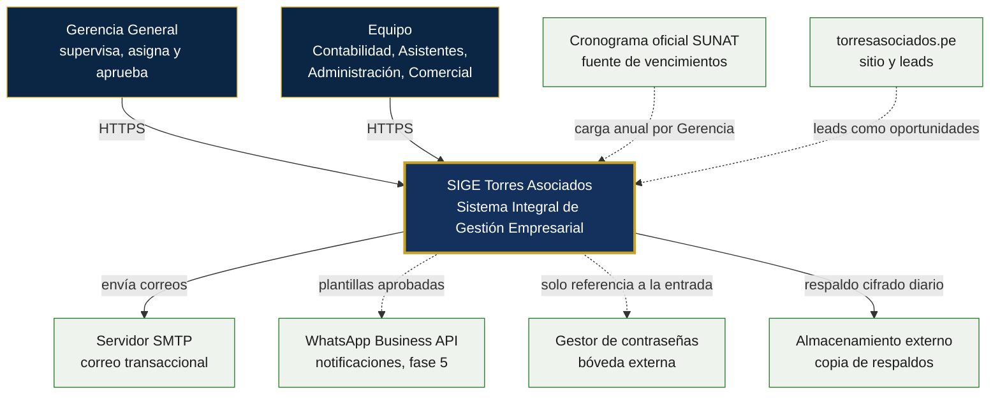

Las líneas punteadas son integraciones opcionales o manuales. El sistema nunca se conecta a la bóveda para leer secretos: solo guarda el identificador de la entrada.

### 7.3 Contenedores

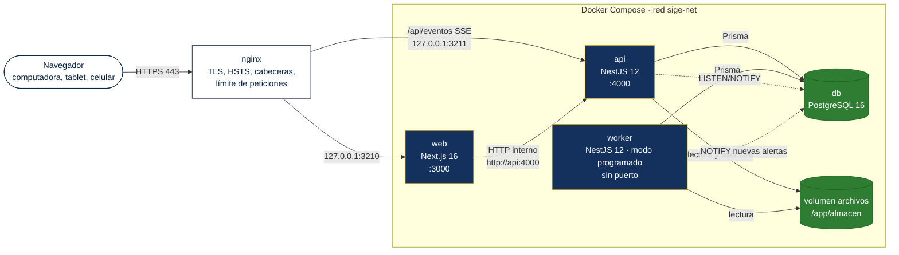

| Contenedor | Imagen | Puerto publicado | Memoria límite |
|---|---|---|---|
| `web` | `sige/web` | `127.0.0.1:3210` | 512 MB |
| `api` | `sige/api` | `127.0.0.1:3211` | 768 MB |
| `worker` | `sige/api` (mismo build, otro comando) | ninguno | 384 MB |
| `db` | `postgres:16-alpine` | ninguno | según servidor |

Los puertos 3210 y 3211 están libres en el servidor actual; los de torresasociados.pe son 3200 y 3201.

La web llama a la API desde sus componentes de servidor y sus *route handlers* reenviando la cookie de sesión (patrón BFF, igual que torresasociados.pe). Solo el flujo de eventos SSE va directo del navegador a la API a través de nginx.

### 7.4 Despliegue

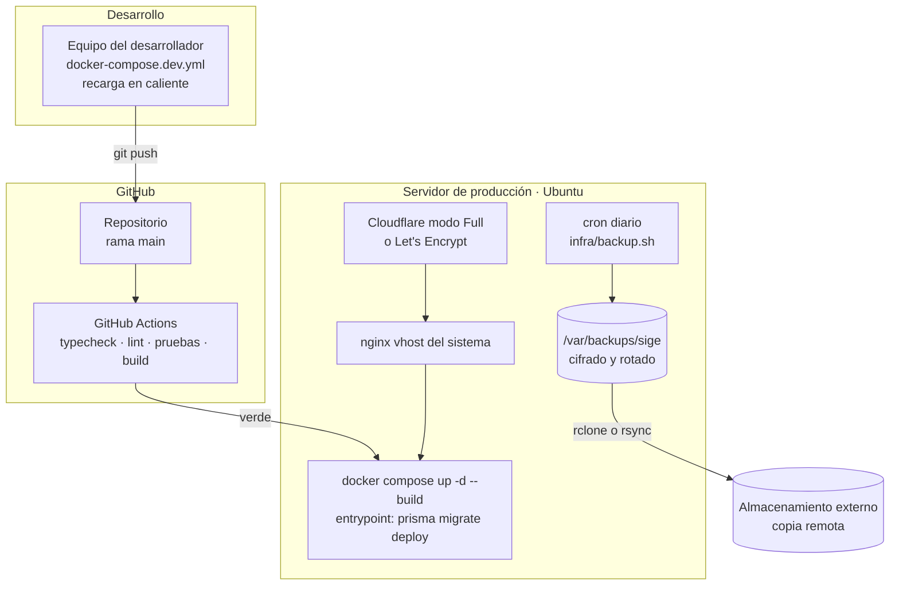

Procedimiento de despliegue, igual que torresasociados.pe:

```bash
cd /var/www/SISTEMA-INTEGRAL-DE-GESTI-N-EMPRESARIAL
git pull
docker compose up -d --build
```

El `docker-entrypoint.sh` de la API ejecuta `prisma migrate deploy` antes de arrancar; el `worker` arranca solo cuando la API está sana.

### 7.5 Estructura del monorepo

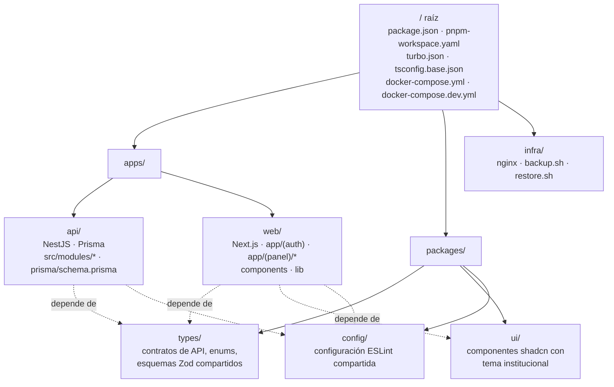

```text
SISTEMA-INTEGRAL-DE-GESTI-N-EMPRESARIAL/
├── apps/
│   ├── api/
│   │   ├── prisma/
│   │   │   ├── schema.prisma
│   │   │   └── migrations/
│   │   ├── src/
│   │   │   ├── main.ts
│   │   │   ├── worker.ts
│   │   │   ├── app.module.ts
│   │   │   ├── config/
│   │   │   ├── prisma/
│   │   │   ├── common/
│   │   │   └── modules/
│   │   │       ├── auth/
│   │   │       ├── access-control/
│   │   │       ├── users/
│   │   │       ├── staff/
│   │   │       ├── tasks/
│   │   │       ├── progress/
│   │   │       ├── reviews/
│   │   │       ├── clients/
│   │   │       ├── tax/
│   │   │       ├── documents/
│   │   │       ├── finance/
│   │   │       ├── projects/
│   │   │       ├── commercial/
│   │   │       ├── platform-access/
│   │   │       ├── notifications/
│   │   │       ├── reports/
│   │   │       ├── dashboard/
│   │   │       ├── search/
│   │   │       ├── audit/
│   │   │       ├── storage/
│   │   │       ├── scheduler/
│   │   │       ├── settings/
│   │   │       └── health/
│   │   ├── test/
│   │   ├── Dockerfile
│   │   └── docker-entrypoint.sh
│   └── web/
│       ├── app/
│       │   ├── (auth)/
│       │   └── (panel)/
│       ├── components/
│       ├── lib/
│       ├── e2e/
│       └── Dockerfile
├── packages/
│   ├── types/
│   ├── ui/
│   └── config/
├── infra/
│   ├── nginx/
│   ├── backup.sh
│   └── restore.sh
├── .github/workflows/
├── CLAUDE.md
├── README.md
├── docker-compose.yml
├── docker-compose.dev.yml
├── package.json
├── pnpm-workspace.yaml
├── tsconfig.base.json
└── turbo.json
```

Nombres de carpetas y archivos en inglés; identificadores de dominio, textos de interfaz y mensajes en español. Toda la documentación del proyecto vive en este README.

### 7.6 Módulos del backend

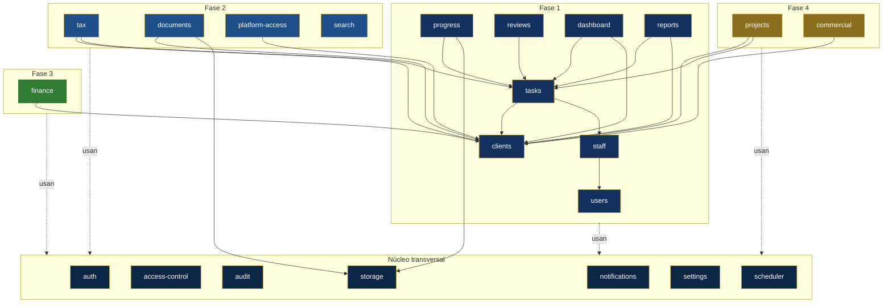

Reglas de dependencia:

- Un módulo de dominio solo consume servicios públicos exportados por otro módulo, nunca su repositorio Prisma directamente.
- El núcleo transversal no depende de ningún módulo de dominio.
- Los módulos se comunican eventos de dominio (`TareaAsignada`, `TareaObservada`, `ObligacionPorVencer`) mediante `@nestjs/event-emitter`; `notifications` y `audit` los escuchan, así el dominio no conoce a sus consumidores.

### 7.7 Capas dentro de un módulo

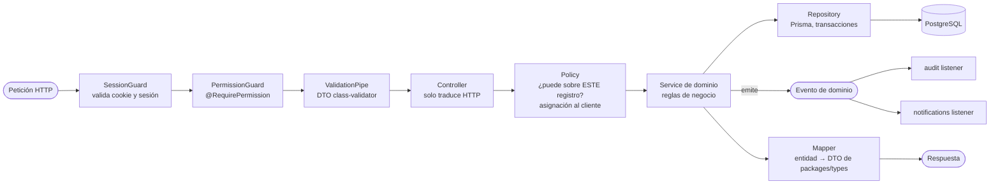

Ejemplo de servicios del módulo `tasks`, uno por responsabilidad:

| Clase | Responsabilidad |
|---|---|
| `TaskCommandService` | Crear, modificar y reasignar tareas. |
| `TaskStateMachine` | Validar y aplicar transiciones de estado. |
| `TaskQueryService` | Listados, filtros y paginación. |
| `TaskPolicy` | Decidir si un usuario puede ver o modificar una tarea concreta. |
| `TaskMapper` | Convertir el modelo Prisma al contrato de `packages/types`. |
| `OverdueTaskDetector` | Detectar tareas atrasadas y próximas a vencer (usado por el worker). |

### 7.8 Frontend: rutas y composición

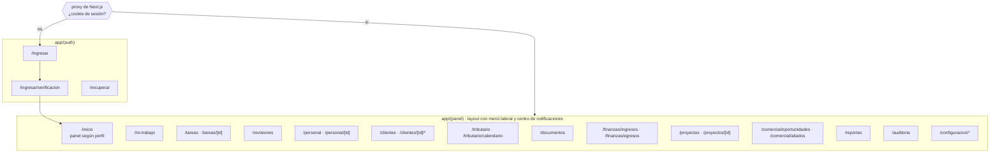

- El layout `(panel)` obtiene en el servidor el usuario y sus permisos efectivos, y construye el menú solo con los módulos permitidos.
- Componentes de servidor por defecto; `"use client"` solo en formularios, tablero kanban, gráficos y el centro de notificaciones.
- Las mutaciones se hacen con *Server Actions* que llaman a la API y revalidan la ruta.

### 7.9 Autenticación y sesiones

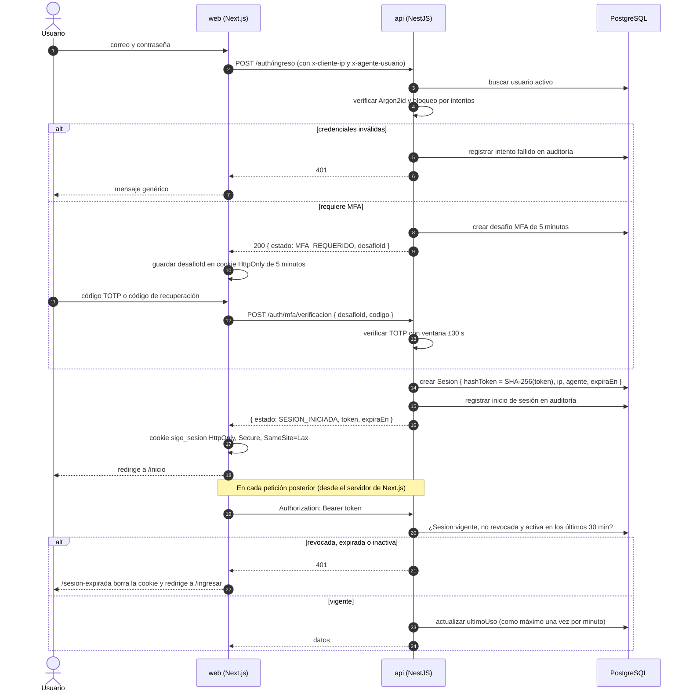

### 7.10 Autorización: rol, permiso y asignación

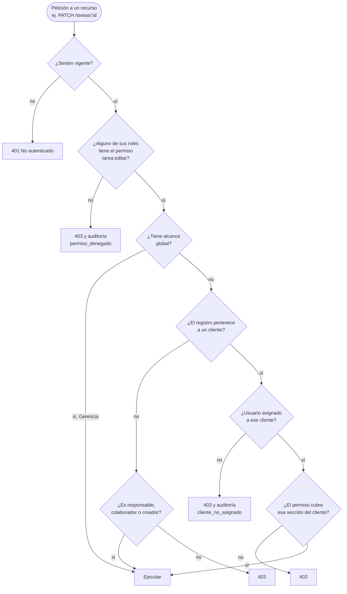

Los permisos son cadenas `recurso:acción` sembradas por migración; los roles son registros que agrupan permisos y tienen un alcance (`GLOBAL`, `ASIGNADO` o `PROPIO`). Ver [Identidad y acceso](#82-identidad-y-acceso) en el modelo de datos.

### 7.11 Almacenamiento de archivos

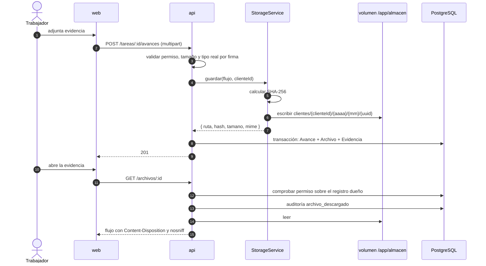

`StorageService` es una interfaz con implementación de disco local; puede sustituirse por una compatible con S3 sin cambiar los módulos (RNF-ESC-04).

### 7.12 Procesos programados

| Proceso | Frecuencia (hora de Lima) | Fase |
|---|---|---|
| Detectar tareas atrasadas y próximas a vencer | Cada hora | 1 |
| Generar tareas recurrentes | Diario 00:10 | 2 |
| Generar obligaciones tributarias del periodo | Día 1 de cada mes 00:30 | 2 |
| Alertas de vencimiento tributario y documental | Diario 07:00 | 2 |
| Generar ingresos esperados por honorarios | Día 1 de cada mes 01:00 | 3 |
| Recordatorios de pagos vencidos | Diario 08:00 | 3 |
| Resumen semanal a Gerencia | Lunes 07:00 | 5 |

Cada proceso toma `pg_try_advisory_lock` con un identificador propio, registra su ejecución en `EjecucionProceso` y usa claves únicas (`clienteId + tipoObligacionId + periodo`) para ser idempotente.

### 7.13 Notificaciones en tiempo real

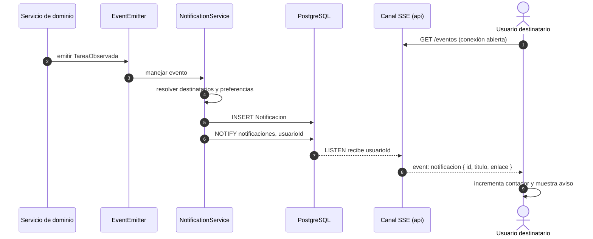

Con `LISTEN/NOTIFY` de PostgreSQL, las alertas generadas por el `worker` también llegan al navegador sin agregar Redis.

### 7.14 Auditoría

- Los servicios emiten eventos de dominio con el estado anterior y el nuevo; `AuditListener` los persiste.
- Una extensión del cliente Prisma registra además cualquier `update` sobre modelos marcados como críticos, para cubrir cambios que no pasen por un evento.
- La tabla `auditoria` tiene un disparador que rechaza `UPDATE` y `DELETE`; el usuario de base de datos de la aplicación no es dueño de la tabla.

### 7.15 Respaldos

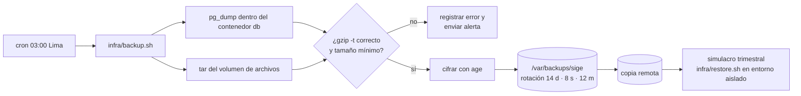

Basado en `infra/respaldo.sh` de torresasociados.pe, agregando cifrado, copia remota y alerta.

### 7.16 Integración continua

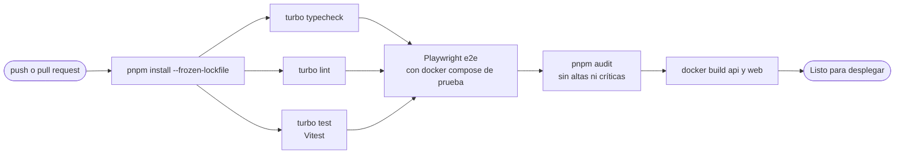

---

## 8. Modelo de datos

Modelo conceptual para PostgreSQL 16 mediante Prisma. Los nombres de modelos y campos están en español, igual que el dominio; las tablas se mapean en `snake_case` con `@@map`.

### 8.1 Convenciones

| Regla | Detalle |
|---|---|
| Identificadores | `uuid` generado por la base de datos. |
| Fechas de control | `creadoEn`, `actualizadoEn` en `timestamptz` (UTC). |
| Autoría | `creadoPorId` en todo registro de negocio. |
| Sin borrado físico | `activo` o `archivadoEn` para catálogos y documentos; `anuladoEn`, `anuladoPorId`, `motivoAnulacion` para movimientos. |
| Concurrencia | `version Int` en tareas y obligaciones para bloqueo optimista. |
| Dinero | `Decimal(12,2)` en soles. |
| Texto sin distinción de mayúsculas | `citext` en correo; extensión `unaccent` para búsquedas. |

### 8.2 Identidad y acceso

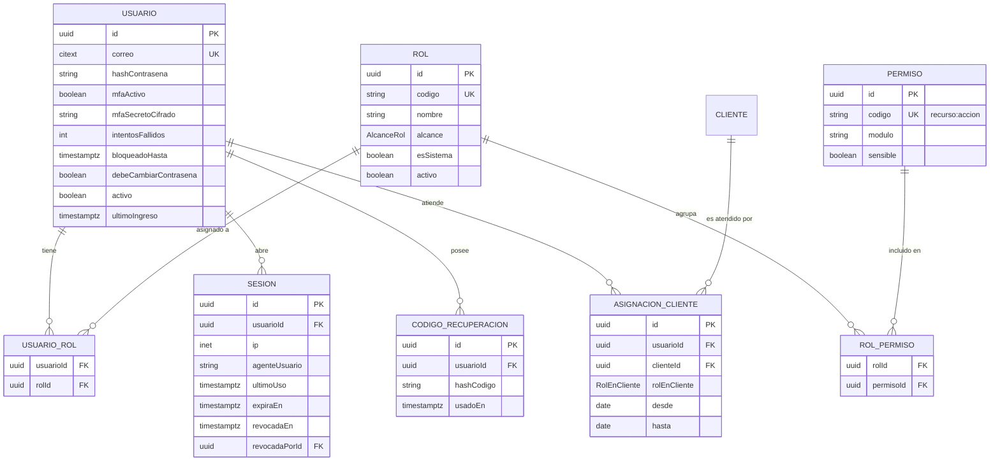

### 8.3 Personal

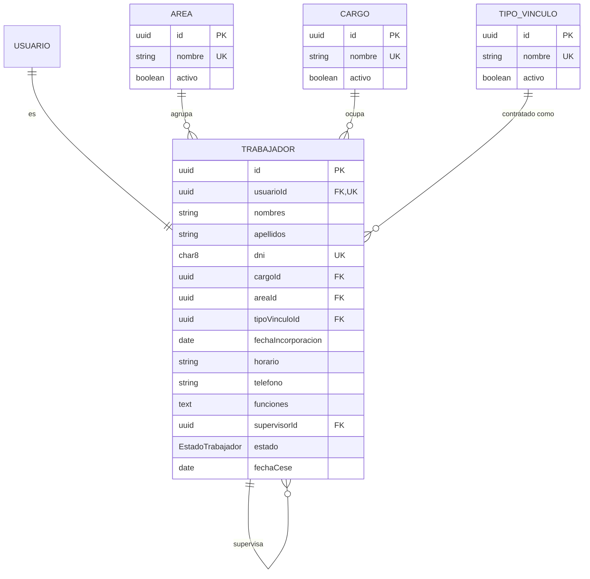

### 8.4 Tareas, avances y revisiones

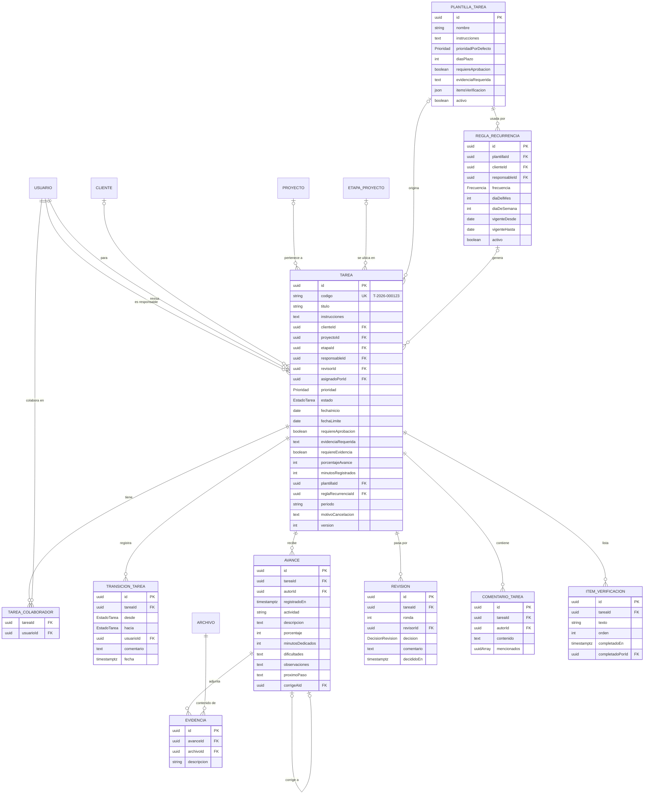

### 8.5 Clientes

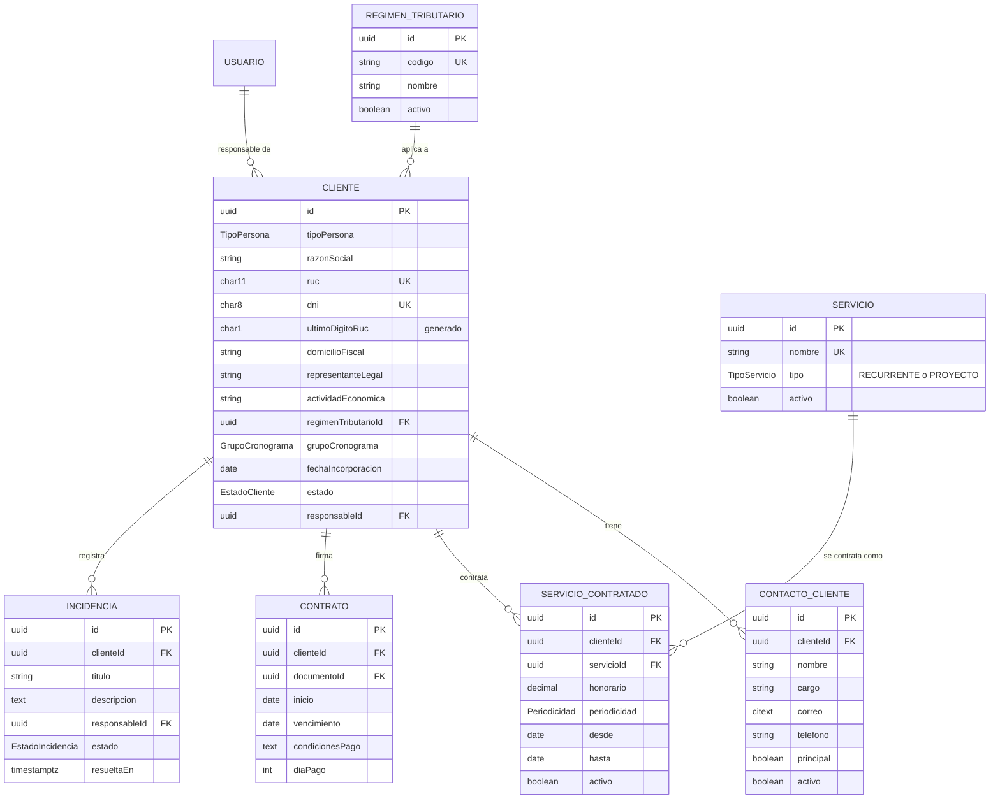

### 8.6 Contable y tributario

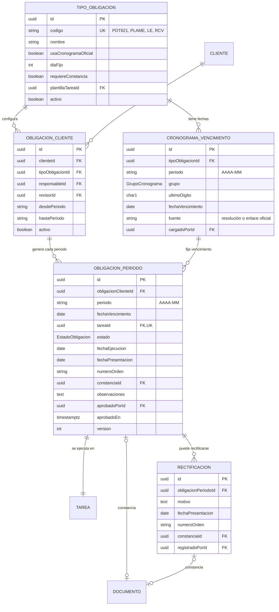

### 8.7 Documentos y archivos

```mermaid
erDiagram
    DOCUMENTO ||--|{ VERSION_DOCUMENTO : "tiene"
    ARCHIVO ||--o{ VERSION_DOCUMENTO : "contenido de"
    TIPO_DOCUMENTO ||--o{ DOCUMENTO : "clasifica"
    CARPETA |o--o{ DOCUMENTO : "contiene"
    CARPETA |o--o{ CARPETA : "anida"
    CLIENTE |o--o{ DOCUMENTO : "expediente"
    PROYECTO |o--o{ DOCUMENTO : "documenta"
    CLIENTE |o--o{ DOCUMENTO_ESPERADO : "debe entregar"
    TIPO_DOCUMENTO ||--o{ DOCUMENTO_ESPERADO : "de tipo"
    DOCUMENTO_ESPERADO |o--o| DOCUMENTO : "cumplido con"

    ARCHIVO {
        uuid id PK
        string rutaAlmacen UK
        string nombreOriginal
        string mime
        bigint tamanoBytes
        char64 sha256
        uuid subidoPorId FK
        timestamptz subidoEn
    }
    DOCUMENTO {
        uuid id PK
        string titulo
        uuid tipoDocumentoId FK
        uuid clienteId FK
        uuid proyectoId FK
        uuid areaId FK
        uuid carpetaId FK
        string periodo
        date fechaDocumento
        date fechaVencimiento
        int versionActual
        Confidencialidad confidencialidad
        timestamptz archivadoEn
    }
    VERSION_DOCUMENTO {
        uuid id PK
        uuid documentoId FK
        int numero
        uuid archivoId FK
        text nota
        uuid cargadoPorId FK
        timestamptz cargadoEn
    }
    TIPO_DOCUMENTO {
        uuid id PK
        string nombre UK
        boolean admiteVencimiento
        boolean activo
    }
    CARPETA {
        uuid id PK
        uuid clienteId FK
        uuid padreId FK
        string nombre
    }
    DOCUMENTO_ESPERADO {
        uuid id PK
        uuid clienteId FK
        uuid tipoDocumentoId FK
        string periodo
        date fechaLimite
        uuid documentoId FK
    }
```

### 8.8 Financiero

```mermaid
erDiagram
    CLIENTE ||--o{ INGRESO : "factura"
    SERVICIO_CONTRATADO |o--o{ INGRESO : "origina"
    INGRESO ||--o{ COBRO : "se paga con"
    ARCHIVO |o--o{ COBRO : "voucher"
    PROVEEDOR |o--o{ EGRESO : "cobra"
    CATEGORIA_EGRESO ||--o{ EGRESO : "clasifica"
    ARCHIVO |o--o{ EGRESO : "comprobante"
    MEDIO_PAGO ||--o{ COBRO : "usado en"
    MEDIO_PAGO ||--o{ EGRESO : "usado en"

    INGRESO {
        uuid id PK
        uuid clienteId FK
        uuid servicioContratadoId FK
        string concepto
        TipoComprobante tipoComprobante
        string serieNumero
        date fechaEmision
        date fechaVencimiento
        decimal monto
        decimal montoPagado "derivado de cobros"
        decimal saldo "derivado"
        EstadoCobranza estado
        string periodo
        timestamptz anuladoEn
        uuid anuladoPorId FK
        text motivoAnulacion
    }
    COBRO {
        uuid id PK
        uuid ingresoId FK
        date fecha
        decimal importe
        uuid medioPagoId FK
        string operacion
        uuid voucherId FK
        uuid registradoPorId FK
        timestamptz anuladoEn
    }
    EGRESO {
        uuid id PK
        string concepto
        uuid proveedorId FK
        date fecha
        decimal importe
        uuid categoriaId FK
        TipoComprobante tipoComprobante
        string serieNumero
        uuid comprobanteId FK
        uuid responsableId FK
        uuid medioPagoId FK
        uuid clienteId FK "opcional, para rentabilidad"
        uuid proyectoId FK "opcional"
        timestamptz anuladoEn
        text motivoAnulacion
    }
    PROVEEDOR {
        uuid id PK
        string razonSocial
        char11 ruc
        boolean activo
    }
    CATEGORIA_EGRESO {
        uuid id PK
        string nombre UK
        boolean activo
    }
    MEDIO_PAGO {
        uuid id PK
        string nombre UK
        boolean activo
    }
```

### 8.9 Proyectos

```mermaid
erDiagram
    CLIENTE ||--o{ PROYECTO : "encarga"
    SERVICIO ||--o{ PROYECTO : "tipo de"
    PROYECTO ||--o{ MIEMBRO_PROYECTO : "integra"
    USUARIO ||--o{ MIEMBRO_PROYECTO : "participa"
    PROYECTO ||--|{ ETAPA_PROYECTO : "se divide en"
    ETAPA_PROYECTO ||--o{ ENTREGABLE : "produce"
    DOCUMENTO |o--o| ENTREGABLE : "archivo"
    ETAPA_PROYECTO ||--o{ TAREA : "agrupa"

    PROYECTO {
        uuid id PK
        string codigo UK
        string nombre
        uuid clienteId FK
        uuid servicioId FK
        text descripcion
        text objetivo
        uuid responsableId FK
        decimal presupuesto
        decimal honorarios
        date fechaInicio
        date fechaEntrega
        EstadoProyecto estado
        boolean conDificultades
        text resultadoFinal
    }
    MIEMBRO_PROYECTO {
        uuid proyectoId FK
        uuid usuarioId FK
        string funcion
    }
    ETAPA_PROYECTO {
        uuid id PK
        uuid proyectoId FK
        string nombre
        int orden
        date inicio
        date fin
        EstadoEtapa estado
    }
    ENTREGABLE {
        uuid id PK
        uuid etapaId FK
        string nombre
        date fechaCompromiso
        uuid documentoId FK
        uuid aprobadoPorId FK
        timestamptz aprobadoEn
    }
```

### 8.10 Comercial

```mermaid
erDiagram
    ALIADO |o--o{ OPORTUNIDAD : "refiere"
    OPORTUNIDAD ||--o{ ACTIVIDAD_COMERCIAL : "seguimiento"
    OPORTUNIDAD ||--o{ COTIZACION : "recibe"
    COTIZACION ||--|{ ITEM_COTIZACION : "detalla"
    SERVICIO ||--o{ ITEM_COTIZACION : "cotiza"
    OPORTUNIDAD |o--o| CLIENTE : "se convierte en"
    USUARIO ||--o{ OPORTUNIDAD : "gestiona"

    ALIADO {
        uuid id PK
        TipoAliado tipo
        string nombre
        string empresa
        string especialidad
        citext correo
        string telefono
        boolean activo
    }
    OPORTUNIDAD {
        uuid id PK
        string nombre
        string empresa
        string contacto
        citext correo
        string telefono
        text descripcion
        uuid responsableId FK
        uuid aliadoId FK
        date fechaContacto
        EtapaNegociacion etapa
        string proximaActividad
        date fechaProximaActividad
        decimal valorEstimado
        ResultadoOportunidad resultado
        uuid clienteId FK
        string origen "manual o sitio web"
        string origenId UK
    }
    ACTIVIDAD_COMERCIAL {
        uuid id PK
        uuid oportunidadId FK
        TipoActividadComercial tipo
        timestamptz fecha
        text resumen
        uuid registradoPorId FK
    }
    COTIZACION {
        uuid id PK
        uuid oportunidadId FK
        string numero UK
        date fecha
        date vigenteHasta
        decimal total
        EstadoCotizacion estado
        uuid documentoId FK
    }
    ITEM_COTIZACION {
        uuid id PK
        uuid cotizacionId FK
        uuid servicioId FK
        string descripcion
        decimal cantidad
        decimal precioUnitario
    }
```

### 8.11 Accesos de plataformas

```mermaid
erDiagram
    CLIENTE ||--o{ ACCESO_PLATAFORMA : "usa"
    PLATAFORMA ||--o{ ACCESO_PLATAFORMA : "tipo"
    USUARIO ||--o{ ACCESO_PLATAFORMA : "autorizado"

    PLATAFORMA {
        uuid id PK
        string nombre UK "SUNAT, SUNARP, banco, AFP"
        string urlPorDefecto
        boolean activo
    }
    ACCESO_PLATAFORMA {
        uuid id PK
        uuid clienteId FK
        uuid plataformaId FK
        string url
        string identificadorNoSecreto "usuario o RUC, nunca clave"
        uuid responsableAutorizadoId FK
        date fechaRevision
        EstadoAcceso estado
        boolean tieneMfa
        string referenciaBoveda "id de la entrada en el gestor"
        text notas
    }
```

No existe ninguna columna destinada a contraseñas, claves, PIN, CVV ni tokens (RF-ACC-02).

### 8.12 Notificaciones, auditoría y procesos

```mermaid
erDiagram
    USUARIO ||--o{ NOTIFICACION : "recibe"
    USUARIO ||--o{ PREFERENCIA_NOTIFICACION : "configura"
    USUARIO |o--o{ AUDITORIA : "actor"
    EJECUCION_PROCESO }o--|| PROCESO_PROGRAMADO : "instancia de"

    NOTIFICACION {
        uuid id PK
        uuid usuarioId FK
        TipoNotificacion tipo
        string titulo
        text mensaje
        string entidad
        uuid entidadId
        string enlace
        timestamptz leidaEn
        timestamptz creadoEn
    }
    PREFERENCIA_NOTIFICACION {
        uuid usuarioId FK
        TipoNotificacion tipo
        boolean enSistema
        boolean porCorreo
        boolean porWhatsapp
    }
    AUDITORIA {
        bigint id PK
        timestamptz fecha
        uuid usuarioId FK
        uuid sesionId
        inet ip
        AccionAuditoria accion
        string entidad
        uuid entidadId
        jsonb antes
        jsonb despues
        string motivo
    }
    PROCESO_PROGRAMADO {
        string codigo PK
        string descripcion
        string cron
        boolean activo
    }
    EJECUCION_PROCESO {
        uuid id PK
        string procesoCodigo FK
        timestamptz inicio
        timestamptz fin
        ResultadoEjecucion resultado
        int registrosCreados
        text error
    }
    PARAMETRO {
        string clave PK
        jsonb valor
        uuid actualizadoPorId FK
    }
```

### 8.13 Enumeraciones

| Enum | Valores |
|---|---|
| `AlcanceRol` | `GLOBAL`, `ASIGNADO`, `PROPIO` |
| `RolEnCliente` | `RESPONSABLE`, `APOYO`, `REVISOR`, `CONSULTA` |
| `EstadoTrabajador` | `ACTIVO`, `INACTIVO` |
| `Prioridad` | `BAJA`, `MEDIA`, `ALTA`, `URGENTE` |
| `EstadoTarea` | `PENDIENTE`, `EN_PROCESO`, `EN_REVISION`, `OBSERVADA`, `CORREGIDA`, `APROBADA`, `FINALIZADA`, `CANCELADA` |
| `DecisionRevision` | `APROBADA`, `OBSERVADA` |
| `Frecuencia` | `SEMANAL`, `MENSUAL`, `ANUAL` |
| `TipoPersona` | `NATURAL`, `JURIDICA` |
| `EstadoCliente` | `PROSPECTO`, `ACTIVO`, `SUSPENDIDO`, `INACTIVO` |
| `GrupoCronograma` | `GENERAL`, `BUENOS_CONTRIBUYENTES`, `UESP` (ajustable al cronograma oficial vigente) |
| `EstadoObligacion` | `PENDIENTE`, `EN_PROCESO`, `EN_REVISION`, `OBSERVADA`, `PRESENTADA`, `APROBADA`, `NO_APLICA` |
| `Confidencialidad` | `INTERNA`, `RESTRINGIDA`, `CONFIDENCIAL` |
| `TipoComprobante` | `FACTURA`, `BOLETA`, `RECIBO_HONORARIOS`, `NOTA_CREDITO`, `OTRO` |
| `EstadoCobranza` | `PENDIENTE`, `PARCIAL`, `PAGADO`, `VENCIDO`, `ANULADO` |
| `EstadoProyecto` | `PLANIFICADO`, `EN_EJECUCION`, `PAUSADO`, `FINALIZADO`, `CANCELADO` |
| `EtapaNegociacion` | `CONTACTO`, `REUNION`, `PROPUESTA`, `NEGOCIACION`, `CERRADA` |
| `ResultadoOportunidad` | `ABIERTA`, `GANADA`, `PERDIDA` |
| `EstadoAcceso` | `VIGENTE`, `POR_REVISAR`, `REVOCADO` |
| `AccionAuditoria` | `CREAR`, `MODIFICAR`, `CAMBIAR_ESTADO`, `APROBAR`, `OBSERVAR`, `ANULAR`, `DESACTIVAR`, `INGRESAR`, `INGRESO_FALLIDO`, `SALIR`, `REVOCAR_SESION`, `DESCARGAR`, `VER_SENSIBLE`, `PERMISO_DENEGADO` |

### 8.14 Índices y restricciones clave

| Tabla | Restricción o índice | Motivo |
|---|---|---|
| `tareas` | índice `(responsable_id, estado, fecha_limite)` | Panel "Mi trabajo" y detección de atrasos. |
| `tareas` | índice `(cliente_id, estado)` | Expediente del cliente. |
| `tareas` | único `(regla_recurrencia_id, periodo)` | Idempotencia de tareas recurrentes. |
| `obligaciones_periodo` | único `(obligacion_cliente_id, periodo)` | Idempotencia de la generación mensual. |
| `cronograma_vencimientos` | único `(tipo_obligacion_id, periodo, grupo, ultimo_digito)` | Una sola fecha por combinación. |
| `asignaciones_cliente` | único `(usuario_id, cliente_id)` | Una asignación por par. |
| `clientes` | `CHECK` de longitud y dígito verificador del RUC | Integridad del identificador. |
| `cobros` | `CHECK (importe > 0)` | |
| `ingresos` | `CHECK (monto > 0)` | |
| `auditoria` | disparador que rechaza `UPDATE` y `DELETE`; índice `(entidad, entidad_id, fecha)` | Inmutabilidad y consulta de historial. |
| `notificaciones` | índice parcial `(usuario_id) WHERE leida_en IS NULL` | Contador de no leídas. |
| `clientes`, `documentos`, `tareas` | índice GIN sobre `to_tsvector('spanish', unaccent(...))` | Búsqueda general. |

---

## 9. Procesos y flujos

### 9.1 Ciclo de vida de una tarea

Requerimiento prioritario de la Fase 1 (RF-TAR-03, RF-TAR-04, RF-REV-03). La primera versión debe demostrar el circuito completo de asignación, avance, evidencia, revisión, observación, aprobación y consulta de historial desde el panel de Gerencia.

> **Regla de negocio:** marcar una tarea como terminada **no equivale** a aprobarla. Cuando corresponda, debe pasar por revisión de un responsable autorizado.

```mermaid
stateDiagram-v2
    direction LR
    state "Pendiente" as Pendiente
    state "En proceso" as EnProceso
    state "En revisión" as EnRevision
    state "Observada" as Observada
    state "Corregida" as Corregida
    state "Aprobada" as Aprobada
    state "Finalizada" as Finalizada
    state "Cancelada" as Cancelada
    state requiere <<choice>>

    [*] --> Pendiente: asignar
    Pendiente --> EnProceso: iniciar o registrar primer avance
    EnProceso --> requiere: marcar terminada
    requiere --> EnRevision: requiere aprobación
    requiere --> Finalizada: no requiere aprobación
    EnRevision --> Observada: revisor observa con comentario
    Observada --> Corregida: responsable registra corrección
    Corregida --> EnRevision: reenviar a revisión
    EnRevision --> Aprobada: revisor aprueba
    Aprobada --> Finalizada: cierre
    Pendiente --> Cancelada: justificación obligatoria
    EnProceso --> Cancelada: justificación obligatoria
    Observada --> Cancelada: justificación obligatoria
    Finalizada --> [*]
    Cancelada --> [*]

    note right of EnRevision
        El responsable no puede
        aprobar su propia tarea
    end note
    note left of requiere
        No se envía a revisión sin
        la evidencia requerida
    end note
```

**Transiciones permitidas**

| Desde | Hacia | Quién | Condición |
|---|---|---|---|
| — | Pendiente | Usuario con `tarea:crear` | Responsable asignado al cliente. |
| Pendiente | En proceso | Responsable o colaborador | — |
| En proceso | En revisión | Responsable | `requiereAprobacion` y evidencia adjunta si `requiereEvidencia`. |
| En proceso | Finalizada | Responsable | No requiere aprobación. |
| En revisión | Observada | Revisor | Comentario obligatorio. Revisor ≠ responsable. |
| En revisión | Aprobada | Revisor | Revisor ≠ responsable. |
| Observada | Corregida | Responsable | Al menos un avance nuevo posterior a la observación. |
| Corregida | En revisión | Responsable | — |
| Aprobada | Finalizada | Gerencia o proceso de cierre | — |
| Pendiente, En proceso, Observada | Cancelada | Quien asignó o Gerencia | Justificación obligatoria. |

Cualquier otra combinación devuelve `409 Conflict` y no modifica la tarea.

### 9.2 Asignación de una tarea

```mermaid
sequenceDiagram
    autonumber
    actor G as Gerencia
    participant W as web
    participant A as api · TaskCommandService
    participant P as TaskPolicy
    participant D as PostgreSQL
    participant N as NotificationService
    actor T as Trabajador

    G->>W: completa formulario de tarea
    W->>A: POST /tareas
    A->>P: ¿puede crear para este cliente?
    P->>D: ¿responsable asignado al cliente?
    alt no asignado
        A-->>W: 422 el responsable no atiende a este cliente
    else válido
        A->>D: BEGIN
        A->>D: INSERT Tarea (Pendiente)
        A->>D: INSERT TareaColaborador
        A->>D: INSERT TransicionTarea (— → Pendiente)
        A->>D: INSERT Auditoria (CREAR)
        A->>D: COMMIT
        A->>N: evento TareaAsignada
        N->>D: INSERT Notificacion para responsable y colaboradores
        N-->>T: SSE "Nueva tarea asignada"
        A-->>W: 201 { id, codigo }
        W-->>G: tarea creada
    end
```

### 9.3 Registro de avance con evidencia

```mermaid
sequenceDiagram
    autonumber
    actor T as Trabajador
    participant W as web
    participant A as api · ProgressService
    participant S as StorageService
    participant SM as TaskStateMachine
    participant D as PostgreSQL
    participant N as NotificationService
    actor R as Revisor o asignador

    T->>W: describe trabajo, %, tiempo y adjunta archivos
    W->>A: POST /tareas/:id/avances (multipart)
    A->>D: ¿es responsable o colaborador?
    A->>S: validar firma, tamaño y guardar archivos
    S-->>A: Archivo[]
    A->>D: BEGIN
    A->>D: INSERT Avance (registradoEn = now())
    A->>D: INSERT Evidencia por archivo
    A->>D: UPDATE Tarea porcentajeAvance, minutosRegistrados
    opt tarea Pendiente
        A->>SM: transición Pendiente → En proceso
        SM->>D: UPDATE estado + INSERT TransicionTarea
    end
    A->>D: COMMIT
    A->>N: evento AvanceRegistrado
    N-->>R: SSE "Nuevo avance en T-2026-000123"
    A-->>W: 201
```

### 9.4 Revisión: observar y aprobar

```mermaid
sequenceDiagram
    autonumber
    actor T as Responsable
    actor R as Revisor
    participant A as api
    participant D as PostgreSQL

    T->>A: POST /tareas/:id/terminar
    A->>D: ¿evidencia requerida adjunta?
    A->>D: estado En revisión · Revision ronda 1 abierta
    A-->>R: notificación "Trabajo por revisar"

    R->>A: POST /tareas/:id/revisiones { decision: OBSERVADA, comentario }
    A->>A: revisor ≠ responsable
    A->>D: Revision ronda 1 = OBSERVADA · estado Observada
    A-->>T: notificación "Tu trabajo fue observado"

    T->>A: POST /tareas/:id/avances (corrección)
    T->>A: POST /tareas/:id/corregir
    A->>D: estado Corregida → En revisión · Revision ronda 2 abierta
    A-->>R: notificación "Corrección enviada"

    R->>A: POST /tareas/:id/revisiones { decision: APROBADA }
    A->>D: Revision ronda 2 = APROBADA · estado Aprobada
    A-->>T: notificación "Tu trabajo fue aprobado"
```

### 9.5 Flujo completo de la Fase 1 entre actores

```mermaid
flowchart TB
    subgraph GER["Gerencia General"]
        G1["Crear tarea con cliente,<br/>prioridad, fecha límite<br/>y evidencia requerida"]
        G2["Ver tablero:<br/>cumplimiento y atrasos"]
        G3["Consultar historial<br/>del trabajador"]
    end

    subgraph TRA["Trabajador"]
        T1["Recibir notificación"]
        T2["Iniciar tarea"]
        T3["Registrar avance<br/>y adjuntar evidencia"]
        T4["Marcar terminada"]
        T5["Corregir según<br/>observación"]
    end

    subgraph REV["Revisor"]
        R1{"¿Trabajo<br/>conforme?"}
        R2["Observar con<br/>comentario"]
        R3["Aprobar"]
    end

    SYS[["Sistema: historial,<br/>auditoría y alertas"]]

    G1 --> T1 --> T2 --> T3 --> T4 --> R1
    R1 -->|"no"| R2 --> T5 --> T3
    R1 -->|"sí"| R3 --> G2
    G2 --> G3
    T3 & R2 & R3 -.-> SYS
    SYS -.->|"tarea atrasada"| G2
```

### 9.6 Ciclo de una obligación tributaria

```mermaid
stateDiagram-v2
    direction LR
    state "Pendiente" as Pendiente
    state "En proceso" as EnProceso
    state "En revisión" as EnRevision
    state "Observada" as Observada
    state "Presentada" as Presentada
    state "Aprobada" as Aprobada
    state "No aplica" as NoAplica

    [*] --> Pendiente: generación mensual
    Pendiente --> EnProceso: responsable inicia
    EnProceso --> EnRevision: preparada para revisión
    EnRevision --> Observada: revisor observa
    Observada --> EnProceso: responsable corrige
    EnRevision --> Presentada: revisor autoriza y se presenta con constancia
    Presentada --> Aprobada: cierre del periodo
    Pendiente --> NoAplica: sin movimiento, con sustento
    Presentada --> Presentada: rectificación registrada
    Aprobada --> [*]
    NoAplica --> [*]
```

La obligación y su tarea asociada avanzan sincronizadas: el estado de la tarea refleja el trabajo y el de la obligación refleja el cumplimiento ante la administración tributaria.

### 9.7 Generación mensual de obligaciones

```mermaid
flowchart TD
    START(["Worker · día 1, 00:30 Lima"]) --> LOCK{"pg_try_advisory_lock<br/>obligaciones-mensuales"}
    LOCK -->|"ocupado"| ENDX(["Terminar: otra instancia ejecuta"])
    LOCK -->|"tomado"| CRON{"¿Cronograma oficial del<br/>periodo cargado para todos<br/>los tipos que lo usan?"}
    CRON -->|"no"| ALERT["Notificar a Gerencia:<br/>cargar cronograma del periodo"] --> LOGF["EjecucionProceso = ERROR"]
    CRON -->|"sí"| LOOP["Por cada ObligacionCliente activa"]
    LOOP --> EXISTS{"¿Existe ObligacionPeriodo<br/>para este periodo?"}
    EXISTS -->|"sí"| NEXT["Omitir"]
    EXISTS -->|"no"| DATE["Fecha = Cronograma(tipo, periodo,<br/>grupo del cliente, último dígito RUC)<br/>o día fijo del tipo"]
    DATE --> TX["Transacción:<br/>crear ObligacionPeriodo + Tarea<br/>desde plantilla del tipo"]
    TX --> NOTI["Notificar al responsable"]
    NOTI --> NEXT
    NEXT --> MORE{"¿Quedan más?"}
    MORE -->|"sí"| LOOP
    MORE -->|"no"| LOGOK["EjecucionProceso = OK<br/>con total creado"]
    LOGOK --> UNLOCK(["Liberar bloqueo"])
    LOGF --> UNLOCK
```

### 9.8 Ciclo de cobranza de un ingreso

```mermaid
stateDiagram-v2
    direction LR
    state "Pendiente" as Pendiente
    state "Parcial" as Parcial
    state "Pagado" as Pagado
    state "Vencido" as Vencido
    state "Anulado" as Anulado

    [*] --> Pendiente: registrar ingreso
    Pendiente --> Parcial: cobro menor al saldo
    Pendiente --> Pagado: cobro igual al saldo
    Parcial --> Pagado: cobro completa el saldo
    Pendiente --> Vencido: pasa fecha de vencimiento
    Parcial --> Vencido: pasa fecha de vencimiento
    Vencido --> Parcial: cobro parcial
    Vencido --> Pagado: cobro total
    Pendiente --> Anulado: con motivo y permiso
    Pagado --> [*]
    Anulado --> [*]
```

### 9.9 Ciclo de un proyecto

```mermaid
stateDiagram-v2
    direction LR
    state "Planificado" as Planificado
    state "En ejecución" as EnEjecucion
    state "Pausado" as Pausado
    state "Finalizado" as Finalizado
    state "Cancelado" as Cancelado

    [*] --> Planificado
    Planificado --> EnEjecucion: inicia primera etapa
    EnEjecucion --> Pausado: con motivo
    Pausado --> EnEjecucion: se reanuda
    EnEjecucion --> Finalizado: entregables aprobados y resultado registrado
    Planificado --> Cancelado: con motivo
    EnEjecucion --> Cancelado: con motivo
    Finalizado --> [*]
    Cancelado --> [*]
```

### 9.10 Embudo comercial

```mermaid
flowchart LR
    WEB(["Lead del sitio web"]) -.-> C
    ALI(["Referido por aliado"]) --> C
    MAN(["Registro manual"]) --> C
    C["Contacto"] --> R["Reunión"]
    R --> P["Propuesta<br/>cotización emitida"]
    P --> N["Negociación"]
    N --> G{"Cierre"}
    G -->|"ganada"| CL["Convertir en cliente<br/>con servicios contratados"]
    G -->|"perdida"| PE["Registrar motivo"]
    CL --> ONB["Asignar equipo y<br/>obligaciones del cliente"]
```

### 9.11 Alta y baja de un trabajador

```mermaid
sequenceDiagram
    autonumber
    actor G as Gerencia
    participant A as api
    participant D as PostgreSQL
    actor T as Trabajador

    rect rgba(46, 125, 50, 0.12)
    Note over G,T: Alta
    G->>A: POST /personal (ficha + correo + roles)
    A->>D: Usuario (debeCambiarContrasena) + Trabajador + UsuarioRol
    A->>D: Auditoria CREAR
    A-->>T: correo con enlace de activación de un solo uso
    T->>A: define contraseña y, si su rol lo exige, configura MFA
    G->>A: asigna clientes
    end

    rect rgba(201, 162, 39, 0.15)
    Note over G,T: Baja
    G->>A: POST /personal/:id/desactivar { fechaCese, motivo }
    A->>D: ¿tiene tareas abiertas?
    alt tiene tareas abiertas
        A-->>G: 409 lista de tareas por reasignar
        G->>A: POST /tareas/reasignar { de, a, tareas }
    end
    A->>D: Trabajador INACTIVO · Usuario inactivo
    A->>D: revocar todas sus sesiones
    A->>D: finalizar asignaciones a clientes
    A->>D: Auditoria DESACTIVAR
    Note over T: La siguiente petición del trabajador recibe 401
    end
```

### 9.12 Detección de atrasos y alertas

```mermaid
flowchart TD
    H(["Worker · cada hora"]) --> Q1["Tareas abiertas con<br/>fecha límite = mañana o hoy"]
    H --> Q2["Tareas abiertas con<br/>fecha límite vencida"]
    H --> Q3["Tareas en revisión<br/>hace más de 48 h"]
    Q1 --> D1{"¿Ya se notificó este<br/>umbral para esta tarea?"}
    Q2 --> D2{"¿Ya se notificó el<br/>atraso hoy?"}
    Q3 --> D3{"¿Ya se notificó<br/>al revisor hoy?"}
    D1 -->|"no"| N1["Notificar responsable"]
    D2 -->|"no"| N2["Notificar responsable,<br/>quien asignó y Gerencia"]
    D3 -->|"no"| N3["Notificar revisor"]
    D1 & D2 & D3 -->|"sí"| SKIP["Omitir"]
```

### 9.13 Mapa de navegación

```mermaid
flowchart LR
    LOGIN["Ingresar"] --> MFA["Verificación MFA"] --> HOME["Inicio<br/>según perfil"]

    HOME --> MT["Mi trabajo"]
    HOME --> TAR["Tareas"]
    HOME --> REV["Por revisar"]
    HOME --> PER["Personal"]
    HOME --> CLI["Clientes"]
    HOME --> TRI["Tributario"]
    HOME --> DOC["Documentos"]
    HOME --> FIN["Finanzas"]
    HOME --> PRY["Proyectos"]
    HOME --> COM["Comercial"]
    HOME --> REP["Reportes"]
    HOME --> AUD["Auditoría"]
    HOME --> CFG["Configuración"]

    TAR --> TARD["Detalle de tarea<br/>avances · evidencias ·<br/>revisiones · historial"]
    TAR --> TARK["Tablero kanban"]
    TAR --> TARC["Calendario"]
    PER --> PERD["Ficha del trabajador<br/>historial y cumplimiento"]
    CLI --> CLID["Expediente del cliente"]
    CLID --> CLIG["General"]
    CLID --> CLIC["Comercial"]
    CLID --> CLIO["Operativa"]
    CLID --> CLIT["Tareas"]
    CLID --> CLIDOC["Documentos"]
    CLID --> CLIA["Accesos"]
    CLID --> CLIH["Historial"]
    TRI --> TRIM["Control mensual<br/>cliente × obligación"]
    TRI --> TRIC["Calendario tributario"]
    TRI --> TRIS["Cronogramas oficiales"]
    FIN --> FINI["Ingresos y cobranza"]
    FIN --> FINE["Egresos"]
    FIN --> FINF["Flujo de caja"]
    PRY --> PRYD["Proyecto<br/>Gantt · kanban · entregables"]
    COM --> COMO["Oportunidades"]
    COM --> COMA["Aliados"]
    CFG --> CFGU["Usuarios y roles"]
    CFG --> CFGC["Catálogos"]
    CFG --> CFGP["Parámetros"]
```

---

## 10. Plan de trabajo

### 10.1 Enfoque

- **Incremental por fases:** cada fase se prueba y aprueba por Gerencia antes de iniciar la siguiente.
- **Sprints de dos semanas** dentro de cada fase, con demostración al final de cada sprint.
- **Una semana de pruebas de aceptación (UAT)** con usuarios reales al cierre de cada fase, seguida de la puesta en producción.
- **Flujo vertical primero:** en la Fase 1 se construye el circuito completo asignar → avanzar → evidenciar → revisar → aprobar antes que pantallas secundarias.
- Mismo stack, reglas de código y procedimiento de despliegue que torresasociados.pe (ver [Stack tecnológico](#71-stack-tecnológico)).

```mermaid
flowchart LR
    F0["Fase 0<br/>Análisis, diseño<br/>y base técnica"] --> A0{"Aprobación<br/>de Gerencia"}
    A0 --> F1["Fase 1<br/>Sistema base y<br/>control gerencial"]
    F1 --> U1{"UAT y<br/>aprobación"}
    U1 --> F2["Fase 2<br/>Contable y<br/>tributario"]
    F2 --> U2{"UAT y<br/>aprobación"}
    U2 --> F3["Fase 3<br/>Administrativo<br/>y financiero"]
    F3 --> U3{"UAT y<br/>aprobación"}
    U3 --> F4["Fase 4<br/>Proyectos y<br/>comercial"]
    F4 --> U4{"UAT y<br/>aprobación"}
    U4 --> F5["Fase 5<br/>Automatización e<br/>integraciones"]
    F5 --> U5{"UAT y<br/>cierre"}
```

| Fase | Nombre | Alcance |
|---|---|---|
| **0** | Análisis, diseño y base técnica | Entregables previos a la programación, prototipo, modelo de datos y repositorio base. |
| **1** | Sistema base y control gerencial | Usuarios, roles, clientes, personal, tareas, avances, evidencias, aprobaciones y dashboard gerencial. |
| **2** | Gestión contable y tributaria | Obligaciones, calendario tributario, control mensual por cliente, declaraciones, documentos y alertas. |
| **3** | Gestión administrativa y financiera | Honorarios, ingresos, egresos, cuentas por cobrar y reportes financieros. |
| **4** | Proyectos y gestión comercial | Proyectos, cronogramas, aliados, prospectos, cotizaciones y seguimiento comercial. |
| **5** | Automatización e integraciones | Correo, WhatsApp Business (si es viable), IA y otras integraciones autorizadas. |

### 10.2 Cronograma general

*Estimación* para un equipo de un desarrollador full stack con apoyo de diseño en la Fase 0. La fecha de inicio es tentativa y se ajusta al aprobarse este plan; las duraciones son relativas.

```mermaid
gantt
    title Cronograma tentativo · SIGE Torres Asociados
    dateFormat YYYY-MM-DD
    axisFormat %d/%m
    excludes sunday

    section Fase 0
    Levantamiento y validación de requerimientos   :f0a, 2026-12-07, 5d
    Prototipo navegable y sistema de diseño        :f0b, after f0a, 8d
    Modelo de datos y arquitectura                 :f0c, after f0a, 6d
    Base técnica del monorepo y CI                 :f0d, after f0c, 5d
    Aprobación de Gerencia                         :milestone, m0, after f0b, 0d

    section Fase 1
    Sprint 1 · Autenticación, MFA, roles, auditoría :f1s1, after m0, 12d
    Sprint 2 · Personal, clientes, asignaciones     :f1s2, after f1s1, 12d
    Sprint 3 · Tareas, avances, evidencias          :f1s3, after f1s2, 12d
    Sprint 4 · Revisión, tablero, reportes          :f1s4, after f1s3, 12d
    UAT y puesta en producción                      :f1u, after f1s4, 6d
    Fase 1 aprobada                                 :milestone, m1, after f1u, 0d

    section Fase 2
    Sprint 5 · Obligaciones y cronograma oficial    :f2s1, after m1, 12d
    Sprint 6 · Documentos y versiones               :f2s2, after f2s1, 12d
    Sprint 7 · Recurrencia, accesos, búsqueda       :f2s3, after f2s2, 12d
    UAT y puesta en producción                      :f2u, after f2s3, 6d
    Fase 2 aprobada                                 :milestone, m2, after f2u, 0d

    section Fase 3
    Sprint 8 · Ingresos, cobros, egresos            :f3s1, after m2, 12d
    Sprint 9 · Cuentas por cobrar y reportes        :f3s2, after f3s1, 12d
    UAT y puesta en producción                      :f3u, after f3s2, 6d
    Fase 3 aprobada                                 :milestone, m3, after f3u, 0d

    section Fase 4
    Sprint 10 · Proyectos, etapas, Gantt            :f4s1, after m3, 12d
    Sprint 11 · Aliados, oportunidades, cotizaciones :f4s2, after f4s1, 12d
    UAT y puesta en producción                      :f4u, after f4s2, 6d
    Fase 4 aprobada                                 :milestone, m4, after f4u, 0d

    section Fase 5
    Sprint 12 · Correo, resúmenes, preferencias     :f5s1, after m4, 12d
    Sprint 13 · WhatsApp e IA asistida              :f5s2, after f5s1, 12d
    UAT, capacitación final y cierre                :f5u, after f5s2, 6d
    Cierre del proyecto                             :milestone, m5, after f5u, 0d
```

| Fase | Duración estimada | Sprints |
|---|---|---|
| 0 · Análisis, diseño y base técnica | 3 semanas | — |
| 1 · Sistema base y control gerencial | 9 semanas | 1 a 4 + UAT |
| 2 · Contable y tributario | 7 semanas | 5 a 7 + UAT |
| 3 · Administrativo y financiero | 5 semanas | 8 a 9 + UAT |
| 4 · Proyectos y comercial | 5 semanas | 10 a 11 + UAT |
| 5 · Automatización e integraciones | 5 semanas | 12 a 13 + UAT |
| **Total** | **≈ 34 semanas** | |

El calendario no contempla los tiempos de espera de aprobación de Gerencia entre fases; cada semana de espera desplaza las fases siguientes.

### 10.3 Fase 0: análisis, diseño y base técnica

Cubre los entregables previos a la programación: diseño de pantallas y prototipo navegable, mapa de navegación y flujo de procesos, estructura de la base de datos, cronograma, presupuesto y costos recurrentes, alcance y exclusiones, plan de pruebas, capacitación, soporte y mantenimiento, y propuesta de titularidad del código fuente.

| # | Actividad | Entregable | Responsable |
|---|---|---|---|
| 0.1 | Revisar con Gerencia este documento y los requerimientos | Requerimientos aprobados (v1.1) | Desarrollador + Gerencia |
| 0.2 | Resolver las decisiones pendientes D-02 a D-15 | Registro de decisiones | Gerencia |
| 0.3 | Obtener logotipo y códigos de color oficiales | Guía visual | Gerencia |
| 0.4 | Diseñar pantallas principales y prototipo navegable (Inicio por perfil, Mi trabajo, Detalle de tarea, Revisión, Expediente de cliente, Tablero gerencial) | Prototipo navegable | Diseño |
| 0.5 | Validar el mapa de navegación y flujos | [Procesos y flujos](#9-procesos-y-flujos) aprobados | Desarrollador |
| 0.6 | Cerrar el modelo de datos de la Fase 1 | [Modelo de datos](#8-modelo-de-datos) y diccionario | Desarrollador |
| 0.7 | Inventariar los datos actuales (Excel, carpetas) a migrar | Plan de migración | Gerencia + Desarrollador |
| 0.8 | Crear el monorepo: pnpm, Turborepo, tsconfig estricto, ESLint, `packages/types`, `packages/ui` | Repositorio base | Desarrollador |
| 0.9 | Docker Compose de desarrollo y producción, `.env.example`, entrypoint con migraciones | Entorno reproducible | Desarrollador |
| 0.10 | GitHub Actions: typecheck, lint, pruebas, build | Integración continua | Desarrollador |
| 0.11 | Crear `CLAUDE.md` con las reglas del proyecto | Reglas versionadas | Desarrollador |
| 0.12 | Presupuesto detallado, costos recurrentes, alcance y exclusiones | Propuesta económica | Desarrollador |
| 0.13 | Plan de pruebas, capacitación, soporte y mantenimiento | Secciones [10.11](#1011-estrategia-de-pruebas) y [10.14](#1014-gobierno-del-proyecto) | Desarrollador |
| 0.14 | Propuesta de titularidad del código fuente | Anexo contractual | Gerencia + Desarrollador |

**Criterio de salida:** Gerencia aprueba por escrito el diseño funcional y el alcance de la Fase 1 antes de iniciar la programación.

**Avance de la Fase 0**

| # | Estado | Detalle |
|---|---|---|
| 0.5, 0.6 | ✅ Documentado | Procesos, mapa de navegación y modelo de datos en este README; pendientes de validación por Gerencia. |
| 0.8 | ✅ Hecho | Monorepo base ([12.4](#124-monorepo-base)). |
| 0.9 | ✅ Hecho | Docker Compose de producción y desarrollo, `.env.example`, entrypoint con migraciones; publicado en `https://sige.torresasociados.pe` ([12.6](#126-publicación-en-el-servidor)). |
| 0.10 | ✅ Hecho | GitHub Actions ([12.7](#127-integración-continua)). |
| 0.11 | ✅ Hecho | `CLAUDE.md` con las reglas del proyecto. |
| 0.13 | ✅ Documentado | Plan de pruebas, gobierno y soporte en las secciones 10.11 y 10.14. |
| 0.1, 0.2, 0.3, 0.7, 0.12, 0.14 | ⏳ Pendiente de Gerencia | Revisión de requerimientos, decisiones D-02 a D-14, logotipo y colores oficiales, inventario de datos a migrar, presupuesto y titularidad. |
| 0.4 | ⏳ Pendiente | Prototipo navegable; requiere el logotipo y la guía visual (D-12). |

### 10.4 Fase 1: sistema base y control gerencial

**Objetivo:** demostrar el circuito completo de asignación, avance, evidencia, revisión, observación, aprobación y consulta de historial desde el panel de Gerencia.

#### Sprint 1 · Autenticación, roles y auditoría ✅

Terminado el 23/11/2026, antes de la aprobación formal de la Fase 0 por decisión del equipo; detalle y pendientes en [12.8](#128-sprint-1-autenticación-roles-y-auditoría).

| Historia | Requerimientos |
|---|---|
| Como usuario ingreso con mi correo y contraseña y, si soy Gerencia, con MFA | RF-AUT-01, 02, 03, 08, 09 |
| Como usuario veo y cierro mis sesiones | RF-AUT-04, 06 |
| Como Gerencia revoco el acceso de un usuario | RF-AUT-05 |
| Como Gerencia administro roles y permisos | RF-ROL-01, 02, 05, 06 |
| Como Gerencia consulto la auditoría | RF-AUD-01 a 04 |
| Layout del panel con menú según permisos y tema institucional | RNF-USA-01 a 04 |

Tareas técnicas: `SessionGuard`, `PermissionGuard`, siembra de roles y permisos, tabla de auditoría con disparador de inmutabilidad, `/health`, cabeceras de seguridad en nginx.

#### Sprint 2 · Personal, clientes y asignaciones ✅

Terminado el 23/11/2026; detalle y pendientes en [12.9](#129-sprint-2-personal-clientes-y-asignaciones).

| Historia | Requerimientos |
|---|---|
| Como Gerencia registro la ficha de un trabajador y le creo usuario | RF-PER-01, 02, 04 |
| Como Gerencia desactivo a un trabajador y reasigno sus tareas | RF-PER-03 |
| Como Gerencia registro clientes con RUC validado y sus contactos | RF-CLI-01, 02, 03, 08 |
| Como Gerencia asigno usuarios a un cliente | RF-CLI-04, RF-ROL-03, 04 |
| Como usuario consulto el expediente del cliente (pestañas General, Tareas, Historial) | RF-CLI-07 |
| Como Gerencia importo clientes desde Excel | RF-CLI-10 |
| Catálogos y parámetros base | RF-CFG-01 a 04 |

#### Sprint 3 · Tareas, avances y evidencias ✅

Terminado y publicado el 24/11/2026; detalle y pendientes en [12.10](#1210-sprint-3-tareas-avances-evidencias-y-notificaciones).

| Historia | Requerimientos |
|---|---|
| Como Gerencia creo y asigno una tarea | RF-TAR-01, 02, 08 |
| Como trabajador veo "Mi trabajo" | RF-PER-05 |
| Como trabajador inicio una tarea y registro avances con evidencias | RF-AVA-01 a 08, RF-TAR-03 |
| Como usuario veo las tareas en lista, kanban y calendario | RF-TAR-10 |
| Como usuario comento y menciono en una tarea | RF-TAR-11 |
| Como usuario recibo notificaciones en tiempo real | RF-NOT-01, 02, 03 |

Tareas técnicas: `TaskStateMachine` con pruebas de todas las transiciones, `StorageService`, canal SSE con `LISTEN/NOTIFY`, contenedor `worker`.

#### Sprint 4 · Revisión, tablero y reportes ✅

Terminado y publicado el 24/11/2026; detalle y pendientes en [12.11](#1211-sprint-4-revisión-tablero-historial-y-reportes).

| Historia | Requerimientos |
|---|---|
| Como trabajador marco una tarea como terminada | RF-TAR-04, 05 |
| Como revisor observo o apruebo un trabajo | RF-REV-01 a 06 |
| Como Gerencia cancelo una tarea con justificación | RF-TAR-06, 07 |
| Como Gerencia veo el tablero con cumplimiento y atrasos | RF-GER-01 a 04, 08, 09, RF-TAR-09 |
| Como Gerencia consulto el historial de un trabajador | RF-PER-06 |
| Como usuario exporto reportes de personal a Excel y PDF | RF-REP-01, 02, 03, 07 |
| Como trabajador recibo alertas de fecha límite y atraso | RF-AUTO-03, 06 |

#### Criterios de aceptación de la Fase 1

- [ ] Gerencia crea una tarea para un trabajador asignado a un cliente y este la recibe al instante.
- [ ] El trabajador registra dos avances con evidencias (PDF e imagen) y la tarea pasa a En proceso.
- [ ] El trabajador no puede enviar a revisión sin la evidencia requerida.
- [ ] El revisor observa; el trabajador corrige; el revisor aprueba. Las dos rondas quedan registradas.
- [ ] El responsable no puede aprobar su propia tarea, ni siquiera llamando directamente a la API.
- [ ] Un asistente no ve clientes que no tiene asignados, ni por pantalla, ni por búsqueda, ni por API, ni por exportación.
- [ ] Una tarea vencida aparece como atrasada en el tablero y genera alerta.
- [ ] Gerencia ve el historial y el porcentaje de cumplimiento de cada trabajador.
- [ ] Los reportes de personal se exportan a Excel y PDF.
- [ ] Toda la secuencia queda en la auditoría con usuario, fecha, valores anteriores y nuevos.
- [ ] Desactivar a un trabajador corta su sesión activa.
- [ ] El flujo funciona en celular (360 px) y computadora.
- [ ] Se ejecuta un simulacro de respaldo y restauración documentado.

### 10.5 Fase 2: gestión contable y tributaria

| Sprint | Alcance | Requerimientos |
|---|---|---|
| 5 ✅ | Tipos de obligación, configuración por cliente, carga del cronograma oficial por periodo y último dígito, generación mensual de obligaciones con tarea, control mensual cliente × obligación, calendario tributario. Detalle en [12.12](#1212-sprint-5-obligaciones-tributarias-y-cronograma). | RF-TRI-01 a 08, 11, 12, RF-AUTO-02, RF-GER-05 |
| 6 ✅ | Documentos con tipos, carpetas, versiones, vencimientos, búsqueda, documentación esperada; integración de evidencias y constancias al expediente. Detalle en [12.13](#1213-sprint-6-documentos-y-expediente-documental). | RF-DOC-01 a 10, RF-NOT-04 |
| 7 | Rectificaciones e historial tributario, plantillas y tareas recurrentes, accesos de plataformas, ficha operativa, incidencias, búsqueda general, reportes de clientes | RF-TRI-09, 10, RF-TAR-12, 13, RF-AUTO-01, 07, RF-ACC-01 a 05, RF-CLI-06, 09, RF-BUS-01 a 03, RF-REP-04 |

**Criterios de aceptación:**

- [ ] Con el cronograma del periodo cargado, el día 1 se generan las obligaciones de todos los clientes con la fecha que corresponde a su último dígito de RUC.
- [ ] Sin cronograma cargado no se genera nada y Gerencia recibe la alerta.
- [ ] Ejecutar la generación dos veces no duplica obligaciones.
- [ ] No se marca una obligación como presentada sin constancia.
- [ ] Los documentos conservan sus versiones y cada descarga queda auditada.
- [ ] El módulo de accesos no tiene ningún campo que admita una contraseña.

### 10.6 Fase 3: gestión administrativa y financiera

| Sprint | Alcance | Requerimientos |
|---|---|---|
| 8 | Ficha comercial del cliente y servicios contratados, ingresos, cobros parciales, egresos, anulaciones con motivo, generación de honorarios mensuales | RF-CLI-05, RF-FIN-01 a 05, RF-ROL-07 |
| 9 | Cuentas por cobrar por antigüedad, morosos, rentabilidad por servicio y cliente, flujo de caja, recordatorios de pago, indicadores financieros del tablero | RF-FIN-06 a 09, RF-AUTO-05, RF-NOT-05, RF-GER-06, RF-REP-05 |

**Criterios de aceptación:**

- [ ] El saldo y el estado de cobranza se recalculan con cada cobro y coinciden con la suma de cobros.
- [ ] Un ingreso anulado no suma en ningún reporte y conserva su historial.
- [ ] El flujo de caja de un mes cuadra con la suma de cobros y egresos del mes.

### 10.7 Fase 4: proyectos y gestión comercial

| Sprint | Alcance | Requerimientos |
|---|---|---|
| 10 | Proyectos, equipo, etapas, entregables, Gantt, kanban, avance calculado, proyectos con dificultades | RF-PRY-01 a 07, RF-GER-07 |
| 11 | Aliados, oportunidades, embudo, actividades comerciales, cotizaciones, conversión a cliente, reporte gerencial consolidado | RF-COM-01 a 06, RF-REP-06 |

### 10.8 Fase 5: automatización e integraciones

| Sprint | Alcance | Requerimientos |
|---|---|---|
| 12 | SMTP, preferencias de notificación por canal, resumen diario y reporte semanal automático | RF-INT-01, RF-NOT-06, 08, RF-AUTO-04 |
| 13 | WhatsApp Business (si D-14 lo aprueba), leads del sitio web (si D-13 lo aprueba), IA asistida para clasificar documentos y extraer comprobantes | RF-INT-02 a 05, RF-NOT-07, RF-COM-07 |

El alcance del Sprint 13 depende de la viabilidad confirmada en la Fase 0; si una integración se descarta, el sprint se reduce y no se reemplaza con trabajo improvisado.

### 10.9 Decisiones pendientes

Aspectos que conviene decidir antes de diseñar cada fase, con una recomendación para cada uno.

| # | Tema | Recomendación | Necesaria antes de |
|---|---|---|---|
| D-01 | Stack tecnológico | **Decidido:** el mismo de torresasociados.pe (ver [Stack tecnológico](#71-stack-tecnológico)). | — |
| D-02 | Bóveda de contraseñas | **Decidido (24/11/2026):** bóveda externa (Bitwarden para equipos o Vaultwarden autoalojado); el sistema guarda solo la plataforma, el usuario y el identificador de la entrada, nunca la contraseña. | Fase 2 |
| D-03 | Revisión de tareas | Revisor por defecto: supervisor inmediato; Gerencia en tareas urgentes o de clientes asignados a Gerencia. Doble aprobación solo para anulaciones financieras. | Fase 1 |
| D-04 | Calendario tributario | **Decidido (24/11/2026):** carga manual por Gerencia desde el cronograma oficial publicado, con campo de fuente; al corregir una fecha se reprograman las obligaciones abiertas. | Fase 2 |
| D-05 | Almacenamiento de archivos | Disco local del servidor en volumen Docker, 25 MB por archivo, sin cuota por cliente en la versión inicial. | Fase 1 |
| D-06 | Registro de tiempo | Obligatorio por avance (no por jornada), en minutos. | Fase 1 |
| D-07 | Facturación | Solo registrar el comprobante emitido en el sistema de facturación actual; sin emisión desde este sistema. | Fase 3 |
| D-08 | Respaldos | Diario, copia remota cifrada, RPO 24 h y RTO 4 h. Elegir el almacenamiento remoto. | Fase 1 |
| D-09 | Datos personales | Revisión por asesor legal de la base legal, consentimiento y plazos de conservación según la Ley N.° 29733 y su reglamento. | Fase 1 |
| D-10 | Titularidad | Cesión total del código fuente y la base de datos a TORRES ASOCIADOS al cierre de cada fase pagada; licencias de terceros y condiciones de mantenimiento por contrato. | Fase 0 |
| D-11 | Migración | Inventario de Excel y carpetas actuales en la Fase 0; importadores para clientes (Fase 1) y documentos (Fase 2). | Fase 0 |
| D-12 | Logotipo y guía visual | **Decidido:** se usan el logotipo y la marca «TA» oficiales de torresasociados.pe, sus colores (`#01295d`, `#f7c902`, `#008945`) y sus tipografías (Plus Jakarta Sans y Fraunces). | — |
| D-13 | Leads del sitio web | Integrar los leads de torresasociados.pe como oportunidades mediante un endpoint con token, igual que la integración existente con cr3s3r. | Fase 4 |
| D-14 | WhatsApp Business | Evaluar costo por conversación y requisitos de verificación de Meta antes de comprometerlo. | Fase 5 |
| D-15 | Dominio | **Decidido:** `https://sige.torresasociados.pe`, detrás de Cloudflare (modo Full) con certificado Let's Encrypt en el origen (ver [Publicación en el servidor](#126-publicación-en-el-servidor)). | — |

### 10.10 Definición de terminado

Una historia está terminada cuando cumple todo lo siguiente:

- [ ] Cumple sus criterios de aceptación y los requerimientos referenciados.
- [ ] `pnpm typecheck` y `pnpm lint` pasan sin errores ni advertencias.
- [ ] Sin `any`, `@ts-ignore`, comentarios en el código ni placeholders en formularios.
- [ ] Pruebas unitarias de las reglas de negocio nuevas y prueba de permisos del endpoint (usuario autorizado, no autorizado y no asignado).
- [ ] Migración de Prisma incluida y aplicada en el contenedor.
- [ ] Tipos compartidos agregados en `packages/types`, sin duplicar en web o API.
- [ ] Funciona en 360 px, 768 px y 1280 px.
- [ ] Las acciones de negocio quedan en la auditoría.
- [ ] Commits convencionales en español, uno por archivo.
- [ ] Demostrada en el entorno de pruebas.

### 10.11 Estrategia de pruebas

```mermaid
flowchart TB
    subgraph PIR["Pirámide de pruebas"]
        direction TB
        E2E["E2E · Playwright<br/>flujo de tarea completo, matriz de permisos,<br/>en Chromium, Firefox y WebKit móvil"]
        INTG["Integración · Supertest contra PostgreSQL real<br/>endpoints, guardias, transacciones, migraciones"]
        UNIT["Unitarias · Vitest<br/>máquina de estados, cálculo de vencimientos,<br/>saldos, indicadores, validación de RUC"]
    end
    E2E --- INTG --- UNIT

    UAT["UAT con usuarios reales<br/>al cierre de cada fase"]
    SEC["Seguridad<br/>pnpm audit · cabeceras · pruebas de acceso<br/>cruzado entre clientes"]
    PERF["Carga · k6<br/>30 usuarios concurrentes"]
    REST["Simulacro de restauración"]

    PIR --> UAT
    SEC --> UAT
    PERF --> UAT
    REST --> UAT
```

| Tipo | Cuándo | Responsable |
|---|---|---|
| Unitarias e integración | En cada push, en la integración continua | Desarrollador |
| E2E | En cada pull request a `main` | Integración continua |
| Seguridad y dependencias | En cada pull request y antes de cada UAT | Desarrollador |
| Carga | Antes de la UAT de las Fases 1, 2 y 3 | Desarrollador |
| Restauración de respaldo | Antes de cada UAT y luego trimestral | Desarrollador + Gerencia |
| Aceptación (UAT) | Semana de cierre de cada fase, con guion de pruebas | Usuarios designados por Gerencia |

### 10.12 Ambientes y despliegue

| Ambiente | Propósito | Datos | Despliegue |
|---|---|---|---|
| Desarrollo | Programación local | Semilla de prueba sin datos reales | `docker compose -f docker-compose.dev.yml up` |
| Pruebas | Demostraciones de sprint y UAT | Copia anonimizada o datos de prueba | Manual tras integración verde |
| Producción | Uso real | Datos reales | `git pull && docker compose up -d --build`, fuera del horario laboral, con respaldo previo |

Reglas:

- Ningún `.env` ni certificado entra al repositorio; solo `.env.example`.
- Las migraciones se aplican en el arranque del contenedor con `prisma migrate deploy`.
- Antes de cada despliegue a producción se ejecuta un respaldo manual.
- Cada despliegue se anuncia a Gerencia con la lista de cambios.

### 10.13 Gestión de riesgos

| # | Riesgo | Prob. | Impacto | Mitigación |
|---|---|:-:|:-:|---|
| R-01 | Cambios de alcance durante una fase | Alta | Alto | Alcance congelado por fase; los cambios van a la siguiente con aprobación de Gerencia. |
| R-02 | Baja adopción del registro de avances por el equipo | Media | Alto | Formulario de avance de menos de un minuto desde el celular, capacitación por rol y tablero que muestre valor al trabajador. |
| R-03 | Cronograma tributario no cargado a tiempo | Media | Alto | Alerta a Gerencia desde el día 20 del mes previo si el periodo siguiente no tiene cronograma. |
| R-04 | Fuga de información entre clientes | Baja | Crítico | Autorización por asignación en el servidor, pruebas e2e de acceso cruzado obligatorias en cada integración. |
| R-05 | Pérdida de datos | Baja | Crítico | Respaldos diarios cifrados fuera del servidor y simulacros de restauración. |
| R-06 | Datos de migración incompletos o inconsistentes | Alta | Medio | Importadores con validación y reporte de filas rechazadas; Gerencia corrige en origen. |
| R-07 | Retrasos en aprobaciones de Gerencia entre fases | Media | Medio | Fecha de revisión agendada al iniciar cada fase. |
| R-08 | Integraciones de la Fase 5 inviables o costosas | Media | Bajo | Evaluación de viabilidad en la Fase 0; el resto del sistema no depende de ellas. |
| R-09 | Uso indebido del módulo de accesos para guardar claves | Media | Alto | Sin campos de contraseña y detección de patrones de secretos en texto libre. |
| R-10 | Competencia de recursos con los demás servicios del servidor | Media | Medio | Límites de memoria por contenedor y monitoreo; evaluar servidor dedicado al superar 50 usuarios. |

### 10.14 Gobierno del proyecto

| Instancia | Frecuencia | Participantes | Resultado |
|---|---|---|---|
| Demostración de sprint | Cada 2 semanas | Gerencia, desarrollador | Retroalimentación y priorización del siguiente sprint |
| Revisión de fase | Al cierre de cada fase | Gerencia, usuarios clave, desarrollador | Acta de aprobación o lista de observaciones |
| Reporte de avance | Semanal | Desarrollador → Gerencia | Avance, bloqueos y decisiones requeridas |
| Soporte post-entrega | Según contrato | Desarrollador | Corrección de errores y mantenimiento |

Herramientas: issues y tablero de GitHub para el backlog, etiquetas por fase y módulo, y plantillas de issue y pull request en `.github/`.

### 10.15 Entregables por fase

| Fase | Entregables |
|---|---|
| 0 | Requerimientos aprobados, prototipo navegable, mapa de navegación, modelo de datos, cronograma, presupuesto, alcance y exclusiones, plan de pruebas y soporte, propuesta de titularidad, repositorio base con CI |
| 1 | Módulos de la Fase 1 en producción, manual de usuario de Gerencia y trabajador, manual técnico inicial, credenciales administrativas iniciales, procedimiento de respaldo probado, capacitación |
| 2 | Módulos tributario y documental, importación de documentos, manual de usuario de Contabilidad, capacitación |
| 3 | Módulo financiero, manual de usuario de Administración, capacitación |
| 4 | Módulos de proyectos y comercial, manual de usuario Comercial, capacitación |
| 5 | Integraciones aprobadas, manual técnico final, diccionario de datos, código fuente y base de datos documentada, acta de cierre |

---

## 11. Criterios de aceptación y entrega

### Checklist de pruebas

- [ ] Gerencia puede visualizar todas las actividades.
- [ ] Cada trabajador ingresa con su propio usuario.
- [ ] Gerencia puede asignar tareas.
- [ ] Los trabajadores pueden registrar avances y adjuntar evidencias.
- [ ] Se puede observar, devolver y aprobar un trabajo.
- [ ] Se puede consultar el historial de cada trabajador.
- [ ] Se puede consultar el expediente de cada cliente.
- [ ] Se generan alertas de fechas límite.
- [ ] Se pueden generar y exportar reportes.
- [ ] Los permisos impiden accesos no autorizados.
- [ ] Se realizan respaldos y se puede recuperar información.
- [ ] El sistema funciona desde computadoras y celulares.
- [ ] Los registros críticos quedan auditados.

La correspondencia de cada criterio con los requerimientos está en [Trazabilidad con los criterios de aceptación](#523-trazabilidad-con-los-criterios-de-aceptación).

### Contenido de la entrega

Código fuente · base de datos documentada · manual técnico · manual de usuario · credenciales administrativas iniciales · capacitación · procedimiento de respaldo.

---

## 12. Configuración del repositorio

### 12.1 Identidad de git

Los commits de este repositorio se firman con la siguiente identidad, configurada a nivel local del repositorio (no global, para no afectar otros proyectos del servidor):

```bash
git config user.name "jose27luis"
git config user.email "18121040@unamad.edu.pe"
```

Comprobación:

```bash
git config --local --get user.name
git config --local --get user.email
```

| Dato | Valor |
|---|---|
| Remoto | `https://github.com/Jose27luis/SISTEMA-INTEGRAL-DE-GESTI-N-EMPRESARIAL.git` |
| Rama principal | `main` |
| Ruta en el servidor | `/var/www/SISTEMA-INTEGRAL-DE-GESTI-N-EMPRESARIAL` |

### 12.2 Reglas de commits

- Un commit por archivo modificado.
- Convencionales, de una sola línea y sin cuerpo: `tipo(scope): descripción en infinitivo`.
- Tipos permitidos: `feat`, `fix`, `docs`, `refactor`, `style`, `test`, `chore`, `build`, `ci`, `perf`.
- En español, máximo 72 caracteres, sin punto final, sin firmas ni co-autores.
- Nunca `--no-verify`.
- Ningún `.env`, credencial, token ni certificado entra al repositorio.

### 12.3 Documentación

Toda la documentación del proyecto (requerimientos, arquitectura, modelo de datos, procesos y plan de trabajo) se mantiene en este README; no se crean archivos de documentación separados.

### 12.4 Monorepo base

| Paquete | Ruta | Contenido actual |
|---|---|---|
| `@sige/api` | `apps/api` | NestJS 12, Prisma 7, módulos `security`, `audit`, `access-control`, `auth`, `users` y `health`; pruebas con Vitest junto al código (`*.spec.ts`, excluidas del build). Ver [12.8](#128-sprint-1-autenticación-roles-y-auditoría). |
| `@sige/web` | `apps/web` | Next.js 16 con Tailwind CSS 4: ingreso, verificación MFA, pantallas obligatorias, panel con menú por permisos, mi cuenta, usuarios, roles y auditoría. `/estado` muestra la salud de API y base de datos. |
| `@sige/types` | `packages/types` | Contratos compartidos como esquemas Zod (autenticación, usuarios, roles, permisos, auditoría, errores) y sus tipos inferidos. |
| `@sige/ui` | `packages/ui` | Tema institucional (`theme.css`), la utilidad `cn` y componentes accesibles: `Boton`, `Campo`, `AreaTexto`, `Seleccion`, `Casilla`, `Alerta`, `Insignia`, `Tarjeta`. |
| `@sige/config` | `packages/config` | Configuración ESLint compartida: `typescript-eslint` estricto con tipos, `any` y `@ts-ignore` prohibidos, y regla que prohíbe el atributo `placeholder` en JSX. |

Los colores de `packages/ui/src/theme.css` salen del logotipo oficial (decisión D-12): azul marino `#01295d`, amarillo `#f7c902` y verde `#008945`. El amarillo no tiene contraste suficiente como texto sobre blanco, por lo que en fondos claros se usa `dorado-oscuro` y el amarillo queda para acentos sobre azul marino. El logotipo y la marca están en `apps/web/public/brand/`.

### 12.5 Puesta en marcha

Requisitos: Docker con Compose. Node 22 y pnpm 11 solo se usan dentro de los contenedores; el servidor no necesita tenerlos instalados.

```bash
cp .env.example .env
docker compose up -d --build
```

| Servicio | Dirección |
|---|---|
| Web | `http://127.0.0.1:3210` |
| API | `http://127.0.0.1:3211/health` |

Desarrollo con recarga en caliente (base de datos expuesta en `127.0.0.1:5434`):

```bash
docker compose -f docker-compose.yml -f docker-compose.dev.yml up --build
```

Verificación del monorepo (typecheck, lint y build) dentro de un contenedor Node 22:

```bash
docker run --rm -v "$PWD":/app -w /app node:22-alpine sh -c "corepack enable && pnpm install --frozen-lockfile && pnpm typecheck && pnpm lint && pnpm test && pnpm build"
```

El `.env` nunca se versiona. Antes del primer arranque se reemplazan `POSTGRES_PASSWORD` por una clave fuerte y `MFA_CLAVE_CIFRADO` por una clave generada con `openssl rand -hex 32`. Perder `MFA_CLAVE_CIFRADO` obliga a restablecer la verificación en dos pasos de todos los usuarios, por lo que debe respaldarse junto con el `.env`.

Variables de sesión opcionales: `SESION_DURACION_HORAS` (por defecto 8) y `SESION_INACTIVIDAD_MINUTOS` (por defecto 30).

Primer usuario de Gerencia (no existe alta de usuarios desde la web hasta el módulo de Personal del Sprint 2):

```bash
docker compose exec api node dist/scripts/create-user.js --nombre "Nombre Apellido" --correo correo@dominio.pe --rol GERENCIA --contrasena "clave-definida-por-gerencia"
```

La contraseña la define quien crea el usuario. En el primer ingreso, si algún rol del usuario exige verificación en dos pasos, el sistema pide configurarla antes de continuar.

### 12.6 Publicación en el servidor

| Dato | Valor |
|---|---|
| URL pública | `https://sige.torresasociados.pe` |
| DNS | Registro proxeado por Cloudflare hacia el origen `187.77.60.97` (modo Full: el origen atiende 443). |
| Certificado de origen | Let's Encrypt (ECDSA) emitido con `certbot --webroot`, renovación automática de certbot. |
| Vhost de nginx | Versionado en `infra/nginx/sige.torresasociados.pe.conf` y copiado a `/etc/nginx/sites-available/sige.torresasociados.pe`, enlazado en `sites-enabled`. |
| Destino | Solo la web (`127.0.0.1:3210`). La API (`127.0.0.1:3211`) no se publica: la web la consulta por la red interna de Docker. |
| Cabeceras | HSTS de un año, `X-Content-Type-Options: nosniff`, `Referrer-Policy`, `X-Frame-Options: DENY`, `frame-ancestors 'none'` y `X-Robots-Tag: noindex`. |
| Tamaño máximo de petición | 25 MB (decisión D-05). |

Actualizar el vhost tras modificarlo en el repositorio:

```bash
cp infra/nginx/sige.torresasociados.pe.conf /etc/nginx/sites-available/sige.torresasociados.pe
nginx -t && systemctl reload nginx
```

`nginx -t` es obligatorio antes de recargar: el servidor atiende otros sitios en producción y una configuración inválida los afectaría a todos.

### 12.7 Integración continua

El flujo `.github/workflows/ci.yml` se ejecuta en cada push y pull request a `main`:

| Trabajo | Pasos |
|---|---|
| `verificar` | Node según `.nvmrc`, pnpm según `packageManager`, `pnpm install --frozen-lockfile`, `pnpm typecheck`, `pnpm lint`, `pnpm test`, `pnpm audit --audit-level high` y `pnpm build`. |
| `imagenes` | Construye las imágenes Docker `runtime` de `api` y `web` (sin publicarlas), con caché de GitHub Actions. Solo corre si `verificar` pasa. |

Las pruebas de integración contra PostgreSQL y las e2e con Playwright (sección 10.11) quedan pendientes; en el Sprint 1 el flujo completo se verificó manualmente sobre un stack desechable (ver 12.8).

**Override de seguridad:** `pnpm-workspace.yaml` fuerza `effect` a `^3.22.1` porque Prisma 7.10 arrastra una versión vulnerable a ReDoS (GHSA-7589-6fvf-x4pw). Se retira cuando Prisma publique una versión que ya dependa de la corregida.

### 12.8 Sprint 1: autenticación, roles y auditoría

**Modelo de datos** (migración `20261123180000_identidad_y_acceso`): `usuarios`, `roles`, `permisos`, `usuarios_roles`, `roles_permisos`, `sesiones`, `desafios_mfa`, `codigos_recuperacion` y `auditoria`. Ninguna operación borra filas: las asignaciones de roles y permisos se retiran con `retirado_en`, las sesiones se revocan con `revocada_en` y los códigos se invalidan con `invalidado_en`. Índices únicos parciales impiden asignaciones vigentes duplicadas. Un disparador rechaza `UPDATE`, `DELETE` y `TRUNCATE` sobre `auditoria`. La migración siembra los 6 permisos del sprint y los 5 roles base; Gerencia recibe todos los permisos.

**Endpoints de la API**

| Método y ruta | Acceso | Descripción |
|---|---|---|
| `POST /auth/ingreso` | Público, 10 por minuto por IP | Correo y contraseña; responde `SESION_INICIADA` o `MFA_REQUERIDO`. |
| `POST /auth/mfa/verificacion` | Público, 10 por minuto por IP | Código TOTP o de recuperación contra un desafío de 5 minutos y 5 intentos. |
| `GET /auth/perfil` | Sesión, aun con pendientes | Usuario, roles, permisos, alcance y pendientes (`CONFIGURAR_MFA`). |
| `POST /auth/contrasena` | Sesión, aun con pendientes | Cambio de contraseña; cierra las demás sesiones del usuario. |
| `POST /auth/mfa/configuracion` · `POST /auth/mfa/activacion` | Sesión, aun con pendientes | QR y secreto TOTP; activación con 10 códigos de recuperación. |
| `GET /auth/sesiones` · `POST /auth/sesiones/:id/cierre` · `POST /auth/salida` | Sesión | Sesiones propias abiertas, cierre remoto y cierre de la actual. |
| `GET /usuarios` · `GET /usuarios/:id` | `usuario:ver` | Listado y detalle con sesiones abiertas. |
| `PUT /usuarios/:id/roles` | `usuario:gestionar` | Asignación de roles. |
| `POST /usuarios/:id/desactivacion` · `/activacion` · `/restablecimiento-mfa` | `usuario:gestionar` | Con motivo obligatorio. |
| `POST /usuarios/:id/restablecimiento-contrasena` | `usuario:gestionar` | Asigna la contraseña que escribe Gerencia, con motivo; quita el bloqueo y cierra las sesiones del usuario. |
| `POST /usuarios/:id/revocacion-sesiones` | `sesion:revocar` | Con motivo obligatorio. |
| `GET /roles` · `GET /roles/:id` · `GET /permisos` | `rol:ver` | Roles con permisos y usuarios activos; catálogo de permisos. |
| `POST /roles` · `PUT /roles/:id` · `POST /roles/:id/desactivacion` · `/activacion` | `rol:gestionar` | Alta, edición y estado de roles. |
| `GET /auditoria` | `auditoria:ver` | Filtros por usuario, acción, entidad y rango de fechas en hora de Lima; 50 registros por página. |

**Reglas implementadas**

- Bloqueo de 15 minutos tras 5 contraseñas incorrectas seguidas; el mensaje indica la hora de desbloqueo en hora de Lima.
- Usuario inexistente y contraseña incorrecta devuelven el mismo mensaje y tardan lo mismo (verificación Argon2 simulada).
- Sesión de 8 horas como máximo y cierre automático tras 30 minutos sin actividad.
- Mientras haya pendientes, la API solo atiende los endpoints de cuenta y la web redirige a la pantalla correspondiente.
- Cada acceso denegado por permisos queda en auditoría como `PERMISO_DENEGADO` con método y ruta.
- Siempre debe quedar al menos un usuario activo con el rol Gerencia General; nadie puede desactivar su propia cuenta.
- El rol Gerencia General conserva todos los permisos; la verificación en dos pasos es opcional y cada rol puede exigirla; los roles del sistema no se desactivan; un rol con usuarios activos no se desactiva.
- Contraseñas definidas por Gerencia, sin longitud mínima (RNF-SEG-02); el usuario puede cambiarla desde Mi cuenta indicando la actual.
- Las acciones irreversibles en la web piden motivo y una casilla de confirmación que explica la consecuencia.

**Verificación realizada:** typecheck, lint y 22 pruebas unitarias (cifrado AES-256-GCM, tokens, TOTP, bloqueo, Argon2id y pendientes). El flujo completo se probó contra un stack desechable con PostgreSQL real. Se cubrieron:

- Primer ingreso y activación de MFA.
- Ingreso con TOTP, con código de recuperación y su reutilización rechazada.
- Permisos denegados y revocación de sesiones.
- Bloqueo tras 5 intentos, límite de 10 intentos por minuto y protecciones de Gerencia.
- Gestión de roles y filtros de auditoría.
- `UPDATE`, `DELETE` y `TRUNCATE` rechazados directamente en PostgreSQL.
- Todas las páginas web renderizadas con datos reales y el formulario de ingreso enviado sin JavaScript.

**Pendiente o diferido**

| Requerimiento | Situación |
|---|---|
| RF-AUT-07 Recuperación de contraseña por correo | Requiere SMTP (RF-INT-01, Fase 5). Mientras tanto, Gerencia asigna una nueva contraseña desde el detalle del usuario. |
| RF-AUD-04 Exportación de la auditoría | Se implementa con la exportación a Excel y PDF del Sprint 4 (RF-REP-01). |
| Pruebas e2e automatizadas | Pendientes de incorporar Playwright a la integración continua. |

### 12.9 Sprint 2: personal, clientes y asignaciones

**Modelo de datos** (migración `20261124140000_personal_y_clientes`): `areas`, `cargos`, `tipos_vinculo`, `regimenes_tributarios`, `trabajadores`, `clientes`, `contactos_cliente` y `asignaciones_cliente`. Restricciones en la base: todo cliente tiene RUC o DNI, formato de RUC (prefijo 10, 15, 16, 17 o 20 y 11 dígitos) y de DNI, RUC, DNI y nombres de catálogo únicos (sin distinguir mayúsculas), y una sola asignación vigente por usuario y cliente. Se siembran los regímenes Nuevo RUS, Régimen Especial de Renta, Régimen MYPE Tributario y Régimen General, y los permisos `personal:ver`, `personal:gestionar`, `cliente:ver`, `cliente:gestionar`, `cliente:asignar` y `catalogo:gestionar` repartidos según la matriz de la sección 3. Las áreas, cargos y tipos de vínculo no se siembran: los define Gerencia en Catálogos.

**Endpoints de la API**

| Método y ruta | Acceso | Descripción |
|---|---|---|
| `GET /catalogos/:tipo` | Sesión | `areas`, `cargos`, `tipos-vinculo` o `regimenes-tributarios`, con cantidad de usos. |
| `POST /catalogos/:tipo` · `PUT /catalogos/:tipo/:id` · `POST .../activacion` · `/desactivacion` | `catalogo:gestionar` | Alta, cambio de nombre y estado; nunca se eliminan. |
| `GET /personal?estado=` · `GET /personal/:id` | `personal:ver` | Fichas del personal. |
| `GET /personal/usuarios-sin-ficha` | `personal:gestionar` | Cuentas existentes que todavía no tienen ficha. |
| `POST /personal` | `personal:gestionar` | Ficha más cuenta nueva (correo, contraseña definida por Gerencia y roles) o vínculo con una cuenta existente sin ficha. |
| `PUT /personal/:id` · `POST /personal/:id/cese` · `/reactivacion` | `personal:gestionar` | Edición, baja con fecha de cese y motivo, y reactivación. |
| `GET /clientes?busqueda=&estado=&pagina=` | `cliente:ver` | 25 por página; búsqueda por razón social, RUC o DNI; solo clientes visibles para el usuario. |
| `GET /clientes/:id` · `GET /clientes/:id/historial` | `cliente:ver` + asignación | Expediente con contactos y equipo; historial desde la auditoría. |
| `POST /clientes` · `PUT /clientes/:id` · `POST /clientes/:id/estado` | `cliente:gestionar` | Alta, edición y cambio de estado (Activo, Suspendido, Inactivo) con motivo. |
| `POST /clientes/:id/contactos` · `PUT .../contactos/:contactoId` · `POST .../desactivacion` | `cliente:gestionar` | Contactos; marcar uno como principal desmarca al anterior. |
| `POST /clientes/:id/asignaciones` · `POST .../asignaciones/:asignacionId/retiro` | `cliente:asignar` | Equipo del cliente con rol (Responsable, Apoyo, Revisor, Consulta). |
| `GET /clientes/importacion/plantilla` · `POST /clientes/importacion` | `cliente:gestionar` | Plantilla Excel y carga de hasta 2000 filas y 5 MB. |

**Reglas implementadas**

- RUC validado con el dígito verificador de SUNAT tanto en la web como en la API; una persona jurídica debe tener RUC.
- Acceso a clientes: quien no tiene alcance global y no está asignado recibe 403 y el intento queda en la auditoría como `PERMISO_DENEGADO`; los listados y búsquedas solo devuelven clientes visibles.
- El responsable de un cliente queda asignado automáticamente a su equipo; quien registra un cliente sin alcance global también queda asignado.
- La baja de un trabajador (o la desactivación de su usuario) desactiva la cuenta, cierra sus sesiones y retira sus asignaciones a clientes, conservando todo su historial; la fecha de cese no puede ser anterior a la de incorporación. La reasignación de sus tareas abiertas (RF-PER-03) se completó en el Sprint 3 (sección 12.10).
- La ficha y la cuenta se mantienen sincronizadas: el nombre del usuario se actualiza con la ficha.
- Importación: cada fila se valida por separado; las válidas se registran y las rechazadas se informan con el número de fila y los motivos (RUC inválido, documento repetido en el archivo o ya registrado, régimen inexistente, fecha inválida, correo inválido). La fecha de incorporación vacía toma la fecha de importación. Solo se aceptan archivos .xlsx reales (se verifica la firma del archivo).
- Toda acción sobre un cliente, sus contactos y su equipo queda en su historial.

**Verificación realizada:** typecheck, lint, 32 pruebas unitarias (se suman lectura de celdas de Excel y validación de RUC y DNI) y build. Contra un stack desechable con PostgreSQL real se probaron:

- Catálogos, con rechazo de nombres duplicados aunque cambien las mayúsculas.
- Alta de trabajador con cuenta nueva y su ingreso con la contraseña definida por Gerencia.
- DNI repetido rechazado.
- RUC con dígito errado, persona jurídica sin RUC y RUC duplicado rechazados.
- Visibilidad por asignación: 0 clientes sin asignar, 1 tras la asignación y 403 al cliente no asignado o al intentar editar.
- Contacto principal único y suspensión del cliente.
- Baja que cierra la sesión y retira al trabajador de sus clientes, y reactivación.
- Importación con 2 filas válidas y 4 rechazadas con sus motivos, y archivo que no es Excel rechazado.
- Todas las páginas web renderizadas con datos reales y la plantilla descargada desde la web.

**Pendiente o diferido**

| Requerimiento | Situación |
|---|---|
| RF-PER-03 Reasignar tareas abiertas en la baja | Completado en el Sprint 3. |
| RF-CLI-07 Pestañas Comercial, Operativa, Tareas, Documentos y Accesos del expediente | Se agregan con sus módulos (Sprints 3, 5, 6, 7 y 8). |
| RF-CFG-01 Datos de la empresa y RF-CFG-03 Parámetros | Pendientes; los parámetros de sesión se configuran hoy por variables de entorno. |
| Aviso de `pnpm audit` (moderado) | `exceljs` depende de `uuid` < 11 (GHSA-w5hq-g745-h8pq), que afecta solo a las funciones v3, v5 y v6 con buffer; ExcelJS usa `v4`, por lo que no aplica. Se revisa al actualizar ExcelJS. |

### 12.10 Sprint 3: tareas, avances, evidencias y notificaciones

**Modelo de datos** (migración `20261124150000_tareas_y_notificaciones`): `tareas`, `tareas_colaboradores`, `transiciones_tarea`, `avances`, `archivos`, `evidencias`, `comentarios_tarea`, `notificaciones` y `ejecuciones_proceso`. Restricciones en la base:

- Porcentaje entre 0 y 100 y minutos no negativos, tanto en la tarea como en cada avance.
- La fecha de inicio no puede ser posterior a la fecha límite, y el revisor debe ser distinto del responsable.
- El tamaño de cada archivo debe ser positivo.
- Un colaborador tiene una sola participación vigente por tarea.
- La clave de deduplicación de las notificaciones es única.

Los códigos `T-AAAA-NNNNNN` salen de la secuencia `tareas_codigo_seq`, así que no se repiten aunque dos personas creen tareas a la vez. Se siembran los permisos `tarea:ver` (los cinco roles) y `tarea:crear` (Gerencia, Contabilidad, Administración y Comercial). La auditoría suma las acciones `CAMBIAR_ESTADO` y `DESCARGAR`.

**Endpoints de la API**

| Método y ruta | Acceso | Descripción |
|---|---|---|
| `GET /tareas?busqueda=&estado=&responsableId=&clienteId=&prioridad=&atrasadas=si&desde=&hasta=&pagina=&porPagina=` | `tarea:ver` | Solo tareas visibles; `estado` acepta un estado, `ABIERTAS` o `CERRADAS`. |
| `GET /tareas/opciones` | `tarea:ver` | Usuarios activos y clientes visibles para los selectores. |
| `GET /tareas/mi-trabajo` | `tarea:ver` | Tareas abiertas propias agrupadas en atrasadas, hoy, próximos 7 días y posteriores, más las pendientes de revisión. |
| `GET /tareas/:id` | `tarea:ver` + visibilidad | Detalle con avances, evidencias, comentarios, historial de estados y acciones permitidas. |
| `POST /tareas` · `PUT /tareas/:id` | `tarea:crear` | Alta y edición; la edición exige la `version` leída (control de concurrencia). |
| `POST /tareas/:id/inicio` | Responsable o colaborador | Pendiente → En proceso. |
| `POST /tareas/:id/avances` | Responsable o colaborador | `multipart/form-data` con el avance y hasta 10 archivos en el campo `evidencias`. |
| `POST /tareas/:id/comentarios` | Visibilidad | Comentario con menciones a participantes. |
| `GET /archivos/:id[?descarga=1]` | Visibilidad de la tarea | Vista previa (PDF e imágenes) o descarga; queda en la auditoría. |
| `GET /notificaciones?pagina=` · `GET /notificaciones/resumen` | Sesión | Centro de notificaciones (30 por página) y contador con las 8 más recientes. |
| `GET /notificaciones/eventos` | Sesión | Flujo SSE: evento `notificacion` al llegar una nueva y `latido` cada 25 s. |
| `POST /notificaciones/lectura` · `POST /notificaciones/:id/lectura` | Sesión | Marcar todas o una como leída. |
| `POST /usuarios/:id/desactivacion` · `POST /personal/:id/cese` | Como antes | Aceptan `reasignarAId`, obligatorio si la persona tiene tareas abiertas. |

**Reglas implementadas**

- **Visibilidad por alcance:**
  - Global: ve todas las tareas.
  - Asignado: ve las tareas en las que participa y las de sus clientes asignados.
  - Propio: ve solo las tareas en las que participa (responsable, colaborador, revisor o quien la asignó).
  - Un intento fuera del alcance devuelve 403 y queda como `PERMISO_DENEGADO`.
- **Participantes:** si la tarea es de un cliente, el responsable, los colaboradores y el revisor deben tener alcance global o estar asignados a ese cliente (RF-TAR-02). Quien crea una tarea sin alcance global debe tener asignado el cliente.
- **Reglas de la tarea:**
  - Si requiere aprobación, exige revisor, y el revisor debe ser distinto del responsable.
  - Si requiere evidencia, exige describir la evidencia esperada.
  - La fecha límite no puede ser anterior a la de inicio.
- **Edición:** solo quien asignó la tarea o Gerencia, y solo mientras esté abierta. Si otra persona la modificó mientras tanto, se responde 409 y se pide recargar. Los participantes reciben `TAREA_MODIFICADA`, y el nuevo responsable recibe `TAREA_REASIGNADA`.
- **Estados:** el servidor valida cada cambio con la máquina de estados de `@sige/types` (`estadoTrasAccion`, con pruebas de todas las transiciones). Cada cambio queda en `transiciones_tarea` y en la auditoría.
- **Avances:**
  - Fecha y hora del servidor; cliente heredado de la tarea.
  - Registrar el primer avance sobre una tarea Pendiente la pasa a En proceso.
  - El porcentaje de la tarea es el del último avance y los minutos se acumulan.
  - Un avance no se edita: las correcciones se registran como un avance nuevo que referencia al anterior.
- **Evidencias:**
  - Se valida la firma real del archivo, no solo la extensión. Se aceptan PDF, PNG, JPEG, WEBP, Word, Excel y PowerPoint, y se rechaza, por ejemplo, un ejecutable renombrado a `.pdf`.
  - Se guardan en el volumen `archivos` (`/app/almacen/clientes/{cliente}/…` o `general/…`) con nombre aleatorio, permisos 0640 y su SHA-256.
  - Se entregan con `nosniff`, `Content-Security-Policy: sandbox` y `no-store`.
  - Límite por avance: 10 archivos y 24 MB en total, por debajo del `client_max_body_size 25m` del vhost.
- **Comentarios:** solo se puede mencionar a participantes de la tarea, y cada mencionado recibe `MENCION`.
- **Notificaciones:**
  - Nunca se notifica a quien hizo la acción.
  - Se publican por `pg_notify` en el canal `sige_notificaciones`. La API las reenvía por SSE a cada usuario, y la web las recibe en la ruta `/eventos`, que reenvía el flujo con `X-Accel-Buffering: no`.
  - La campana del panel actualiza el contador sin recargar la página.
- **Worker** (contenedor `worker`, misma imagen que la API, `node dist/worker.js`):
  - Corre al iniciar y luego cada hora, en el minuto 5, hora de Lima.
  - Toma `pg_try_advisory_xact_lock`: si hay dos workers, solo uno trabaja.
  - Avisa `TAREA_POR_VENCER` al responsable cuando la tarea vence hoy o mañana.
  - Avisa `TAREA_ATRASADA` al responsable y a quien la asignó.
  - Las claves de deduplicación garantizan un aviso por tarea, usuario y día.
  - Cada corrida queda en `ejecuciones_proceso`.
- **Baja con reasignación (RF-PER-03):**
  - Si la persona es responsable o revisora de tareas abiertas, la baja exige indicar quién las recibe; la ficha del personal y la del usuario muestran cuántas tiene.
  - Quien las recibe debe atender a todos los clientes involucrados; si no, la API indica qué tareas lo impiden.
  - Si el destino terminaría siendo su propio revisor, la revisión pasa a quien asignó la tarea; si tampoco es posible, la tarea queda sin revisor ni aprobación.
  - Las colaboraciones del saliente se retiran.
  - Todo ocurre en la misma transacción que la baja.

**Pantallas web:**

- Mi trabajo.
- Tareas, con vistas lista (filtros y paginación), tablero por estado y calendario mensual por fecha límite.
- Nueva tarea y Editar tarea.
- Detalle de la tarea, con registro de avance y evidencias, línea de tiempo de avances con vista previa y descarga, comentarios con menciones e historial de estados.
- Notificaciones.
- La campana de notificaciones en el panel, en escritorio y en celular.

El límite de las server actions subió a 25 MB para admitir las evidencias.

**Verificación realizada:** typecheck, lint, 51 pruebas unitarias y build. Las pruebas nuevas cubren la máquina de estados, la detección de tipo de archivo, la regla del revisor en la reasignación y la clasificación y deduplicación de alertas. Contra un stack desechable con PostgreSQL real se probaron:

- **Validaciones al crear:** se rechazan un responsable o un colaborador no asignado al cliente y un revisor igual al responsable; el código de la primera tarea fue `T-2026-000001`.
- **Visibilidad:** el responsable ve 1 tarea; una asistente sin relación ve 0 y recibe 403 al abrirla o al descargar su evidencia.
- **Notificaciones:** `TAREA_ASIGNADA` al responsable y aviso por SSE al revisor en el momento del avance.
- **Avances:**
  - Se rechazó un ejecutable con extensión `.pdf`.
  - Un avance válido con un PDF de nombre acentuado pasó la tarea a En proceso con 60 % y 90 minutos.
  - La descarga entregó el archivo con su nombre original y las cabeceras de seguridad.
- **Comentarios:** se rechazó la mención a una persona ajena a la tarea; la mención válida notificó.
- **Edición:** una edición con versión vieja devolvió 409, y un asistente sin `tarea:crear` recibió 403.
- **Baja:** sin reasignar devolvió 409, y hacia una persona sin el cliente también, con el código de la tarea. Tras asignarle el cliente se completó: la tarea cambió de responsable y la receptora fue notificada.
- **Worker:**
  - Con tareas vencida, por vencer mañana y lejana generó 2 avisos de atraso (responsable y quien asignó) y 1 de vencimiento; la tarea lejana no generó avisos.
  - Una segunda corrida generó 0 avisos.
- **Web:** todas las páginas se renderizaron con datos reales; la vista previa del PDF y el flujo `/eventos` (con su latido) funcionaron a través de la web.

**Pendiente o diferido**

| Requerimiento | Situación |
|---|---|
| Terminar, observar, corregir, aprobar y finalizar tareas; avisos de trabajo observado o aprobado (parte de RF-TAR-03 y RF-NOT-03) | La máquina de estados ya los contempla; las pantallas y endpoints de revisión llegan en el Sprint 4. |
| Proyecto en tareas y filtros (RF-TAR-01, RF-TAR-10) | Se agrega con el módulo de proyectos. |
| RF-AVA-07 Tiempo obligatorio u opcional | Hoy el campo es obligatorio y admite 0; se ajusta cuando se resuelva la decisión D-06. |
| Límite de evidencias configurable (RF-AVA-03) | Fijo en 10 archivos y 24 MB por avance; pasa a parámetros con RF-CFG-03. Subirlo exige también ampliar `client_max_body_size` en nginx. |
| Pestaña Tareas del expediente del cliente (RF-CLI-07) | Se suma con el Sprint 4; por ahora se filtra por cliente en Tareas. |

### 12.11 Sprint 4: revisión, tablero, historial y reportes

**Modelo de datos** (migración `20261125120000_revision_y_reportes`):

- **`rondas_revision`:** número de ronda único por tarea, revisor, decisión `APROBADA` u `OBSERVADA`, comentario y fecha. Una observación sin comentario se rechaza en la base.
- **`tareas.completada_en`:** registra el primer paso a Aprobada o Finalizada. Las tareas ya cerradas toman esa fecha de su historial de estados.
- **Cancelación:** una tarea Cancelada debe tener motivo; lo exige un CHECK en la base.
- **Notificaciones nuevas:** `TAREA_POR_REVISAR`, `TRABAJO_OBSERVADO`, `TRABAJO_APROBADO` y `TAREA_CANCELADA`.
- **Permisos nuevos**, según la matriz de la sección 3:
  - `tarea:revisar` (aprobar u observar): Gerencia, Contabilidad y Administración.
  - `reporte:personal` (carga del equipo y reportes de personal): Gerencia.

**Endpoints de la API**

| Método y ruta | Acceso | Descripción |
|---|---|---|
| `POST /tareas/:id/envio` | Responsable o colaborador | Terminar (En proceso → En revisión o Finalizada) o reenviar una corrección (Corregida → En revisión). |
| `POST /tareas/:id/revision` | `tarea:revisar` | `{ decision: APROBADA \| OBSERVADA, comentario }`; observar exige comentario. |
| `POST /tareas/:id/finalizacion` | `tarea:crear`, quien asignó o Gerencia | Aprobada → Finalizada. |
| `POST /tareas/:id/cancelacion` | `tarea:crear`, quien asignó o Gerencia | Con justificación obligatoria; solo desde Pendiente, En proceso u Observada. |
| `GET /tareas?revisorId=&areaId=` | `tarea:ver` | Filtros nuevos para la bandeja de revisión y el detalle del tablero. |
| `GET /tablero?desde=&hasta=&areaId=&usuarioId=` | `tarea:ver` | Indicadores del periodo dentro del alcance del usuario; la carga por trabajador solo con `reporte:personal`. |
| `GET /historial/:usuarioId?desde=&hasta=` | El propio trabajador, su supervisor o Gerencia | Indicadores, tareas y avances del trabajador. |
| `GET /reportes/personal?desde=&hasta=&areaId=[&formato=xlsx\|pdf]` | `reporte:personal` | Cumplimiento por trabajador y por área. |
| `GET /reportes/actividades?desde=&hasta=&areaId=&usuarioId=[&formato=xlsx\|pdf]` | `reporte:personal` | Avances del periodo (diario, semanal o mensual según el rango), hasta 5000 filas. |

El periodo de los indicadores no puede superar un año, y la fecha final no puede ser anterior a la inicial.

**Reglas implementadas**

- **Terminar (RF-TAR-04 y 05):**
  - Si la tarea requiere aprobación pasa a En revisión y avisa al revisor; si no, queda Finalizada y avisa a quien la asignó.
  - No se puede enviar sin evidencia si la tarea la exige, ni sin revisor si requiere aprobación.
- **Revisar (RF-REV-01 a 05):**
  - Revisa el revisor asignado o, con alcance global, Gerencia. Ambos necesitan `tarea:revisar`.
  - El responsable y los colaboradores nunca pueden aprobar ni observar su propia tarea, ni siquiera llamando a la API directamente.
  - Al asignar un revisor, se exige que tenga `tarea:revisar`.
  - Cada decisión crea una ronda numerada y avisa al responsable, a los colaboradores y a quien asignó la tarea.
  - El primer avance sobre una tarea Observada la pasa a Corregida; desde ahí se reenvía a revisión.
- **Finalizar (RF-REV-06):** manual, por quien asignó la tarea o por Gerencia. El cierre automático por periodo queda para cuando existan los parámetros (RF-CFG-03).
- **Cancelar (RF-TAR-06):** solo quien asignó la tarea o Gerencia, con justificación de al menos 5 caracteres; avisa a los participantes.
- **Cambios de estado (RF-TAR-07):** cada cambio queda en `transiciones_tarea` (quién, cuándo, de qué estado a cuál y comentario) y en la auditoría como `CAMBIAR_ESTADO`.
- **Indicadores:** se calculan por responsable.
  - Asignadas: tareas creadas en el periodo.
  - Terminadas: aprobadas o finalizadas en el periodo.
  - Aprobadas y observadas: rondas de revisión del periodo.
  - Abiertas y atrasadas: al día de hoy. Una tarea atrasada no es un estado, sino que se calcula (RF-TAR-09).
  - Tiempo: minutos de los avances del periodo, por autor.
  - Cumplimiento: de las tareas que vencen en el periodo y ya pueden evaluarse (terminadas o con la fecha límite vencida, sin contar las canceladas), el porcentaje que se completó a tiempo.
- **Tablero (RF-GER-01 a 04, 08 y 09):**
  - Es la página de Inicio de cada usuario con `tarea:ver`, dentro de su alcance.
  - Muestra indicadores de actividades; clientes activos y nuevos (con `cliente:ver`); trabajadores activos y carga por trabajador (con `reporte:personal`).
  - Lista alertas: atrasadas, urgentes sin iniciar y trabajos por revisar.
  - Cada indicador lleva al listado que lo compone.
- **Historial (RF-PER-06):** lo ven el propio trabajador (menú **Mi historial**), su supervisor (según la ficha) y Gerencia. Cualquier otro recibe 403, que queda registrado como `PERMISO_DENEGADO`.
- **Reportes (RF-REP-01 a 03 y 07):**
  - Excel (exceljs) y PDF (pdfkit, A4 horizontal) con el logotipo (`apps/api/assets/torres-logo.png`), los filtros aplicados, el usuario y la fecha y hora de Lima en que se generó.
  - El PDF incluye números de página.
  - El reporte de personal suma subtotales por área y un total.
  - Ambos aplican el mismo filtro de visibilidad que las pantallas.
  - Cada exportación queda en la auditoría como `DESCARGAR` sobre `reporte`.

**Pantallas web:**

- **Inicio:** tablero con periodo (hoy, semana, mes, mes anterior, año o fechas elegidas); filtros de área y trabajador para Gerencia.
- **Por revisar:** bandeja propia y, para Gerencia, las demás tareas en revisión.
- **Mi historial** e **Historial del trabajador**, enlazados desde la ficha del personal y desde la carga del tablero.
- **Reportes:** personal o actividades, con vista previa y descarga en Excel o PDF a través de `/reportes/descarga`.
- **Detalle de la tarea:**
  - Formularios para terminar o reenviar (con aviso si falta la evidencia), para aprobar u observar, y para finalizar y cancelar con confirmación.
  - Rondas de revisión, la última observación destacada y el motivo de cancelación.

**Verificación realizada:** typecheck, lint, 59 pruebas unitarias y build. Las pruebas nuevas cubren las reglas de envío y de avance y el cálculo de indicadores y cumplimiento. Contra un stack desechable con PostgreSQL real se probaron:

- **Revisor:** asignar como revisor a una asistente sin `tarea:revisar` se rechaza.
- **Ciclo completo:**
  - El envío sin evidencia se rechazó; con un PDF adjunto pasó a En revisión y la revisora recibió `TAREA_POR_REVISAR`.
  - El responsable y la asistente recibieron 403 al intentar revisar.
  - Observar sin comentario se rechazó; con comentario, la tarea quedó Observada y el responsable fue avisado.
  - Reenviar estando Observada devolvió 409. El avance de corrección la pasó a Corregida, el reenvío a En revisión y la aprobación a Aprobada, con 2 rondas y su fecha de completado.
  - Gerencia la finalizó; el responsable recibió 403 al intentarlo.
- **Sin aprobación:** terminar pasó la tarea directamente a Finalizada.
- **Cancelación:** el responsable recibió 403 y la cancelación sin motivo se rechazó. Con motivo quedó Cancelada y se avisó a los participantes.
- **Tablero de Gerencia (noviembre):** 4 asignadas, 2 completadas, 1 aprobada, 1 observada, 1 abierta, 1 atrasada, 210 minutos y 67 % de cumplimiento, con la carga del trabajador y la tarea urgente sin iniciar. El tablero del asistente no muestra la carga del equipo.
- **Historial:** devolvió 403 para otra asistente; el propio trabajador ve las mismas cifras que el tablero.
- **Reportes:** JSON, Excel y PDF reales para personal y actividades, con su nombre de archivo, y el texto del PDF comprobado. Contabilidad recibe 403; 10 cambios de estado y 4 exportaciones quedaron auditados.
- **Web:** todas las páginas nuevas se renderizaron con datos reales, y la descarga a través de la web entrega el PDF.

**Pendiente o diferido**

| Requerimiento | Situación |
|---|---|
| RF-REV-06 Finalización automática al cerrar el periodo | Manual por ahora; se configura con RF-CFG-03. |
| RF-GER-01 Filtro por área en indicadores para roles sin `reporte:personal` | Ven su propio alcance sin filtros de equipo. |
| RF-REP-04 a 06 Reportes de clientes, honorarios y gerencial | Fases 2 a 4, con sus módulos. |
| Criterio de Fase 1: simulacro de respaldo y restauración | Pendiente de ejecutar y documentar antes del cierre de la fase. |

### 12.12 Sprint 5: obligaciones tributarias y cronograma

**Modelo de datos** (migración `20261126120000_obligaciones_tributarias`):

- **`tipos_obligacion`:** catálogo con código único, uso del cronograma oficial o día fijo de vencimiento (1 a 28 del mes siguiente al periodo) y días de aviso (por defecto 5, 3 y 1; máximo 5 avisos de 1 a 30 días).
  - Vienen cargados PDT 621, PLAME, RVIE, RCE y libros electrónicos, todos con cronograma oficial.
  - También vienen Conciliación bancaria y Cálculo de planilla, con plazo interno y **desactivados**: Gerencia define el día y los activa antes de usarlos.
- **`obligaciones_cliente`:** qué obligación tiene cada cliente, con su responsable, revisor opcional y vigencia (desde y hasta el periodo).
  - Una sola configuración activa por cliente y tipo (índice único parcial).
  - El revisor debe ser distinto del responsable; lo exige un CHECK.
  - Desactivar conserva el historial.
- **`cronograma_vencimientos`:** una fecha por tipo, periodo, grupo y último dígito del RUC (único), con la fuente oficial y quién la cargó.
- **`obligaciones_periodo`:** la obligación de un cliente en un periodo, única por configuración y periodo, enlazada 1 a 1 con su tarea.
  - Guarda la fecha de presentación, el número de orden, la constancia y las observaciones.
  - Una presentación sin constancia se rechaza en la base (CHECK).
- **`clientes.grupo_cronograma`:** `GENERAL` o `BUENOS_CONTRIBUYENTES`, que también cubre las UESP, para elegir la columna del cronograma.
- **Notificaciones nuevas:** `OBLIGACION_POR_VENCER`, `OBLIGACION_VENCIDA` y `CRONOGRAMA_FALTANTE`.
- **Permisos nuevos**, según la matriz de la sección 3:
  - `obligacion:ver`: Gerencia, Contabilidad, Asistente contable y Administración.
  - `obligacion:gestionar` (configurar por cliente y generar el periodo): Gerencia y Contabilidad.
  - `cronograma:gestionar` (tipos de obligación y cronograma): Gerencia.

**Endpoints de la API**

| Método y ruta | Acceso | Descripción |
|---|---|---|
| `GET /obligaciones/tipos` | `obligacion:ver` | Tipos con el número de clientes que los tienen configurados. |
| `POST /obligaciones/tipos`, `PUT /obligaciones/tipos/:id`, `POST /obligaciones/tipos/:id/activacion` | `cronograma:gestionar` | Crear, editar, activar o desactivar tipos. |
| `GET /obligaciones/cronograma?anio=` | `obligacion:ver` | Cronogramas cargados del año, agrupados por tipo, periodo y grupo. |
| `PUT /obligaciones/cronograma` | `cronograma:gestionar` | Carga o reemplaza las 10 fechas de un tipo, periodo y grupo; devuelve cuántas obligaciones abiertas se reprogramaron. |
| `GET /obligaciones/clientes/:clienteId` | `obligacion:ver` y cliente visible | Ficha tributaria: RUC, grupo del cronograma y obligaciones configuradas. |
| `PUT /obligaciones/clientes/:clienteId/grupo` | `obligacion:gestionar` | Cambia el grupo del cronograma. |
| `POST /obligaciones/clientes/:clienteId`, `PUT …/:obligacionId`, `POST …/:obligacionId/desactivacion` | `obligacion:gestionar` | Configurar, editar o desactivar (con motivo) una obligación del cliente. |
| `GET /obligaciones?mes=&clienteId=&responsableId=&tipoObligacionId=&estado=` | `obligacion:ver` | Obligaciones que vencen en el mes, dentro del alcance del usuario. |
| `GET /obligaciones/control?periodo=` | `obligacion:ver` | Matriz cliente × obligación del periodo con totales, vencidas y no generadas. |
| `GET /obligaciones/indicadores` | `obligacion:ver` | Por vencer en 7 días, vencidas, presentadas y cumplidas del mes, y próximos vencimientos. |
| `POST /obligaciones/generacion` | `obligacion:gestionar` | Genera el periodo indicado; devuelve generadas, existentes y omitidas con su motivo. |
| `GET /obligaciones/:id` | `obligacion:ver` y alcance | Detalle con presentación, constancia y aprobación. |
| `POST /obligaciones/:id/presentacion` | Responsable o colaborador de la tarea | Multipart con la fecha, el número de orden, las observaciones y la constancia (un solo PDF o imagen, hasta 25 MB). |

**Reglas implementadas**

- **Alcance:** Gerencia ve todo. Con alcance asignado se ven las obligaciones de los clientes asignados más las propias como responsable o revisor; con alcance propio, solo las propias. Un acceso fuera de alcance devuelve 403 y queda como `PERMISO_DENEGADO`.
- **Configuración (RF-TRI-02):**
  - El responsable y el revisor deben estar activos y asignados al cliente, salvo los roles con alcance global.
  - El revisor necesita `tarea:revisar`.
  - Las obligaciones con cronograma exigen que el cliente tenga RUC.
- **Cronograma (RF-TRI-03, D-04):**
  - Se cargan las 10 fechas a la vez, con la fuente oficial, y ninguna puede ser anterior al periodo.
  - Las fechas nunca se calculan con una regla fija.
  - Al corregir un cronograma ya cargado, se reprograman la obligación y la fecha límite de su tarea, solo en las que siguen abiertas y sin presentar.
- **Generación (RF-TRI-04, RF-AUTO-02):**
  - El worker genera todos los días a las 06:00 (hora de Lima) el periodo del mes anterior. Gerencia y Contabilidad pueden generar cualquier periodo desde el control mensual.
  - Cada obligación nace con una tarea de prioridad alta, que vence en la fecha de la obligación, exige la constancia como evidencia y requiere aprobación si hay revisor.
  - Se avisa al responsable y al revisor.
  - Generar dos veces no duplica nada (índice único y comprobación previa).
- **Omisiones (RF-TRI-12):**
  - No se genera con fechas supuestas. Se omite la obligación y se informa el motivo: falta el cronograma, el cliente no tiene RUC, o el responsable o el revisor ya no está asignado o está inactivo.
  - Si falta el cronograma, Gerencia recibe `CRONOGRAMA_FALTANTE` una sola vez por tipo, periodo y grupo.
- **Presentación (RF-TRI-05 y 06):**
  - Solo con la constancia: un archivo PDF o imagen, verificado por su contenido y no por la extensión.
  - La fecha de presentación no puede ser futura ni anterior al periodo.
  - Se registra como avance al 100 % de la tarea, con la constancia como evidencia, en la misma transacción que actualiza la obligación.
  - Después se envía la tarea a revisión o, sin revisor, queda finalizada.
  - Una obligación observada se corrige registrando otra presentación, que reenvía la tarea a revisión.
- **Estado:** se deriva de la tarea y no se guarda aparte, así no se desincroniza.
  - Pendiente, En proceso, Presentada (en revisión), Observada, Cumplida (aprobada o finalizada) y Anulada (tarea cancelada).
  - «Vencida» se calcula: sin presentar y con la fecha de vencimiento pasada.
- **Aprobación:** es la revisión de la tarea; el detalle muestra quién aprobó y cuándo.
- **Alertas (RF-TRI-08):**
  - Cada hora (minuto 15) se avisa al responsable y al revisor en los días configurados del tipo, una vez por día de aviso.
  - El vencimiento se avisa una sola vez.
  - Se omiten las obligaciones ya presentadas o cerradas.
- **Tareas:** el detalle de una tarea generada por una obligación enlaza a la obligación para registrar ahí la presentación.

**Pantallas web:**

- **Obligaciones:** calendario del mes y lista con filtros por cliente, responsable, tipo y estado, más el control mensual.
  - El control muestra la matriz cliente × obligación, los totales por estado y las vencidas, el aviso de las no generadas y el formulario para generar el periodo.
- **Detalle de la obligación:** datos, presentación con enlace a la constancia, aprobación, enlace a la tarea y formulario de presentación o de corrección.
- **Expediente del cliente → Obligaciones:** obligaciones configuradas con edición y desactivación con motivo, el formulario para configurar otra (responsable y revisor del equipo del cliente) y el grupo del cronograma.
- **Cronograma tributario:** cronogramas del año, el aviso de los periodos generales que faltan cargar y el formulario de carga o edición de las 10 fechas.
- **Tipos de obligación** (Administración): catálogo con creación, edición y activación.
- **Inicio (RF-GER-05):** obligaciones por vencer y vencidas, presentadas y cumplidas del mes, y los próximos vencimientos.

**Verificación realizada:** typecheck, lint, 71 pruebas unitarias (12 nuevas de periodos, vencimientos, dígito del RUC, estado, vencida y alertas) y build. La migración se aplicó sobre las anteriores y el esquema no queda con diferencias. Contra un stack desechable con PostgreSQL real se probaron:

- **Configuración:**
  - Responsable no asignado al cliente: 400.
  - Revisor sin `tarea:revisar`: 400.
  - Configuración duplicada: 409.
  - Asistente sin `obligacion:gestionar`: 403.
- **Sin cronograma:** generar el periodo 2026-10 omitió las 2 obligaciones con su dígito, y Gerencia recibió `CRONOGRAMA_FALTANTE`.
- **Cronograma:**
  - Contabilidad recibió 403 al cargarlo.
  - Las fechas incompletas se rechazaron.
  - La carga de Gerencia permitió generar 2 obligaciones; repetir la generación dio 0 nuevas y 2 existentes.
  - Al corregir la fecha del dígito 5 se reprogramó 1 obligación abierta y su tarea.
- **Alcance:** la asistente solo vio la obligación de su cliente y recibió 403 en la del otro.
- **Presentación:**
  - Se rechazaron: sin constancia, con un archivo de texto disfrazado de PDF, con fecha futura y por la revisora (403).
  - Con el PDF quedó Presentada; repetir mientras estaba en revisión dio 409.
  - La observación la dejó Observada; la corrección la volvió a Presentada y la aprobación a Cumplida, con fecha, número de orden, constancia descargable (PDF) y aprobación.
- **Sin revisor:** la presentación dejó la obligación Cumplida y la tarea Finalizada.
- **Control e indicadores:** el control 2026-10 cuadró (1 pendiente y vencida, 1 cumplida), y los indicadores de la asistente y de Gerencia coincidieron con los datos.
- **Worker:**
  - La generación diaria creó sola la obligación de un tipo de plazo interno.
  - La alerta a 3 días llegó al responsable y a la revisora, y no se duplicó al volver a correr.
- **Auditoría:** creaciones, modificaciones, presentaciones, cronogramas y el acceso denegado quedaron registrados.
- **Web:** Inicio, calendario, lista, control, detalle, pestaña del cliente, tipos, cronograma y el aviso en la tarea se renderizaron con datos reales.

**Pendiente o diferido**

| Requerimiento | Situación |
|---|---|
| RF-TRI-09 y 10 Rectificaciones e historial tributario | Sprint 7. |
| Importar el cronograma desde Excel | La carga es manual por periodo, según D-04; un importador se puede sumar si Gerencia lo pide. |
| Constancias en el módulo de documentos (RF-DOC, RF-NOT-04) | Sprint 6; hoy la constancia vive como evidencia de la tarea. |
| Avisos por correo | Fase 5 (SMTP). |

### 12.13 Sprint 6: documentos y expediente documental

**Modelo de datos** (migración `20261127120000_documentos`):

- **`tipos_documento`:** nombre único y si admite fecha de vencimiento. Vienen cargados los tipos de RF-DOC-02: Ficha RUC, Contrato, Poder, Licencia, Declaración, Constancia, Estado financiero, Comprobante, Informe, Acta, Documento laboral, Documento administrativo y Documento comercial. Contrato, Poder y Licencia admiten vencimiento.
- **`carpetas`:** por cliente, anidables hasta 5 niveles, con nombre único en el mismo nivel (índices únicos parciales).
- **`documentos`:** título, tipo, cliente (o interno sin cliente), carpeta, área, periodo, fecha del documento, vencimiento, versión vigente y confidencialidad (`NORMAL` o `RESTRINGIDO`).
  - Nunca se borran: se archivan con fecha, autor y motivo obligatorio (CHECK).
  - La carpeta exige cliente y el vencimiento no puede ser anterior a la fecha del documento (CHECK).
- **`versiones_documento`:** número único por documento, archivo, nota, quién la subió y cuándo.
- **`documentos_esperados`:** documentación que el cliente debe entregar por tipo y periodo, con fecha límite.
  - Solo uno vigente por cliente, tipo y periodo (índice único parcial).
  - Se anula con motivo; no se borra.
- **Auditoría:** nueva acción `ARCHIVAR`.
- **Notificaciones nuevas:** `DOCUMENTO_POR_VENCER`, `DOCUMENTO_VENCIDO` y `DOCUMENTACION_FALTANTE`.
- **Permisos nuevos**, según la matriz de la sección 3:
  - `documento:ver` y `documento:gestionar`: Gerencia, Contabilidad, Asistente contable y Administración.
  - El catálogo de tipos usa el permiso existente `catalogo:gestionar` (Gerencia).

**Endpoints de la API**

| Método y ruta | Acceso | Descripción |
|---|---|---|
| `GET /documentos/tipos` | `documento:ver` | Tipos con su cantidad de documentos. |
| `POST /documentos/tipos`, `PUT /documentos/tipos/:id`, `POST /documentos/tipos/:id/activacion` | `catalogo:gestionar` | Administrar el catálogo. |
| `GET /documentos?busqueda=&clienteId=&carpetaId=&tipoDocumentoId=&periodo=&desde=&hasta=&vencimiento=&archivados=&pagina=` | `documento:ver` | Búsqueda paginada (25 por página) dentro del alcance; `desde` y `hasta` son fechas de carga. |
| `POST /documentos` | `documento:gestionar` | Multipart con los datos y el `archivo`, hasta 25 MB. |
| `GET /documentos/:id` | `documento:ver` y alcance | Detalle con todas sus versiones. |
| `PUT /documentos/:id` | `documento:gestionar` | Editar la clasificación. |
| `POST /documentos/:id/versiones` | `documento:gestionar` | Nueva versión; la anterior se conserva. |
| `POST /documentos/:id/archivo` | Quien lo subió o Gerencia | Archivar con motivo. |
| `GET /documentos/clientes/:clienteId` | `documento:ver` y cliente asignado | Expediente: carpetas con conteo, documentación esperada y evidencias y constancias de las tareas del cliente. |
| `POST /documentos/clientes/:clienteId/carpetas`, `PUT …/carpetas/:carpetaId` | `documento:gestionar` | Crear o renombrar carpetas. |
| `POST /documentos/clientes/:clienteId/esperados`, `POST …/esperados/:id/anulacion` | `documento:gestionar` | Registrar o anular documentación esperada. |
| `GET /documentos/opciones`, `GET /documentos/indicadores` | `documento:ver` | Listas para formularios; por vencer, vencidos y documentación no recibida. |

**Reglas implementadas**

- **Alcance:**
  - Gerencia ve todo, incluidos los documentos restringidos.
  - Con alcance asignado se ven los documentos normales de los clientes asignados y los propios. Los internos (sin cliente) solo los ve quien los subió y Gerencia.
  - Solo Gerencia puede marcar un documento como restringido.
  - Un acceso fuera de alcance devuelve 403 y queda como `PERMISO_DENEGADO`.
- **Archivos (RF-DOC-01 y 07):**
  - Se acepta PDF, imágenes, Word, Excel y PowerPoint, verificados por su contenido.
  - La ruta `/archivos/:id` controla el acceso del documento de cada versión, y cada vista o descarga queda en la auditoría como `DESCARGAR`, con el documento y la versión.
- **Versiones (RF-DOC-04):** una nueva versión aumenta la vigente con control de concurrencia y conserva las anteriores con quién y cuándo las subió.
- **Vencimiento (RF-DOC-05):** solo en los tipos que lo admiten. Se avisa 30, 15, 7 y 1 día antes, y una vez al vencer.
  - Avisa a quien subió el documento y a los responsables del equipo del cliente; los restringidos, solo a quien los subió.
- **Documentación esperada (RF-DOC-08):**
  - Al subir o editar un documento del mismo cliente, tipo y periodo, el esperado pendiente queda **recibido** solo. Si ya existía el documento al registrarlo, nace recibido.
  - Se avisa 3 días y 1 día antes del plazo, y una vez cuando vence sin recibirse.
- **Archivo (RF-DOC-09):** archivar exige motivo y lo hace quien subió el documento o Gerencia. El documento archivado sale de las vistas normales, se consulta con el filtro «Archivados» y no admite cambios ni versiones.
- **Expediente (RF-DOC-10):** las evidencias de los avances y las constancias de obligaciones del cliente aparecen en su pestaña Documentos, enlazadas a su tarea y respetando la visibilidad de las tareas.
- **Alertas:** el worker las revisa cada hora (minuto 25) con bloqueo consultivo; la clave de cada aviso evita duplicarlos.

**Pantallas web:**

- **Documentos:** búsqueda por título, cliente, tipo, periodo, rango de carga, vencimiento y archivados, con paginación y descarga directa.
- **Subir documento:** clasificación completa. El vencimiento solo aparece en los tipos que lo admiten y la confidencialidad solo para Gerencia.
- **Detalle del documento:** versiones con ver y descargar, subir otra versión, editar los datos y archivar con confirmación.
- **Expediente del cliente → Documentos:** carpetas, documentos de la carpeta elegida, documentación esperada (pendiente, recibida o no recibida), evidencias y constancias de las tareas, y formularios para subir, crear carpetas y registrar lo esperado.
- **Tipos de documento** (Administración).
- **Inicio (RF-GER-05):** documentos por vencer, vencidos y documentación no recibida.

**Verificación realizada:** typecheck, lint, 76 pruebas unitarias (5 nuevas de avisos por fecha) y build. La migración se aplicó sobre las anteriores y el esquema no queda con diferencias. Contra un stack desechable con PostgreSQL real se probaron:

- **Carpetas:** la subcarpeta se creó. Un nombre repetido sin distinguir mayúsculas dio 409 y una carpeta en un cliente no asignado dio 403.
- **Esperados:** registrar dos veces el mismo dio 409.
- **Subidas rechazadas:** vencimiento en un tipo que no lo admite, archivo de texto con extensión `.pdf` y restricción hecha por la asistente (400).
- **Esperado cumplido:** la declaración de 2026-10 quedó **recibida** al subirla, y el estado financiero quedó **no recibido** con su plazo vencido.
- **Versiones:** la nueva versión dejó la versión 2 vigente y conservó la 1 con su nota.
- **Alcance:**
  - La asistente recibió 403 en el documento de un cliente ajeno y en el restringido, y también al descargar el archivo ajeno; su propia descarga devolvió el PDF.
  - En la búsqueda, la asistente ve 2 documentos y Gerencia 4. El filtro de por vencer encontró la licencia.
- **Archivo:**
  - La contadora recibió 403 al archivar un documento de la asistente.
  - Al archivarlo la asistente, salió de la vista normal y apareció en archivados; una versión posterior dio 409.
- **Expediente:** mostró la evidencia del avance de una tarea del cliente.
- **Worker:** avisó la licencia que vence en 7 días y la documentación no recibida al responsable y a la asistente, sin duplicar al volver a correr.
- **Auditoría:** creaciones, modificación, archivo, descarga y accesos denegados quedaron registrados.
- **Web:** Inicio, búsqueda, subida, detalle, pestaña del cliente y tipos se renderizaron con datos reales, y la descarga a través de la web entrega el PDF.

**Pendiente o diferido**

| Requerimiento | Situación |
|---|---|
| Clasificación por proyecto (RF-DOC-01) | Se agrega con el módulo de proyectos (Fase 4). |
| Restaurar un documento archivado | No se pidió; queda consultable y su historial se conserva. |
| Buscar por el contenido de los archivos | Fuera del alcance; la búsqueda es por los datos del documento. |

---

## Licencia y titularidad

*Por definir con el desarrollador, conforme a lo acordado contractualmente (ver la decisión D-10 en [Decisiones pendientes](#109-decisiones-pendientes)).*

---

<sub>Documento de trabajo derivado de *Requerimientos Funcionales y Técnicos – Sistema Integral de Gestión Empresarial, v1.0 (noviembre de 2026)*.</sub>
